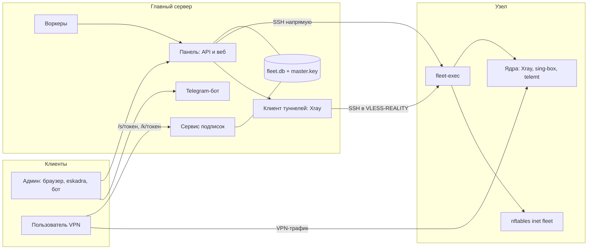
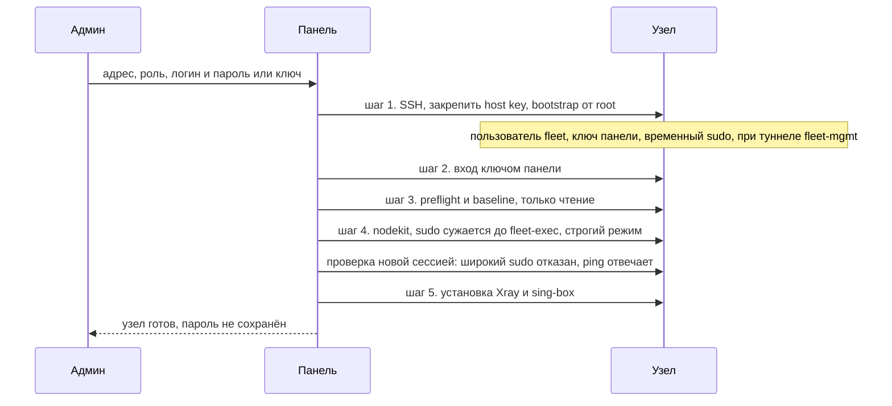
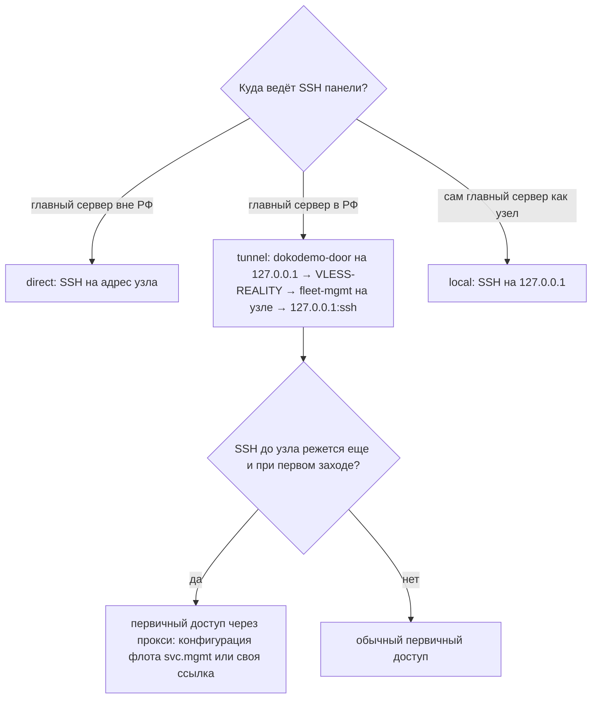
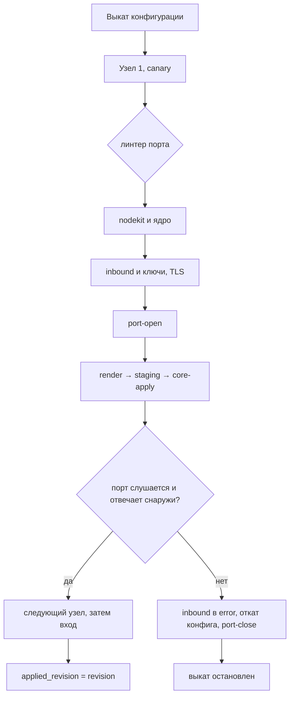
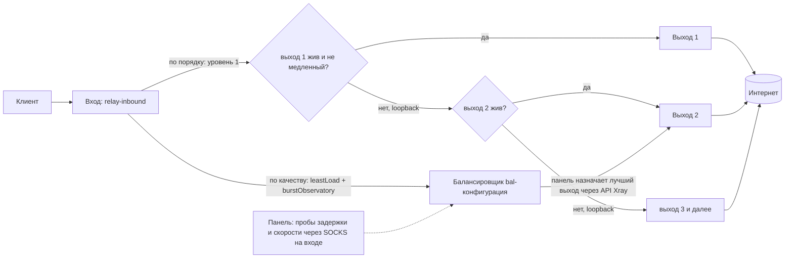
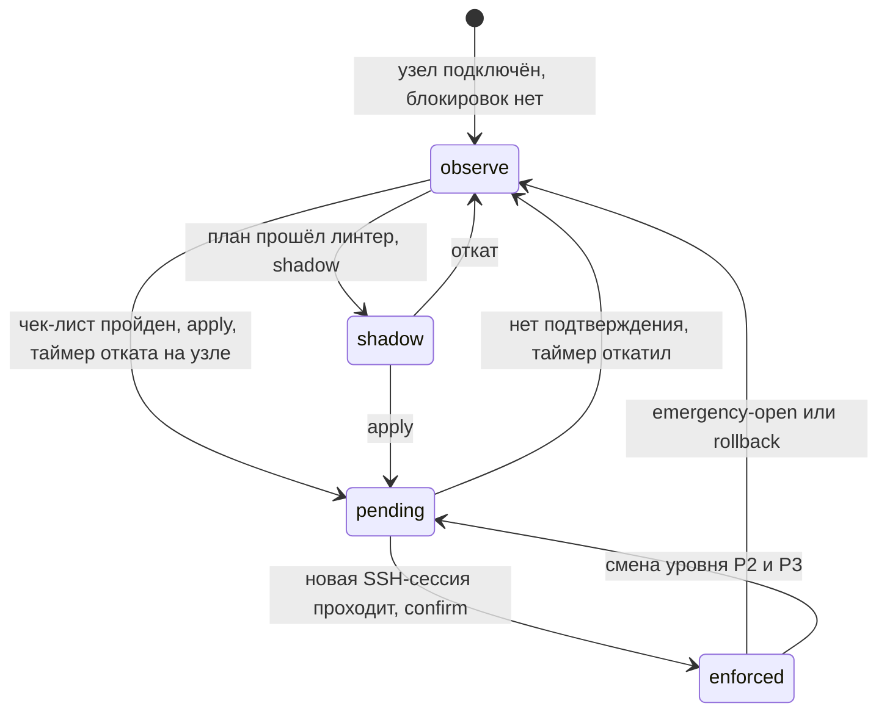
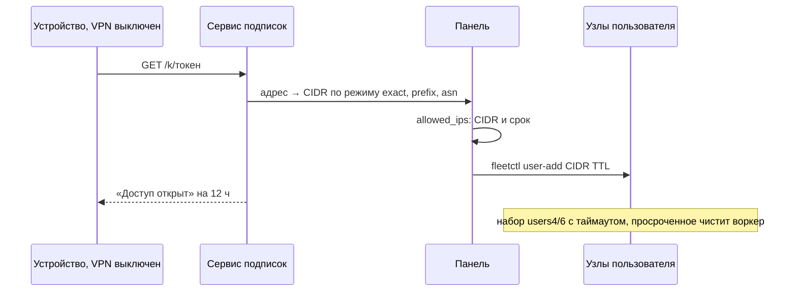
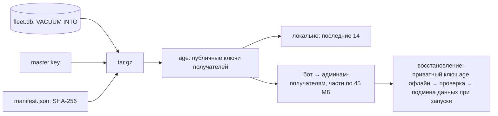

# Эскадра — архитектура

Документ описывает, как устроена Эскадра **сейчас**: что запущено, что делает каждая часть и зачем она нужна. Он написан по коду; пути к модулям даны в скобках. Как пользоваться — в [README.ru.md](README.ru.md).

## 1. Что это и зачем

Эскадра — панель управления личным флотом VPN-серверов. Задачи, которые она закрывает:

- **Один центр на много серверов.** Вместо ручной настройки каждого сервера — один главный сервер, который по SSH ставит ядра (Xray, sing-box, telemt), выкатывает конфигурации, ведёт пользователей и подписки.
- **Блокировки не должны отрезать управление.** Главный сервер может стоять в РФ, где ТСПУ режет прямой SSH и WireGuard. Поэтому канал управления умеет ходить внутри VLESS-REALITY, а первичный доступ — через прокси.
- **Нельзя потерять сервер собственным firewall.** Блокировки применяются только после ручного чек-листа, сначала в теневом режиме, затем под таймером отката, который работает на самом узле. Есть аварийные команды для консоли хостера.
- **Пользователь получает одну ссылку.** Подписка собирает все доступные ему варианты подключения (напрямую к узлам, через вход, «Авто»), сама обновляется и учитывает лимиты.
- **Всё чувствительное зашифровано и под аудитом.** Секреты в базе зашифрованы мастер-ключом, бэкапы шифруются age, действия пишутся в журнал с цепочкой хэшей.

Модель — личный флот: роли `owner / admin / operator` и свои роли, но не платформа для реселлеров (биллинга и платёжных систем нет).

## 2. Общая схема

```
                         ┌──────────────────────── главный сервер ────────────────────────┐
 админ (браузер,         │  eskadra.service (Node.js, пользователь eskadra, без root)      │
 терминал `eskadra`,  ──►│   ├─ веб-интерфейс + API  (HTTPS, случайный порт и путь)       │
 Telegram-бот)           │   ├─ сервис подписок      (отдельный случайный порт)           │
                         │   ├─ Telegram-бот         (long polling, входящего порта нет)  │
 пользователь VPN ──────►│   ├─ воркеры              (опрос узлов, трафик, «Авто», …)     │
 (подписка /s/<токен>)   │   └─ Xray-клиент туннелей (дочерний процесс, при необходимости)│
                         │  SQLite fleet.db + master.key        /var/lib/eskadra           │
                         │  root-юниты: eskadra-update.path, eskadra-selfnode.path        │
                         └───────────────┬───────────────────────────────┬─────────────────┘
                          SSH напрямую   │            SSH внутри VLESS-REALITY (туннель)
                                         ▼                               ▼
                  ┌────────────────── узел (любой Linux с systemd) ─────────────────┐
                  │ пользователь fleet → sudo → fleet-exec (единственная команда)    │
                  │ nodekit: fleetctl, fleet-core, fleet-fw-*, fleet-gate, …         │
                  │ ядра: eskadra-xray, eskadra-sing-box, eskadra-telemt             │
                  │ nftables-таблица inet fleet (когда включена защита)              │
                  │ fleet-mgmt (Xray туннеля управления, если выбран туннель)        │
                  └──────────────────────────────────────────────────────────────────┘

  клиент ─► вход (relay) ─► выход (exit) ─► интернет          клиент ─► узел напрямую
```

Роли серверов:

- **Выход** — сервер за рубежом, через который трафик уходит в интернет. По умолчанию скрыт (`direct_access = 0`): пользователи напрямую к нему не подключаются, его сервисные порты в firewall открыты только узлам флота.
- **Вход** — сервер, к которому подключаются пользователи. Он может вести трафик на выходы (цепочка «вход → выход»).
- **Главный сервер** — тот, где работает панель. Отдельно его добавлять не нужно; кнопка «Главный сервер — вход» делает его ещё и узлом (канал управления `local`: панель ходит на свой SSH через loopback).



## 3. Что запущено на главном сервере

Один процесс `eskadra.service` (`server/src/main.ts`), запущенный от пользователя `eskadra` с жёсткими параметрами systemd (`NoNewPrivileges`, `ProtectSystem=strict`, пустой набор capabilities). Всё, что требует root, вынесено в отдельные юниты, которые срабатывают по файлу-запросу.

| Часть | Модуль | Зачем |
|---|---|---|
| API + веб | `routes/*`, `web/` | Fastify; интерфейс — React + Vite, раздаётся этим же процессом. Всё приложение живёт под случайным базовым путём, вне него — нейтральный 404, чтобы панель не светилась сканерам |
| Сервис подписок | `subsvc.ts` | Отдельный порт (случайный 10000–60000, выбирается при первом запуске). Публичная часть: `/s/<токен>` и `/k/<токен>`; лимит 30 запросов в минуту на IP |
| Telegram-бот | `bot.ts`, `botadmin.ts` | Управление кнопками и уведомления; ходит наружу сам (long polling), входящего порта не требует |
| Воркеры | `workers.ts` | Периодические задачи: связь с узлами, трафик, лимиты, «Авто», сертификаты, бэкапы (см. §13) |
| Клиент туннелей | `mgmt.ts` | Дочерний процесс Xray: на каждый туннельный узел `dokodemo-door` на `127.0.0.1:<порт>` → VLESS-REALITY к узлу. Заодно держит HTTP-прокси для бота |
| SSH-исполнитель | `ssh/executor.ts`, `ctx.ts` | Подключается к узлу ключом панели, сверяет host key, не допускает двух одновременных операций на один узел, маскирует секреты в журналах |
| root-помощники | `scripts/install.sh`, `scripts/eskadra` | `eskadra-update.path` — кнопка «Обновить»; `eskadra-selfnode.path` — «Главный сервер — вход». Панель (без root) кладёт `request.json`, root-юнит выполняет |
| Консольное меню | `scripts/eskadra`, `cli.ts`, `tui.ts` | Команды обслуживания; раздел «флот» ходит в API панели под консольной сессией (те же права и аудит) |

**Данные** лежат в `/var/lib/eskadra` (`FLEET_DATA`): `fleet.db` (встроенный SQLite, режим WAL, миграции в `db.ts`), `master.key`, каталоги `backups/`, `mgmt/`, `update/`, `selfnode/`, `tls/`. Настройки процесса — `/etc/eskadra/eskadra.env`.

**Секреты.** Приватные ключи SSH, ключи REALITY, учётные данные пользователей, пароль 3x-ui, ключи туннелей хранятся в базе зашифрованными (`lib/crypto.ts`: AES-256-GCM, мастер-ключ лежит отдельно от базы). Пароли администраторов — scrypt. Секреты 2FA — тоже зашифрованы.

### Основные таблицы

| Таблица | Содержимое |
|---|---|
| `servers` | Узлы: адрес, роль, состояние, ключ панели для узла, закреплённый host key, режим sudo, параметры канала управления, уровень защиты, режим firewall, установленные ядра, состояние сертификатов |
| `templates` / `inbounds` | Конфигурации (протокол и настройки) и их воплощение на узлах: порт, состояние, ключи REALITY, ошибка |
| `users`, `user_creds`, `traffic`, `allowed_ips`, `user_devices` | Пользователи, их идентификаторы по профилям, трафик по месяцам, белый список адресов, устройства |
| `limit_groups`, `groups` | Группы лимитов пользователей; группы серверов (скрытность, область связности, диапазон портов) |
| `admins`, `sessions`, `roles` | Администраторы, сессии, роли |
| `jobs`, `preflight_reports`, `peer_checks`, `exit_health`, `exit_speed` | Журналы задач, отчёты проверки узлов, связность между узлами, замеры выходов «Авто» |
| `audit_log` | Журнал с цепочкой хэшей (`lib/audit.ts`): запись хранит хэш предыдущей, подмена ломает цепочку |
| `settings`, `service_creds`, `backups` | Настройки (ключ-значение), служебные секреты, список бэкапов |

## 4. Как панель управляет узлами

### 4.1 Nodekit и «единственная команда»

На каждый узел ставится nodekit (`nodekit/`): набор скриптов в `/usr/local/sbin`. Панель не выполняет произвольный shell. Вся работа идёт через `sudo -n /usr/local/sbin/fleet-exec <операция> <аргументы>`:

- `fleet-exec` — список разрешённых операций (`ping`, `core-install`, `core-apply`, `fw-apply`, `port-open`, `tls-issue`, …). Всё остальное получает `denied`. Аргументы проходят проверку на допустимые символы и на стороне панели (`ctx.ts`), и на узле; содержимое файлов приходит через stdin в каталог `staging`.
- `fleet-gate` — forced command ключа панели в **строгом режиме**: пропускает только вызов `fleet-exec`. Ни интерактивной оболочки, ни произвольных команд.
- sudoers узла разрешает пользователю `fleet` ровно одну команду — `fleet-exec`.
- Версия nodekit — хэш содержимого файлов. Если она отличается, панель обновляет скрипты сама (`fleet-exec kit-install`), поэтому новая версия Эскадры доходит до узлов без ручных действий.

Режим `shell` (широкий sudo, терминал) включается отдельно на каждом сервере и только ролью `owner`; по умолчанию выключен.

### 4.2 Подключение узла (`onboard.ts`)

«Серверы → Добавить сервер» запускает фоновую задачу из пяти шагов; пройденные шаги пропускаются, поэтому «Повторить» продолжает с места остановки.

1. **Первичный доступ.** Панель заходит по одноразовому логину и паролю (или ключу), закрепляет host key по этому подключению и выполняет bootstrap-скрипт (`bootstrap.ts`) от root. Скрипт **только добавляет** доступ: пользователя `fleet`, ключ панели в `authorized_keys` с ограничениями (`from=`, `restrict`), временный широкий sudo, каталог `/etc/sudoers.d` (если он не подключён). Пароль живёт только в памяти задачи. Если выбран туннель — скрипт ставит ещё и служебный Xray (см. §4.3).
2. **Вход ключом панели и sudo** — проверка, что дальше пароль не понадобится; запоминается адрес, с которого узел видит панель.
3. **Проверка узла (только чтение).** `fleet-preflight` и `fleet-baseline`: ОС, пакетный менеджер, SSH-порты (из `sshd -T`, `ssh.socket` и реальных слушателей), активные ufw/firewalld, установленные 3x-ui, xray, sing-box и др. Исходное состояние firewall и sshd сохраняется в `/var/lib/fleet/baseline`.
4. **Служебные скрипты и сужение прав.** Ставится nodekit, затем широкий sudo заменяется на одну обёртку (новый файл → `visudo -cf` → только потом удаление широкого). Включается строгий режим ключа. Результат проверяется **новой** сессией: широкий sudo и сырой shell должны быть отказаны, `fleet-exec ping` — работать. Новый узел попадает в наборы соседей (§7.5).
5. **Ядра.** Ставятся Xray и sing-box, если их место не занято чужими ядрами или 3x-ui.

Если прямого SSH с главного сервера нет, ту же настройку можно выполнить командой на самом сервере (сниппет в карточке) — тогда host key закрепится при первом подключении панели.



### 4.3 Каналы управления

| Канал | Когда | Как |
|---|---|---|
| `direct` | Главный сервер вне РФ | Обычный SSH на адрес узла |
| `tunnel` | Главный сервер в РФ | SSH идёт внутри VLESS-REALITY (`mgmt.ts`). На узле — отдельный Xray `fleet-mgmt` на случайном порту, у которого единственный выход `freedom` с редиректом на `127.0.0.1:<ssh>`; на главном сервере — `dokodemo-door` на локальном порту → VLESS-REALITY к узлу. Для ТСПУ это HTTPS к обычному сайту (маскировка: apple.com, cloudflare.com и т. п.). Узел пускает панель по ключу туннеля, а не по IP; host key узла сверяется как обычно |
| `local` | Главный сервер как узел | SSH на `127.0.0.1` |

Дополнительно:

- **Закрепление Xray.** Версия Xray для туннелей закрепляется при первом использовании, архив проверяется по SHA-256 (хэши для amd64 и arm64 вписываются в bootstrap-скрипт).
- **Порт туннеля.** Сразу после bootstrap, пока открыт первичный доступ, панель проверяет TLS-рукопожатием, что порт достижим тем путём, каким пойдёт туннель (`tunnelcheck.ts`). Если нет — смотрит по root-сессии, слушает ли служба и не режет ли порт firewall системы, открывает его; если режет firewall хостера — ищет порт, который он пропускает (временные «маячки»), и переносит туннель.
- **Первичный доступ через прокси** (`via.ts`, `proxylink.ts`). Если SSH из РФ до сервера режется, панель поднимает отдельный процесс Xray с пробросом `127.0.0.1 → прокси → сервер:SSH` на время подключения. Прокси — конфигурация самого флота (служебный клиент `svc.mgmt` есть в каждом inbound Xray) или своя ссылка `vless:// trojan:// vmess:// ss://` / JSON outbound. Ссылка не сохраняется. Если сервер недоступен из РФ целиком, туннель управления дальше идёт через тот же прокси (цепочка `dialerProxy`).


- **«Главный сервер — вход».** Узкий root-помощник `eskadra self-node-apply` добавляет ключ панели на этом же хосте с `from="127.0.0.1"`; далее обычный цикл подключения. Порты панели и подписок попадают в защищённые.

### 4.4 Что видит панель о сервере

Воркеры раз в минуту проверяют связь, раз в 5 минут собирают счётчики, живая статистика хоста (ЦП, память, диск, сеть, аптайм — `hoststats.ts`) запрашивается при открытии карточки. Сбой связи дольше порога (по умолчанию 120 мин) сбрасывает ручной чек-лист защиты: после долгой потери связи проверять доступ нужно заново.

## 5. Конфигурации: от формы до работающего inbound

Конфигурация (`templates`) — «протокол + порт + защита + на каких серверах + (необязательно) вход». Панель хранит желаемое состояние, а узлы получают отрендеренные конфиги.

### 5.1 Протоколы (`protocols.ts`)

| Протокол | Ядро | Защита | Транспорты |
|---|---|---|---|
| VLESS | Xray | REALITY, TLS, без шифрования | TCP, WebSocket, gRPC, XHTTP, HTTPUpgrade |
| VMess | Xray | TLS, без шифрования | TCP, WebSocket, gRPC, HTTPUpgrade |
| Trojan | Xray | TLS, REALITY | TCP, WebSocket, gRPC, HTTPUpgrade |
| Shadowsocks-2022 | Xray | — | TCP |
| Hysteria2 | sing-box | TLS (QUIC, UDP) | — |
| MTProto | telemt | fake-TLS | — |

Модуль протокола отвечает на четыре вопроса: как выглядит inbound для ядра, как выглядит клиент пользователя, какая ссылка попадёт в подписку, какой outbound нужен для пересылки через вход. MTProto выдаётся отдельной ссылкой `tg://` и в VPN-подписку не попадает; у узла может быть только одна MTProto-конфигурация.

### 5.2 Что хранится у пользователя и как строятся клиенты

Каждому пользователю и каждому «профилю» (вариант подключения) выдаётся свой секрет (UUID/пароль), создаётся при первом обращении и хранится зашифрованным. Клиент в ядре получает имя `u-<id>.<профиль>`; по этому имени считаются трафик и устройства. «Перевыпустить ссылки» удаляет секреты — старые ссылки перестают работать. Служебные клиенты имеют префикс `svc.` (вход→выход, прокси бота, `svc.mgmt`).

Профили пользователя (`vpn.ts: profiles`):

- `d:<конфигурация>:<сервер>` — напрямую к узлу (если у узла включён прямой доступ и узел разрешён пользователю);
- `v:<конфигурация>:<выход>` — через вход на конкретный выход;
- `v:<конфигурация>:auto` — через вход, выход выбирает «Авто».

В карточке пользователя варианты отключаются галочками (`excluded_profiles`); новые варианты включены сами.

### 5.3 Выкат (`ops.ts: rollout`)

Панель обновляет узлы **последовательно**: сначала первый (canary), затем остальные, затем вход. На каждом узле:

1. проверка порта (`lintPort`): не SSH, не зарезервирован, не занят другой конфигурацией или процессом (по данным preflight), в диапазоне группы;
2. при необходимости обновить nodekit и поставить ядро;
3. создать inbound и ключи (REALITY x25519 генерируется **на узле**, приватный ключ сохраняется зашифрованным; Shadowsocks-ключ; сертификат TLS);
4. `port-open` — порт попадает в набор сервисных портов firewall (до запуска);
5. отрендерить конфиг ядра → положить в `staging` → `core-apply`;
6. убедиться, что порт слушается; для TCP — проверка с самой панели снаружи (`tcpProbe`).

Ошибка на любом шаге помечает inbound как `error`, откатывает конфиг узла, закрывает порт и **останавливает выкат**: следующие узлы не трогаются.



`core-apply` на узле (`fleet-core`) проверяет конфиг ядром, подменяет файл атомарно, перезапускает и при неудаче возвращает прежний.

Изменения пользователей (создан, отключён, лимит) не требуют ручного выката: узел помечается `config_dirty`, и воркер раз в 20 секунд переприменяет конфиг. Отпечаток отрендеренного конфига хранится; после обновления панели узлы, чей конфиг теперь формируется иначе, переприменяются сами.

### 5.3a Hysteria2: скорость и маскировка

Настройки шаблона (`hy2*` в `settings`, `protocols.ts`):

- **Полоса клиента** (`hy2UpMbps`/`hy2DownMbps`) — вшивается в подписку sing-box (`up_mbps`/`down_mbps`) и в ссылку (`upmbps`/`downmbps`). При ненулевой полосе клиент работает по Brutal и не теряет скорость от потерь на межстрановом плече; без неё — loss-based CC, в разы медленнее.
- **Сервер** — потолок полосы на клиента (`up_mbps`/`down_mbps` inbound'а) или BBR для всех (`ignore_client_bandwidth`), одно из двух; сайт маскировки (`masquerade`) для запросов без пароля.
- **Смена портов** (`hy2Hop`, «20000-30000») — клиент получает диапазон (`server_ports` + `hop_interval`, в ссылке `mport`); на узле `fleet-core singbox-net` перенаправляет UDP с диапазона на порт inbound'а (таблица `inet eskadra_hop`, юнит `eskadra-hy2hop` поднимает её после перезагрузки). Диапазон не может задевать SSH, UDP-порты и диапазоны других конфигураций узла.
- Там же — постоянные буферы UDP 16 МБ (`/etc/sysctl.d/90-eskadra-udp.conf`): ставятся на каждом узле с sing-box при выкате.

### 5.4 Сертификаты TLS

Режимы (`certMode`): Let's Encrypt **на IP узла** (по умолчанию), свой домен на каждом узле, загруженный сертификат (общий домен/wildcard), самоподписанный с закреплением отпечатка (Hysteria2).

Выпуск и продление выполняет **сам узел**: `fleet-core cert-issue` ставит certbot ≥ 5.4 в отдельный venv (системный certbot не трогается), выпуск по HTTP-01. Порт 80 на время выпуска и продления открывается правилом в таблице `inet fleet` и в ufw/firewalld, затем закрывается. Продление — таймер дважды в сутки; новый сертификат кладётся в `/etc/eskadra/tls/<имя>/` и перезапускает ядра, которые его используют. Панель раз в 3 часа читает сроки и результат продления (`certs.ts`), при сбое пишет в «Требует внимания» и в бот; на вкладке «Хост» есть «Продлить сейчас».

### 5.5 Узлы с уже установленным 3x-ui

Preflight находит чужие ядра. Если на узле работает 3x-ui, Эскадра **не запускает второй Xray**: её inbounds создаются в Xray самой 3x-ui через её API (пометка `eskadra-…`; чужие inbounds не затрагиваются), учётные данные 3x-ui вводятся один раз и хранятся зашифрованными. Трафик в этом режиме берётся из накопительных счётчиков 3x-ui. Ограничения: нет «входа» (нужны собственные маршруты Xray), нет лимита устройств. Если работает другое ядро того же типа, своё не ставится и панель объясняет почему. `eskadra conflicts` и карточка сервера предлагают дополнить или удалить 3x-ui (база сохраняется в бэкап узла).

### 5.6 Блокировки протоколов

В настройках можно запретить на всех узлах BitTorrent, почту (SMTP) и QUIC. Они рендерятся правилами маршрутизации Xray и sing-box — на входе и на выходах. Для распознавания протокола включается sniffing (на inbound, где он выключен, — только для маршрутизации, адрес назначения не подменяется). Полностью зашифрованный BitTorrent по содержимому не отличить: режутся рукопожатие, uTP и домены публичных трекеров.

### 5.7 Изоляция от внутренней сети

Во всех пользовательских конфигах трафик на локальные и частные адреса (`PRIVATE_NETS`: 127/8, 10/8, 172.16/12, 192.168/16, 169.254/16, fc00::/7 и т. д.) отправляется в `block` раньше пользовательских правил. Иначе VPN-пользователь мог бы через своё подключение достучаться до API ядра на `127.0.0.1:10085`, до SSH узла «с самого узла» (а `from=127.0.0.1` разрешён для туннеля) или до внутренней сети хостера.

## 6. Вход, выходы и «Авто»

Если у конфигурации есть вход, то на нём создаётся relay-inbound, а в Xray входа — по outbound на каждый выход (VLESS/…-клиент с служебным `svc.relay-…`). Правила привязывают пользователя к его выходу по имени клиента; всё, что не попало в правила, блокируется на самом входе — наружу с входа ничего не выходит.

Профиль «вход → авто» выбирает выход одним из трёх способов (настройка конфигурации):

- **По качеству (`smart`).** Пороги: задержка (по умолчанию 100 мс) и скорость (10 Мбит/с). Xray входа сам наблюдает за выходами (`burstObservatory`, раз в минуту) и стратегией `leastLoad` уводит трафик с выходов выше порога задержки. Раз в `checkMin` минут (15) панель меряет **скорость** скачивания через каждый выход локальными SOCKS-пробами на входе (`exit-probe`, по умолчанию 5 МБ) и, если текущий выход не проходит пороги, назначает балансировщику лучший подходящий через API Xray (`RoutingService`) — без перезапуска и разрыва соединений. Текущий выход держится, пока проходит пороги. Если подходящих нет — назначение снимается, выбор остаётся за Xray (наименьшая задержка).
- **По порядку (`order`).** Администратор задаёт список выходов. Конфиг входа строится как **цепочка уровней**: уровень k видит только k-й выход; если выход жив (прошла хоть одна из двух последних проверок, наблюдение каждые 5 с), трафик идёт через него, иначе `loopback` возвращает соединение в маршрутизацию на уровень k+1. Резервный выход включается за секунды без участия панели, а когда вернулся вышестоящий — трафик возвращается к нему. Опциональный порог скорости: панель замеряет скорость каждые `speedEveryMin` минут (по умолчанию 1), а **решение** о пропуске медленного выхода принимает раз в `decideMin` минут по **медиане** замеров за это время (одна неудачная минута трафик не перекидывает; вернуть выход можно только от порога +10 %, чтобы не дёргаться на границе). Пропуск реализован назначением балансировщику уровня перехода на следующий.
- **Случайно (`random`).** Любой выход на каждое соединение.



Воркер `exits` раз в минуту запускает проверку для каждой конфигурации с «Авто». Результаты (задержка, скорость, адрес и страна выхода по Cloudflare) пишутся в `exit_health`. Переключение трафика приводит к уведомлению в бот. Перезапуск Xray входа сбрасывает назначения — после `applyServer` панель восстанавливает выбранные выходы и сверяется с тем, что реально выбрано.

## 7. Защита хоста

### 7.1 Уровни

Цель задаётся на сервер (`protection_target`), фактическое состояние — `protection_current`:

- **P1 — обычная.** Сервер как есть, плана nftables нет.
- **P2 — средняя.** `policy drop`; открыты SSH, сервисные порты конфигураций, связь между узлами флота.
- **P3 — высокая.** SSH только с адресов панели и администраторов; сервисные порты — по скрытности группы.

План рендерится из фиксированного шаблона, данные лежат в наборах nft (`firewall.ts`): `panel4/6` (адреса исполнителя), `admin4/6`, `fleet4/6` (соседние узлы), `users4/6` (белый список с таймаутами), `svc_tcp`, `svc_udp`. Это важно: набор можно менять на лету командами `fleetctl`, не пересобирая и не перезагружая правила.

Скрытность группы серверов (`groups.stealth`): при `S3/S4` на уровне P3 сервисные порты открыты только пользователям из белого списка; при `S0–S2` — всем (различий между S0, S1 и S2 в плане nftables пока нет). Выход со скрытым прямым доступом не открывает сервисные порты никому, кроме узлов флота.

### 7.2 Как применяются блокировки

Последовательность, которая не должна отрезать доступ:

1. **План и линтер.** Блокирующие ошибки: неизвестны SSH-порты, пустой список адресов исполнителя (панель отрежет сама себя), сервисный порт совпадает с SSH или портом туннеля, узел видит панель с адреса, которого нет в списке, активен ufw/firewalld (он перебивает разрешения).
2. **Ручной чек-лист** (12 пунктов). Часть проверяется автоматически (панель заходит на сервер, связь с соседями, узел видит панель с ожидаемого адреса), часть — подтверждает человек: заходит сам по SSH, открывается консоль хостера, работает аварийный вход, каждая конфигурация подключается из домашней и мобильной сети, подписка добавляется в клиент, сделан снапшот сервера. Без пройденного чек-листа применение отклоняется.
3. **Shadow-режим.** Та же таблица, но `policy accept` и логирование `FLEET-WOULD-DROP`: видно, что **было бы** заблокировано. Топ потоков доступен в интерфейсе.
4. **Применение под таймером** (`fleet-fw-apply`): проверка синтаксиса (`nft -c`) → снимок прошлого состояния → маркер `pending` → таймер отката `systemd-run` **ставится до применения** → атомарное применение → `fleetctl sync` возвращает в наборы данные.
5. **Подтверждение** (`fleet-fw-confirm`): панель проверяет, что **новая** SSH-сессия проходит, и просит подтвердить; подтверждение сохраняет сам план в `/etc/fleet/fleet-fw.nft` и включает юнит `fleet-fw.service`, поднимающий его при загрузке (раньше сети). Нет подтверждения за окно (120–600 с) — таймер на самом узле откатывает правила, даже если панель недоступна.

Все изменяющие операции защиты требуют права `servers.protect` и кода 2FA.



### 7.3 SSH только по ключам

`fleet-sshd-harden`: пишет `00-fleet-hardening.conf` (отключает пароль и kbd-interactive), проверяет `sshd -t` и что `sshd -T` действительно принял настройку (не перебил чужой файл), и тоже работает под таймером отката 180 с.

### 7.4 Аварийный доступ

Нужен на случай смены IP главного сервера, сбоя панели или собственной ошибки. Работает через консоль хостера (KVM/VNC):

- `sudo fleetctl allow 203 0 113 99` — добавить адрес в панельные наборы и в `from=` ключа (команда показана в карточке сервера с подставленным адресом);
- `fleetctl open` — снять все блокировки (удаляет таблицу, снимает `from=`, SSH остаётся только по ключу);
- `fleetctl relax 30m|2h` — временно открыть SSH для любых адресов (только ключ, лимит 20 новых соединений в минуту, автовозврат; переживает перезагрузку, но не дольше срока); `unrelax`, `restore` (вернуть последний подтверждённый набор под таймером), `status`;
- `fleetadmin` — консольный break-glass пользователь, вход по SSH ему запрещён (`DenyUsers`), только консоль хостера; пароль выдаётся один раз и нигде не хранится (только `owner`);
- «Аварийно снять блокировки» и «Временно открыть SSH» доступны и из панели, пока она достаёт узел.

### 7.5 Связность узлов

Все узлы флота автоматически попадают в `fleet4/6` друг у друга и видят сервисные порты соседей — это нужно, чтобы вход доходил до выходов даже при закрытом firewall. Раз в 10 минут узлы проверяют соседей (`peer-check`: TCP-порт или ping) — это один из автоматических пунктов чек-листа. Порт новой конфигурации открывается автоматически (до запуска ядра) и закрывается при снятии конфигурации.

## 8. Пользователи, подписки, лимиты

### 8.1 Подписка

`/s/<токен>` на порту сервиса подписок. Ответ зависит от запрашивающего:

- **браузер** — страница (`subpage.ts`): QR-код и кнопки для приложений, срок, трафик и лимиты, узлы, отдельные ссылки с QR; один HTML без внешних ресурсов;
- **приложение** — по умолчанию base64-список ссылок; sing-box, Hiddify, Karing (по User-Agent) получают JSON с селектором «Эскадра» и `urltest`-группой; `?fmt=raw|singbox|base64` задаёт формат явно.

В заголовках отдаются `subscription-userinfo` (трафик, срок), `profile-update-interval` и название профиля. Токен ненастраиваемый и случайный; неактивному пользователю — 404.

### 8.2 Лимиты

- **Трафик и срок.** Воркер `stats` раз в 5 минут забирает счётчики Xray с обнулением (`fleet-core stats`), суммирует по пользователю за месяц. `enforceLimits` проверяет срок и квоту: пользователь отключается (`disabled_reason`) либо только уведомляется (`over_action`). Затем узлы помечаются на переприменение.
- **Группы лимитов.** Шаблоны «трафик / срок / устройства»; личные значения пользователя перекрывают группу.
- **Устройства** (`devices.ts`). Устройство — IP, с которого у пользователя сейчас открыты соединения (Xray `statsUserOnline`). Раз в 30 секунд панель собирает онлайн со всех узлов, объединяет по пользователю (один IP через вход и напрямую — одно устройство) и пропускает **первых N по времени появления**; остальные блокируются правилом Xray «email пользователя + IP → block». Правило касается только этого пользователя и применяется на ходу, без перезапуска ядра. Устройство, пропавшее дольше 2 минут, освобождает место. Для MTProto лимит передаётся в `maxIps` telemt.

### 8.3 Белый список адресов и knock

Для групп с `S3/S4` пользователь допускается в firewall по адресу из `allowed_ips` с TTL. Узнать реальный адрес бот не может, поэтому используется ссылка **knock** `/k/<токен>`: она должна открываться **без VPN** (иначе в список попадёт адрес выхода), фиксирует адрес и рассылает `user-add` на все узлы пользователя с включённой защитой (по умолчанию на 12 часов; воркер чистит просроченные). Гранулярность — по режиму пользователя: `exact` (/32, IPv6 /64), `prefix` (/24, /48), `asn` (/16, /32 — приближение префиксом, базы ASN нет). Через бота пользователь открывает доступ с нового адреса кнопкой.



## 9. Доступ к самой панели

- **Первый владелец** создаётся по одноразовой ссылке установщика (`eskadra url`) или с loopback; после создания токен удаляется.
- **Сессии**: cookie `httpOnly`, `sameSite=strict`, 12 часов; изменяющие запросы требуют заголовок `X-Fleet` (защита от CSRF). Вход: 10 неудачных попыток с IP — блокировка на 15 минут. Свои сессии можно просмотреть и завершить.
- **2FA TOTP** (RFC 6238). Для чувствительных операций (защита серверов, удаление сервера, применение firewall…) кроме входа требуется код в заголовке `X-Fleet-OTP`. Консольная сессия (создаётся root на самом сервере) код не спрашивает.
- **Роли и права** (`roles.ts`): `owner` — всё; встроенные `admin` и `operator`; собственные роли. Права: `users.edit/delete/limits`, `configs.edit/rollout/delete`, `servers.manage/protect`, `cores.manage`, `ports.groups`, `backups.run`, `settings.edit`, `ips.view`. У роли есть **область**: какие конфигурации, серверы, режимы подключения и группы лимитов она видит и выдаёт. Область работает «слиянием»: то, что вне области, роль не видит и не может ни выдать, ни снять, а при сохранении оно остаётся как было. Только `owner`: администраторы и роли, токен бота, бэкапы и восстановление, обновление, режим shell, `fleetadmin`.
- **Адреса людей.** Без права `ips.view` адреса пользователей и администраторов (устройства, белые списки, сессии, журнал) вырезаются из ответа API — до отправки, а не прячутся в интерфейсе. Адреса серверов не маскируются: они есть в каждой ссылке подписки.
- **Аудит.** Каждое действие пишется в `audit_log` с хэшем, зависящим от предыдущей записи.

## 10. Telegram-бот

Бот отвечает только привязанным людям и только в личных чатах; незнакомцу на `/start` показывает лишь его Telegram ID. Привязка: панель выдаёт одноразовую ссылку на бота (15 минут), человек нажимает «Старт».

- **Администратор** (по правам роли): пользователи (добавить по Telegram ID, подписка, ссылки, включить/отключить, удалить), серверы (состояние, защита, включение ядер, добавление нового `/addserver` — сообщение с паролем удаляется сразу), «Требует внимания», выходы «Авто», бэкап.
- **Пользователь VPN**: `/sub`, `/links`, трафик, открыть доступ с нового адреса.
- **Уведомления** — по категориям, каждый админ выбирает свои: связь с серверами, переключения «Авто», сертификаты, новые версии ядер, лимиты пользователей.
- **Если Telegram недоступен с главного сервера**, бот ходит через одну из конфигураций флота (`botproxy.ts`): Xray-клиент панели открывает HTTP-прокси на `127.0.0.1` и выводит его через inbound выбранного узла под служебным клиентом `svc.bot`.
- Бот доставляет и **бэкапы** (§12), поэтому «Требует внимания» предупреждает, если получателей меньше двух.

## 11. Ядра

Версии и обновления — «Конфигурации → Ядра» (`routes/cores.ts`, `fleet-core`).

- **Установка**: релиз скачивается узлом с GitHub; панель заранее узнаёт SHA-256 архива (из GitHub API, а если его нет — скачивает и считает сама) и передаёт его узлу, который сверяет. Архитектура — amd64 или arm64.
- **Обновление на узле**: новая версия ставится **рядом**, текущий конфиг проверяется новым бинарником, затем переключение и перезапуск; не поднялось — автоматический возврат. Панель дополнительно проверяет, что порты inbounds снова слушаются, иначе откат. Хранятся текущая и предыдущая версии, есть ручной откат.
- **«Обновить все узлы»** — волнами: canary, затем остальные по одному; первая ошибка останавливает выкат.
- Версию для новых узлов можно закрепить. Раз в 6 часов панель проверяет новые релизы и один раз на версию пишет в бот.
- Ядро можно временно остановить на вкладке «Хост» (проверка отказоустойчивости): панель его не запустит, пока не включат обратно.
- Xray узла с 3x-ui принадлежит 3x-ui: панель только показывает его версию.

## 12. Бэкап, восстановление, обновление

**Бэкап** (`backup.ts`): согласованный снимок базы (`VACUUM INTO`) + `master.key` + манифест с SHA-256 → tar.gz → шифрование **age на публичные ключи получателей**. Панель хранит только публичные ключи и свои копии расшифровать не может; приватный ключ получатель держит у себя.



Копия создаётся ежедневно в заданное время (UTC) и по кнопке, отправляется ботом администраторам-получателям (файлы больше 45 МБ режутся на части), локально хранятся последние 14.

**Восстановление** (`restorelib.ts`): файл копии + приватный ключ age → расшифровка, проверка SHA-256 по манифесту, сводка. Подмена данных выполняется **при следующем запуске, до открытия базы** (пока база открыта, менять её нельзя); прежние файлы остаются рядом. На новом сервере то же делает `npm run restore`.

**Обновление** (`update.ts`, `scripts/eskadra`): кнопка «Обновить» (owner) → запрос `request.json` → root-юнит `eskadra-update.path` запускает `eskadra update` → журнал в панели. Установщик проверяет SHA-256 Node.js и релиза. Перед каждым обновлением делается копия базы; при откате на прошлую версию панель возвращает и данные этой версии.

## 13. Фоновые задачи (`workers.ts`)

| Задача | Период | Что делает |
|---|---|---|
| `heartbeat` | 1 мин | `ping` каждого узла; уведомление о потере и восстановлении связи; сброс чек-листа при долгом сбое; сверка firewall в режиме `pending` с тем, что откатил таймер узла |
| `sync` | 20 с | Переприменить конфиг узлов с `config_dirty` |
| `devices` | 30 с | Онлайн-IP с узлов → лимит устройств |
| `exits` | 1 мин | Проверка выходов «Авто» по расписанию каждой конфигурации, уведомление о смене |
| `stats` | 5 мин | Трафик пользователей, `enforceLimits` |
| `peers` | 10 мин | Связность узлов друг с другом |
| `cleanup` | 10 мин | Удалить просроченные адреса белого списка |
| `backup` | 1 мин (проверка) | Ежедневный бэкап по расписанию |
| `certs` | 3 ч | Сроки и результат продления сертификатов |
| `cores` | 6 ч | Новые релизы Xray и sing-box |

Каждая задача не запускается повторно, пока предыдущий запуск не завершился; ошибка одного узла не останавливает остальные.

## 14. Установка, консоль и релизы

**Установщик** (`scripts/install.sh`) работает на любом Linux с systemd и glibc ≥ 2.28 (amd64/arm64; Alpine не поддерживается): ставит Node.js из официальных сборок и релиз Эскадры с GitHub (обе загрузки проверяются по SHA-256), создаёт пользователя `eskadra`, генерирует случайные порт и секретный путь, выпускает сертификат Let's Encrypt **до** первого запуска панели, открывает в ufw/firewalld только порты панели и подписок, разбирается с найденными 3x-ui/xray/sing-box (дополнить или удалить) и печатает одноразовую ссылку создания владельца. Повторный запуск обновляет панель, сохраняя данные; прерванная установка продолжается с места обрыва, весь вывод пишется в `/var/log/eskadra-install.log`.

**Сертификат панели.** certbot ≥ 5.4 ставится в отдельное окружение `/opt/eskadra/certbot` и держит данные в `/etc/eskadra/letsencrypt`; выпуск — на IP сервера (6-дневный, обновляется сам) или на домен. Новый сертификат панель подхватывает без перезапуска; с публичным сертификатом подписки тоже отдаются по HTTPS.

**Команда `eskadra`** — меню и команды обслуживания: смена порта, пути, порта подписок, сброс пароля, отключение 2FA, бэкап, сертификат, конфликты с чужими ядрами, обновление, удаление (с данными или без). Список команд — в README.

**Релиз.** Тег `v*` запускает GitHub Actions (`.github/workflows/release.yml`): `scripts/build-release.sh` собирает веб и сервер, прогоняет тесты и проверку i18n, упаковывает продовые зависимости в `eskadra.tar.gz` с контрольной суммой и публикует вместе с `install.sh`. Из этого релиза ставится и обновляется панель.

**Стек.** Сервер: Node.js 24, TypeScript, Fastify, встроенный SQLite (`node:sqlite`), `ssh2`, `age-encryption`, `zod`. Интерфейс: React + Vite, русский и английский (`web/src/i18n*.ts`). Узлы: bash/python3 + nftables + systemd, никаких агентов — панель сама приходит по SSH.

## 15. Принятые решения и ограничения

**Почему так:**

- *SSH-push, а не агент на узле* — нечего ставить, нечего обновлять отдельным демоном, нет входящего канала от узла к панели. Платой становится зависимость от SSH-канала (смягчена туннелем и аварийным доступом).
- *Туннель в VLESS-REALITY, а не WireGuard* — WireGuard между РФ и зарубежом режется по сигнатуре; REALITY для ТСПУ выглядит как обычный HTTPS. Потеря канала останавливает только управление: VPN пользователей продолжает работать.
- *Единственная команда под sudo* — компрометация ключа панели не даёт оболочку на узле.
- *Теневой режим и таймер отката на узле* — откат не зависит от того, жива ли панель и доходит ли до узла SSH.
- *Сертификаты выпускает узел* — приватные ключи не покидают сервер, выпуск не зависит от доступности панели.
- *Свой код, а не форк 3x-ui* — 3x-ui остаётся ориентиром по функциям и поддерживается как «сосед» на узле.
- *nftables на всём флоте* — активный ufw/firewalld узла перебивает наши разрешения, поэтому его отключают по явному подтверждению (правила сохраняются в baseline).

**Ограничения текущей версии:**

- Канал управления фиксирован на узел: автоматического переключения между туннелем и прямым SSH нет.
- Нет интеграции с API firewall провайдеров: порт туннеля и порты конфигураций у хостера открываются вручную (панель проверяет достижимость и подсказывает).
- Интерактивного терминала нет — только отдельные команды под аудитом.
- Лимит устройств не работает на узлах с 3x-ui; статистика трафика sing-box (Hysteria2) не собирается.
- На узлах в режиме 3x-ui недоступен «универсальный вход» (relay).
- Режим белого списка `asn` — приближение префиксом, точной базы ASN нет.
- Уровни скрытности S0–S2 в плане nftables пока не различаются.
