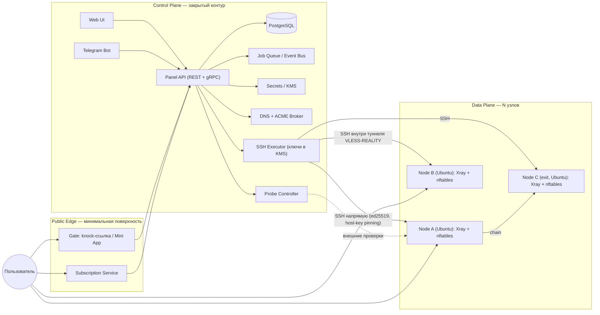
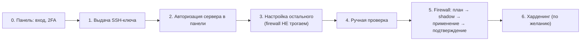
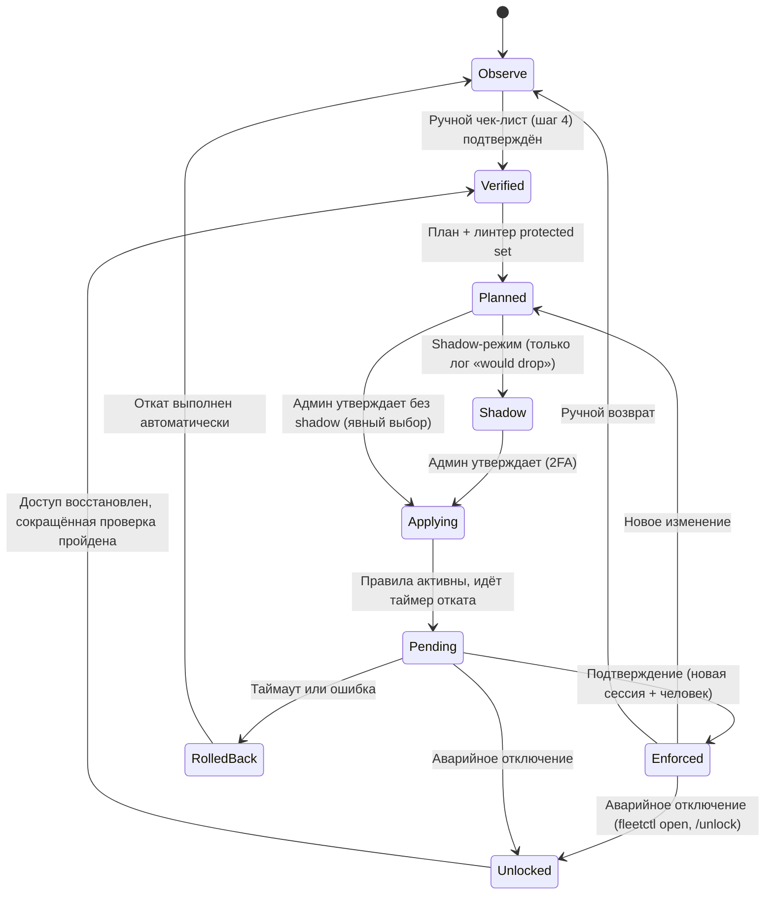
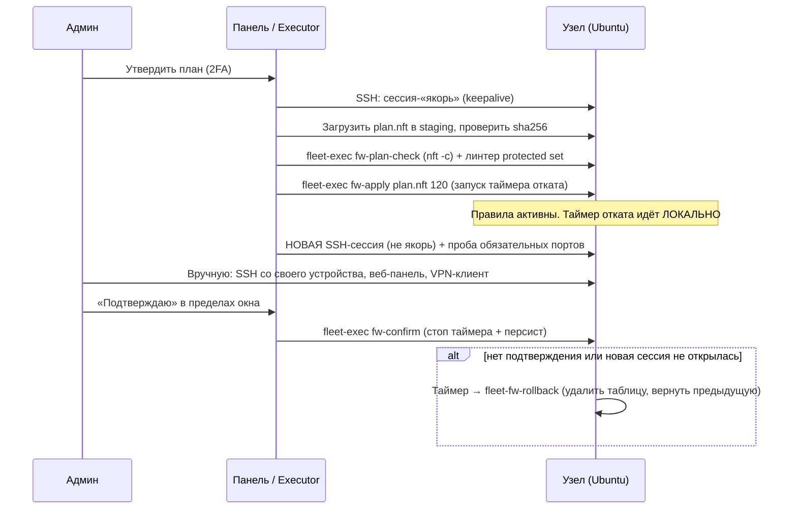
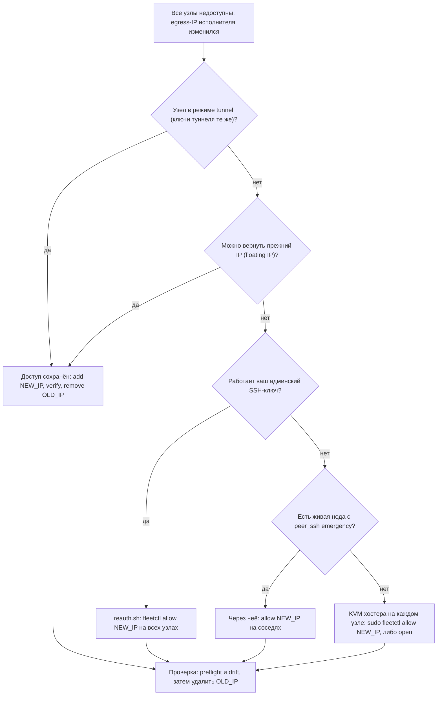
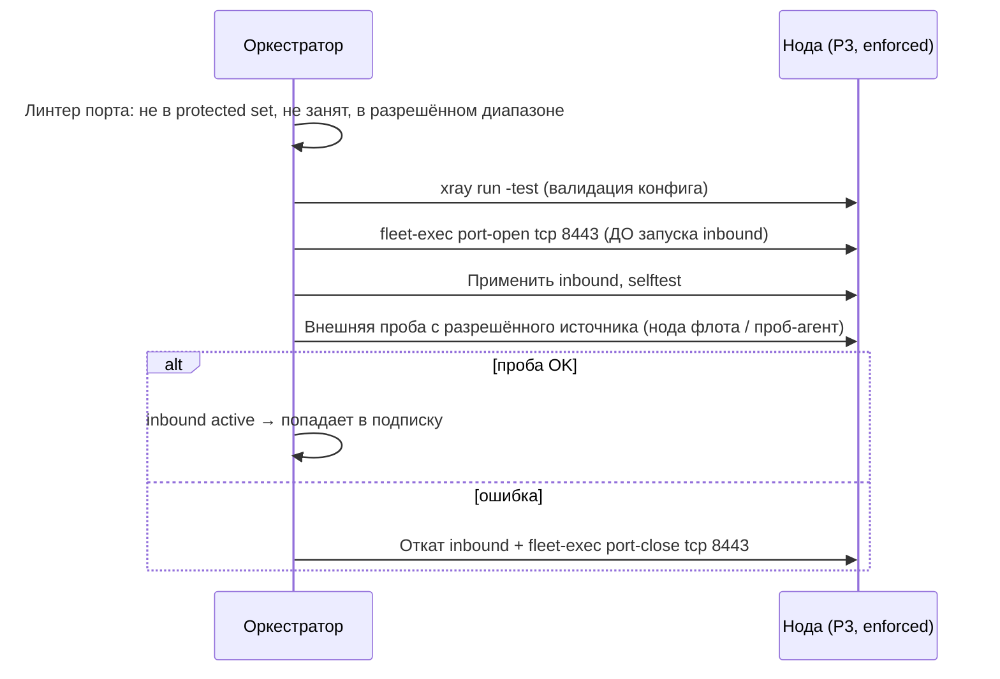
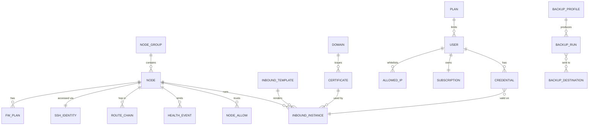
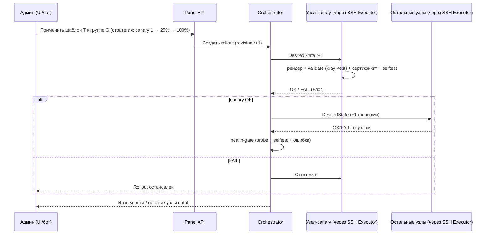
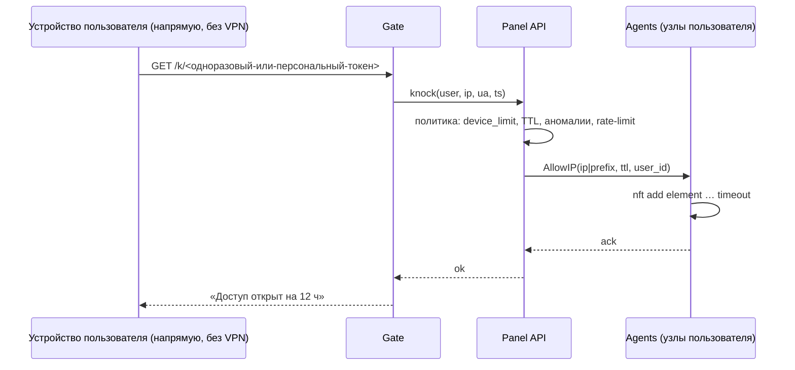
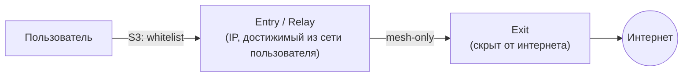

# Fleet-UI — концепт-архитектура мульти-серверной VPN-панели

> **Статус:** концепт v0.4 · **Дата:** 10.10.2026 · **Рабочее название:** Fleet-UI
> **v0.2:** добавлены управление узлами по SSH (Ubuntu), runbook подключения сервера и протокол «Never lose access» для безопасного применения блокировок (§4.8, §5–§7, Приложение E).
> **v0.3:** добавлены аварийный доступ при смене IP исполнителя (§7.10), уровни защиты хоста P1–P3 для главного сервера и нод (§7.11), резервное копирование и восстановление с нуля (§18, Приложение F).
> **v0.4:** ноды флота связаны между собой, порт нового inbound открывается автоматически (§7.12); проверка реализуемости и исправления скриптов и nft-шаблона (Приложение G).
> **v0.6:** узел подключается целиком из панели по одноразовому логину и паролю (или ключу); host key закрепляется по этому подключению; главный сервер становится входом одной кнопкой; роли упрощены до «вход» и «выход» (§6, §24.1 п. 21–23).
> **v0.5:** WireGuard-overlay заменён каналом управления на выбор при добавлении узла: **напрямую по SSH** или **через служебный туннель VLESS-REALITY** — для главного сервера в РФ, где WireGuard режется ТСПУ (§5.8). Пользовательские ядра больше не пропускают трафик на локальные и частные адреса узла.
> **Ориентир:** [3x-ui](https://github.com/MHSanaei/3x-ui) (Xray-панель), но с упором на *флот серверов*, а не на один узел.

---

## 0. Коротко

**Что строим.** Панель управления флотом VPN-узлов: один центр, N серверов, единые шаблоны протоколов, единые пользователи и подписки, централизованные TLS-сертификаты, и отдельный «слой невидимости» — динамические белые списки IP, которыми управляют из Telegram-бота.

### Ответы на ваши прямые вопросы

| Вопрос | Ответ | Где подробнее |
|---|---|---|
| Можно ли привязать **все серверы к одному домену**? | **Да.** Три рабочие схемы: (1) один домен → несколько A-записей; (2) поддомен на каждый узел + один wildcard-сертификат; (3) клиент подключается **по IP**, а домен нужен только как SNI/имя в сертификате (DNS-запись вообще не требуется). Рекомендуется комбинация (2)+(3). | §10.1 |
| Можно ли **TLS по IP**, а не только по домену? | **Да, 4 способа:** REALITY (своего сертификата нет вообще), Let's Encrypt IP-сертификат (GA с 15.01.2026, срок ~6 суток), self-signed + pinning, домен-как-SNI поверх IP. У каждого свои плюсы и «отпечатки». | §10.2 |
| Как поднимать **VLESS+TLS сразу на нескольких серверах**? | Шаблон inbound → рендер под каждый узел → валидация на узле → canary → поэтапный rollout с автооткатом. Приватные ключи не покидают узел. | §11 |
| Подключение **через общий вход или напрямую**? | Оба режима в одной подписке: «через вход → нода X» (один entry, маршрут по пользователю) и «напрямую → нода X». Режимы и ноды настраиваются на пользователя. | §12.5 |
| «**Универсальный и уникальный вход**»? | Универсальный = одно имя/одна подписка/один порт 443 для разных протоколов. Уникальный = у каждого пользователя свои UUID, shortId, (опционально) свой SNI-лейбл и свой токен подписки. | §12 |
| Белый список IP пользователей и серверов через бот? | Да, но **главный риск проекта** — мобильные пользователи с динамическими/CGNAT IP. Поэтому whitelist делается *динамическим с TTL* и узнаёт IP через отдельный «Gate», а не через сам бот. | §13, §14 |
| Как панель **управляет серверами** (Ubuntu)? | Панель хранит SSH-ключ на каждый сервер и выполняет шаблонные команды через SSH Executor. Порядок: выдача ключа → авторизация сервера в панели → настройка остального → ручная проверка → firewall. | §5, §6 |
| Как **не потерять доступ** к серверам? | Firewall по умолчанию в режиме `observe`. Блокировки — только после ручной проверки, через план → shadow → применение с автооткатом на узле → подтверждение. SSH-порт и порт панели в защищённом наборе. | §7 |
| Что делать, если **сменится IP исполнителя**? | Заранее: служебный туннель (доступ по ключу туннеля, а не по IP; ключи — в бэкапе), список адресов исполнителя, break-glass на узлах. В аварии: `fleetctl allow <IP>` через KVM хостера, `fleetctl open` / кнопка «Аварийно отключить блокировки», массовая переавторизация своим ключом. | §7.10 |
| Главный сервер **в РФ**: не отрежет ли ТСПУ управление? | WireGuard между РФ и зарубежом режется по сигнатуре, поэтому overlay на нём не используется. При добавлении узла выбирается канал: **напрямую по SSH** или **через служебный туннель VLESS-REALITY** — тот же маскирующий транспорт, что у пользователей. Потеря канала останавливает только управление, VPN пользователей продолжает работать. | §5.8 |
| Какие бывают **уровни защиты** сервера? | Главный сервер (опционально): P1 обычный — как есть; P2 нормальный — закрытые порты; P3 высокий — порты + whitelist адресов + SSH только по ключам. **Ноды — сразу P3** (применение после ручной проверки). | §7.11 |
| **Бэкапы** и восстановление с нуля | Профили с настраиваемой периодичностью, шифрование age, отправка ботом админам (на MVP только Telegram), safe mode при восстановлении, пересборка узла. | §18 |
| Связь **нод друг с другом** и **новые порты** | Все ноды флота автоматически попадают в набор `fleet4/fleet6` друг у друга и видят сервисные порты соседей. Порт нового inbound открывается сам (до запуска, после валидации) и закрывается после вывода inbound. Защищённый набор при этом не затрагивается. | §7.12 |

### Пять вещей, которые легко упустить

1. **Бот не видит IP пользователя.** Telegram не отдаёт его боту. IP можно узнать только из HTTP-запроса с устройства пользователя (Gate / Mini App) — и этот запрос должен идти **напрямую, не через VPN**, иначе в whitelist попадёт IP выхода, а не пользователя.
2. **Курица и яйцо с Telegram.** Если у пользователя Telegram заблокирован/нестабилен без VPN, он не сможет открыть бота, чтобы «открыть себе доступ». Нужен независимый канал (knock-ссылка в браузере, §13.4).
3. **Let's Encrypt для IP-сертификатов нужен доступ к вашему порту 80/443 с неизвестных адресов** — это прямо конфликтует с whitelist. Нужно «ACME-окно» (§10.4) или DNS-01 для доменных сертификатов.
4. **Firewall — последний шаг, а не первый.** Самая частая причина потери сервера — собственное правило, отрезавшее SSH или порт панели. Поэтому блокировки включаются только после ручной проверки, под таймером отката, который работает на самом узле (§7).
5. **Сброс сервера панели = смена IP исполнителя.** Новый сервер получает новый адрес, и узлы перестают его пускать. Поэтому аварийный доступ (§7.10) и восстановление (§18) проектируются вместе.

---

## 1. Цели, не-цели, допущения

### Цели
- Управлять десятками узлов из одной панели, **плоскость данных не зависит от плоскости управления** (упала панель — VPN работает).
- Протокол-агностичность: ТСПУ меняет сигнатуры, поэтому профили транспорта должны переключаться конфигом, а не переписыванием кода.
- Один пользователь = одна подписка = все узлы и протоколы, которые ему положены.
- Минимальная внешняя поверхность: наружу торчат только входные узлы и маленький Gate/Sub; панель и API — в закрытом контуре.
- Whitelist IP (пользователи + серверы) как управляемая сущность с TTL, аудитом и откатом.
- **Все узлы — Ubuntu**; панель управляет ими по SSH (ключ на сервер, шаблонные команды, аудит).
- **Не потерять доступ:** блокировки портов/адресов показываются и настраиваются только после ручной проверки, с автооткатом (§7).

### Не-цели (v1)
- Собственное VPN-ядро (используем Xray-core / sing-box / Hysteria2 / WireGuard-семейство).
- Биллинг как обязательная часть (оставляем как плагин).
- Гарантия «необнаружимости». Whitelist снижает шанс сканирования и active probing, но **не скрывает трафик от пассивного DPI** на стороне пользователя (§13.7).

### Что 3x-ui уже умеет, а чего не хватает

3x-ui v3 уже содержит multi-node, PostgreSQL, Telegram-бота, REST API с Swagger, встроенный subscription-сервер, fail2ban-лимиты IP и поддержку VLESS/VMess/Trojan/SS/WireGuard/Hysteria2/TUN с TLS/XTLS/REALITY и транспортами XHTTP/gRPC/WS/mKCP. Авторы при этом позиционируют проект как личный, не production.

| Область | 3x-ui | Fleet-UI (цель) |
|---|---|---|
| Узлы | Есть multi-node | Флот: группы, роли (entry/exit/relay), drain, burned-статус |
| Шаблоны | Inbound настраивается вручную | Шаблон → рендер на N узлов, canary/rollout, откат |
| Сертификаты | Управление SSL на узле | Центральный ACME-брокер: домены, wildcard, IP-серты, мониторинг |
| Подписка | Есть | Универсальная: все узлы × протоколы × форматы клиентов |
| Защита от сканеров | fail2ban по лимиту IP | Whitelist-плоскость (nftables), Gate, режимы «стелса» |
| Блокировки | — | Детект «сгоревших» узлов, ротация IP, relay-цепочки |
| RBAC/аудит | Базово | Роли, 2-person approval, неизменяемый аудит |

> **Лицензия.** 3x-ui — GPL-3.0. Если копируете код оттуда, ваш продукт тоже станет GPL-3.0. При clean-room реализации (только идеи и публичные API Xray) лицензия свободна.

---

## 2. Модель угроз

| Противник | Что делает | Чем отвечаем |
|---|---|---|
| Интернет-сканеры (Censys, Shodan, Shadowserver, Netlas, FOFA, ZoomEye…) | Сканируют все IPv4, снимают TLS-баннеры, сертификаты, ищут несоответствия «сертификат чужого сайта на неподходящем IP» (характерно для REALITY) | Default-drop на сервисных портах + whitelist; SNI-gating; не светить имена в CT-логах |
| Active probing (в т.ч. со стороны ТСПУ) | После пассивного подозрения коннектится к серверу сам и проверяет, «что отвечает» | Whitelist по IP; REALITY-проксирование на настоящий сайт; fallback на реальный сайт |
| Пассивный DPI (ТСПУ) | Анализ размера/тайминга первых пакетов, JA3/JA4, SNI, объёма трафика | Смена транспорта (XHTTP/gRPC/Hysteria2/…), fingerprints, паддинг, SNI-ротация. **Whitelist тут не помогает** |
| Белые списки операторов (мобильные сети) | Пропускают только разрешённые адреса/домены | Entry-relay на «белых» IP → цепочка на exit (§15) |
| Блокировка по IP/ASN/объёму | Блок «подозрительных» хостингов, обрезание соединений | Пул резервных IP, быстрая ротация, разные провайдеры/ASN |
| Компрометация узла | Кража ключей, UUID | Приватные ключи только на узле; радиус поражения ограничен per-node секретами |
| Компрометация панели | Контроль над флотом | Закрытый контур, mTLS, RBAC, 2FA/passkey, подписанные артефакты |

> Информация о текущем поведении ТСПУ и белых списках основана на публикациях сообщества и вендорских блогов, а не на первичных источниках; поведение быстро меняется. Поэтому архитектура ничего не «зашивает» про конкретный протокол.

---

## 3. Высокоуровневая архитектура



**Ключевые принципы**

1. **Панель управляет узлами по SSH (основной режим).** SSH Executor заходит на узлы по ключу (свой ключ на сервер) и выполняет идемпотентные шаблонные операции; обязательного демона на узле нет. SSH идёт к узлу напрямую или внутри служебного туннеля VLESS-REALITY — канал выбирается при добавлении узла (§5.8). Опционально (фаза 2) — агент с исходящим соединением для узлов за NAT и большей автономии. См. §5.
2. **Desired-state + reconciliation** (как в Kubernetes): панель хранит желаемое состояние с `revision`, Executor (или агент) сводит фактическое к желаемому и фиксирует результат.
3. **Data plane автономен:** конфиги ядра, сертификаты и подтверждённые firewall-правила живут на узле (systemd, локальные таймеры); падение панели не останавливает VPN.
4. **Секреты рождаются на узле:** REALITY-ключи и TLS-ключи генерируются на узле (командой по SSH), в панель возвращается только публичная часть.
5. **Экспозиция по уровням:** публично видны только входные узлы (entry), Gate и Sub. Exit-узлы принимают только от relay/mesh.
6. **Firewall — последний шаг и только по ручному подтверждению.** До этого панель лишь показывает рекомендуемые правила (§7).

---

## 4. Компоненты

### 4.1 Panel API (control plane)
- Go (или любой язык с зрелым gRPC), stateless, горизонтально масштабируем.
- REST для UI/интеграций + gRPC для агентов. OpenAPI-схема.
- Транзакционные операции над флотом выполняет **оркестратор задач** (job queue: идемпотентные шаги, ретраи, блокировка per-node).
- Не доступна из интернета: только через VPN/mTLS или по белому списку админских адресов.

### 4.2 Node Agent (опционально, фаза 2)
В MVP его функции выполняют SSH Executor (§5) и локальные systemd-таймеры (продление сертификатов, откат firewall). Агент нужен для узлов без входящего SSH/за NAT и для масштаба. Один статический бинарник, systemd-юнит.

| Модуль | Задача |
|---|---|
| `link` | Постоянный bidi gRPC-стрим к панели, mTLS, авто-реконнект, heartbeats |
| `core` | Рендер конфигов, `xray run -test`, атомарная подмена, откат, перезапуск/hot-reload |
| `users` | Добавление/удаление клиентов без рестарта через gRPC API ядра |
| `stats` | Съём счётчиков трафика, дельты с sequence-номерами |
| `fw` | nftables: whitelist-сеты с TTL, ACME-окна, mesh-allowlist, автооткат по таймеру (§7) |
| `acme` | Выпуск/продление сертификатов (DNS-01 через брокер, HTTP-01/TLS-ALPN-01 для IP) |
| `selftest` | Локальный loopback-клиент проверяет, что inbound реально работает |
| `updater` | Подписанные обновления агента/ядра/geo-данных, канареечная раскатка |
| `cache` | Локальное состояние на случай потери связи с панелью |

### 4.3 Subscription Service (public edge)
- Отдельный маленький сервис (можно на отдельном VPS/домене, за CDN при необходимости).
- Отдаёт по токену подписку в формате, нужном клиенту; никогда не даёт доступа к панели.
- Rate-limit, одинаковый ответ на неверный токен (без утечки «есть/нет»), несколько зеркал-доменов.
- **Порт настраивается** и по умолчанию **выбирается случайно при установке** (из диапазона 10000–60000, исключая занятые и зарезервированные). Известный фиксированный порт по умолчанию (как у типовых панелей) облегчает поиск сканерами. Порт и домен меняются в настройках; старые ссылки после смены перестают работать, поэтому панель предупреждает об этом.

### 4.4 Gate (public edge)
- Принимает «knock» — запрос с устройства пользователя, чтобы зафиксировать его **реальный** IP.
- Режимы: персональная ссылка `/k/<token>` (основной), Telegram Mini App (удобство), QR/NFC (опционально).
- См. §13.4.

### 4.5 Telegram Bot
- Отдельный процесс, **без прямого доступа к БД**: только через Panel API по scoped-токену.
- **Размещение — на главном сервере** (решение §24.1, вместе с Gate и Sub).
- Режим **long polling** (бот сам ходит к `api.telegram.org`), без webhook — входящий порт не нужен.
- Если главный сервер в РФ и связь с Telegram API нестабильна, исходящий трафик бота идёт через одну из зарубежных нод флота (`proxy: node:<id>`) с автоматическим переключением на другую ноду. Сам бот при этом остаётся на главном сервере.
- См. §14.

### 4.6 Probe Controller (детект блокировок)
- Внешние пробы: TCP/TLS/реальный прокси-хэндшейк к каждому узлу из нескольких точек наблюдения (в т.ч. из целевых регионов — VPS/домашние агенты/клиентская телеметрия).
- Сигнал «узел сгорел» = N подряд неудач из ≥2 независимых точек при том, что узел жив изнутри.
- Действие: пометка `suspected_blocked` → алерт в бот → (опционально) авто-ротация IP/переключение на резервный (§15.3).

### 4.7 Хранилище
- **PostgreSQL** — основная БД (для малых инсталляций допустим SQLite + Litestream).
- **Redis/NATS** — события и очереди (можно начать с очереди в Postgres).
- **KMS/Vault** — envelope-шифрование секретов (UUID, токены, DNS-API-ключи, bot token). Для старта подойдёт `age`/`sops`.

---

### 4.8 SSH Executor (основной канал управления узлами)
- Отдельный воркер control plane; единственный компонент, которому доступны SSH-ключи (хранятся в KMS, расшифровываются только в памяти воркера).
- Выходит в сеть с **фиксированного egress-IP** — именно его узлы разрешают в SSH (`from=` и firewall).
- Адрес исполнителя — это **список** `executor.ips` (основной + резервные); менять его можно только по схеме add → verify → remove (§7.10). Для узлов на служебном туннеле адрес исполнителя роли не играет: узел видит панель как `127.0.0.1` после аутентификации в туннеле (§5.8).
- **Канал управления выбирается на каждый узел** при добавлении: `direct` (SSH напрямую) или `tunnel` (SSH внутри VLESS-REALITY). Подробности — §5.8.
- Выполняет задачи оркестратора: шаблонные операции, preflight, rollout, firewall-протокол. Подробности — §5–§7.

---

## 5. Управление узлами по SSH (Ubuntu)

### 5.1 Допущения

- **Все узлы — Ubuntu Server LTS** (целевые: 22.04 и 24.04; более новые LTS — после прогона тест-матрицы). Версия проверяется на preflight по `/etc/os-release`; неподдерживаемая версия блокирует *автоматические* операции, ручной override — только owner.
- На узле есть `sshd`, `systemd`, `nftables`, доступ к `apt`. Архитектуры: amd64/arm64.
- Панель (точнее, SSH Executor) имеет **входные креды** к каждому серверу: SSH-ключ + пользователь `fleet` с sudo.
- Панель **добавляет** доступ, но никогда не заменяет и не удаляет существующие ключи, пароли и порты на этапах подключения и настройки.

### 5.2 Режимы управления

| | **SSH-push (основной, MVP)** | Agent (фаза 2) | Гибрид |
|---|---|---|---|
| Кто инициирует | Панель | Узел | Оба |
| Что стоит на узле | `sshd`, пользователь `fleet`, мелкие скрипты и systemd-таймеры | Демон-агент | Агент + SSH как break-glass |
| Входящий порт на узле | SSH (ограничен по источнику) | Не нужен | SSH только аварийно |
| Узлы за NAT | ✗ | ✓ | ✓ |
| Масштаб | Десятки–сотни (пул соединений) | Тысячи | Тысячи |
| Сложность | Ниже | Выше | Выше |

Оба режима работают с **одним и тем же** desired state; переход на агента не меняет модель данных.

### 5.3 Идентичность панели на узле (SSH-ключи)

- **Ключ на каждый сервер** (ed25519), а не один общий: компрометация одного ключа не открывает флот. Приватный ключ создаётся в панели, хранится в KMS, в UI не показывается (только ротация).
- **Пользователь `fleet`**, не root. Вход под root по ключу панели не используется.
- **Ограничения ключа в `authorized_keys`:**

| Опция | Зачем |
|---|---|
| `from="<egress-IP Executor>"` | Ключ работает только с адреса исполнителя |
| `restrict` | Выключает PTY, agent/X11-forwarding, user-rc |
| `port-forwarding` + `permitopen="127.0.0.1:10085"` | Разрешён только туннель к локальному API ядра (Xray API наружу не публикуется) |
| `command="/usr/local/sbin/fleet-exec"` *(строгий режим)* | Любой вход идёт через валидатор-обёртку; SFTP отключён, файлы передаются через stdin обёртки |

- **Адреса исполнителя — список.** В `from=` и в наборе `panel4` стоят все адреса из `executor.ips`; при аварии их правит `fleetctl allow` (§7.10).
- **sudo:** на время первичной настройки — временный `NOPASSWD:ALL` (`90-fleet-bootstrap`), затем **сужается** до одной обёртки `/usr/local/sbin/fleet-exec` (шаг 3 runbook). Если сужение не удалось, панель показывает предупреждение «sudo всё ещё широкий».
- **Pinning host key.** Ключ хоста (ed25519) закрепляется автоматически при первичном подключении — по тому же SSH-соединению, которым панель выполняет bootstrap с одноразовым доступом (решение §24.1, п. 22). Ручная сверка отпечатка не требуется. Дальше любое расхождение ключа = стоп операций и алерт: сервер переустановлен или подменён, его нужно добавить заново.
- **Ротация ключа: add → verify → remove.** Новый ключ добавляется, вход проверяется новым ключом, и только потом удаляется старый. Массовая ротация — отдельный job.
- **SSH-CA (фаза 2):** узлы доверяют CA панели (`TrustedUserCAKeys`), Executor получает сертификат со сроком жизни 5–15 минут под конкретную операцию. Нет раздачи `authorized_keys`, отзыв мгновенный.

### 5.4 Как панель выполняет команды

| Класс операций | Примеры | Кто может | Аудит |
|---|---|---|---|
| **Декларативные модули** (идемпотентные) | `pkg.ensure`, `file.render`, `systemd.ensure`, `sysctl.set`, `xray.apply`, `acme.issue`, `fw.plan/apply/confirm` | operator и выше | job + diff |
| **Каталог команд** | `xray.restart`, `fw.show`, `cert.list`, `logs.tail` | operator и выше | да |
| **Произвольная команда / терминал** | любая | только owner/admin, подтверждение 2FA | запись сессии целиком |

Произвольный shell **выключен по умолчанию** и включается переключателем **на каждом сервере** (решение §24.1). Всё управление (rollout, firewall, сертификаты, логи, аварийные операции) работает через декларативные модули и каталог команд, то есть без shell.

**Строгий режим следует за переключателем shell:**

| Shell на сервере | Строка ключа панели в `authorized_keys` | Что возможно |
|---|---|---|
| **Выключен** (по умолчанию) | `command="/usr/local/sbin/fleet-exec",restrict,port-forwarding,permitopen=…` | Любое подключение принудительно уходит в обёртку. Даже с украденным ключом можно выполнить только операции из её списка |
| **Включён** | Без `command=`, с опцией `pty` | Терминал в UI (только owner/admin, 2FA, запись сессии) |

Переключение — операция `fleet-exec ssh-mode strict|shell`. Она переписывает строку ключа и, как и всё, что касается SSH, выполняется под таймером отката с проверкой новой сессией (§7.6).

**Механика исполнения**
- Пул SSH-соединений с keepalive; таймауты на каждую операцию; параллелизм: **1 операция на узел** (блокировка), N узлов одновременно по флоту.
- Каждый скрипт — `set -euo pipefail`, идемпотентный; режим `--check` возвращает diff без изменений.
- **Файлы:** staging (`/var/lib/fleet/staging`) → проверка sha256 → атомарный `mv`; владелец/права задаются явно.
- **Секреты не передаются в argv/ENV** (видны в `ps`): только через stdin или файл `0600`.
- **Долгие шаги** (apt, обновление ядра, ACME) запускаются через `systemd-run --unit fleet-job-<id>`, чтобы обрыв SSH не оставил полуприменённое состояние; Executor опрашивает статус юнита.
- Вывод (stdout/stderr, код возврата, время) пишется в журнал **с маскированием** секретов (UUID, ключи, токены).
- Доступ к API ядра — через SSH `direct-tcpip` на `127.0.0.1:10085`.
- Любая операция — `job` со шагами, статусами, возможностью resume/rollback.

### 5.5 Ubuntu-специфика («грабли» и что делаем)

| Проблема | Что делаем |
|---|---|
| `apt` занят (`unattended-upgrades`, dpkg lock) | `-o DPkg::Lock::Timeout=600`, очередь на узел |
| Интерактивные запросы (`needrestart`, debconf) | `DEBIAN_FRONTEND=noninteractive`, `NEEDRESTART_MODE=a` |
| **`ssh.socket` (socket activation в Ubuntu 24.04):** смена `Port` в `sshd_config` может не сработать, пока не изменён сокет | Смотрим *фактические* порты (`ss -ltn`, `systemctl show ssh.socket -p Listen`), а не только `sshd -T`; порт меняем только по §7.6. Проверено: пакет `openssh-server` в Ubuntu 24.04 ставит `ssh.socket` с `ListenStream=0.0.0.0:22` и `[::]:22` |
| `sshd -T` без работающего sshd: «Missing privilege separation directory: /run/sshd» | Перед `sshd -T` выполнять `install -d /run/sshd` (проверено) |
| Учётка, созданная `useradd` без пароля, «заблокирована» (`!` в shadow): при `UsePAM no` sshd отказывает даже ключу («account is locked»), при `UsePAM yes` (по умолчанию в Ubuntu) пускает | Для служебной учётки ставим `usermod -p '*'` (пароля нет, но учётка не заблокирована). Проверено на OpenSSH из Ubuntu 24.04 в обоих режимах |
| Drop-in'ы `sshd_config.d/`: действует правило «первое значение побеждает», cloud-init кладёт `50-cloud-init.conf` | Наш файл называется `00-fleet*.conf` (читается раньше); итог проверяем `sshd -T` |
| Включён `ufw` | Preflight обнаруживает и на шаге 2 предлагает **выключить ufw по ручному подтверждению** (решение §24.1). Его правила сохраняются в baseline, затем `ufw disable`. Правила для ufw не генерируются. Пока подтверждения нет, узел не поднимается выше P1 и автооткрытие портов на нём не работает (§7.12.3) |
| Docker правит iptables | См. §13.3 |
| cloud-init/netplan | Сеть не трогаем без плана; при необходимости `netplan try` с таймаутом |
| Файрвол провайдера (security groups) | С хоста не виден. Если у провайдера есть API, панель читает и правит SG сама (§7.12.3); иначе preflight просит ручное подтверждение |
| Перезагрузка после обновления ядра | Отдельная операция: drain → reboot → проверка после загрузки |
| Время | `chrony` (§21) |

### 5.6 Инвентаризация и телеметрия

Read-only снимок по SSH: `/etc/os-release`, `uname -r`, `ss -ltnup`, `nft list ruleset`, `iptables-save`, `ufw status verbose`, `sshd -T`, `systemctl is-active …`, `chronyc tracking`, `df -h`, `free -m`. Лёгкий heartbeat — каждые 30–60 с, полный снимок — раз в N минут, статистика ядра — через SSH-forward к API.

### 5.7 Честно о рисках SSH-канала

Панель с SSH-доступом ко всем узлам — **единая точка компрометации флота**. Это осознанный компромисс, который снижается мерами: изоляция Executor (отдельный процесс/хост, фиксированный egress); `from=` на узлах; ограниченный sudo / forced command; ключи по серверу + быстрая массовая ротация; SSH-CA с TTL; 2FA/two-person approval на опасные операции; полный аудит; **break-glass** — прямой SSH администратора своим ключом, не зависящим от панели.

### 5.8 Канал управления: напрямую или через служебный туннель

**Проблема.** Главный сервер может стоять в РФ (решение §24.1, п. 1), а узлы — за границей. Трафик управления тогда пересекает ТСПУ:

| Транспорт | Что видит ТСПУ | Вывод |
|---|---|---|
| WireGuard | Фиксированные типы и размеры пакетов рукопожатия — узнаётся по сигнатуре | По отчётам сообщества режется на границе. **Overlay на WireGuard не используется** (бывшее решение 17 пересмотрено) |
| AmneziaWG | Маскирует заголовки и добавляет мусорные пакеты | Пока проходит, но это гонка сигнатур; отдельный модуль ядра на каждом узле |
| SSH напрямую | Баннер `SSH-2.0-…` открытым текстом | Массово не блокируется, но гарантий нет: сообщества описывают обрывы соединений к зарубежным хостингам после первых ~16 КБ и режимы белых списков. Страдают крупные передачи (nodekit, бинарники ядер) |
| VLESS-REALITY | TLS 1.3 к «чужому» сайту, неотличимый от обычного HTTPS | Тот же транспорт, что у пользователей; его живучесть мы и так поддерживаем |

> Сведения о поведении ТСПУ — из публикаций сообщества (§2), они быстро устаревают. Поэтому транспорт туннеля меняется конфигом, а не кодом.

**Решение: канал выбирается при добавлении узла** (решение §24.1, п. 20).

| | `direct` — напрямую по SSH | `tunnel` — через служебный туннель |
|---|---|---|
| Когда | Главный сервер вне РФ, либо SSH до узла проходит стабильно | Главный сервер в РФ, SSH режется или обрывается |
| Путь | Executor → `узел:22` | Executor → `127.0.0.1:<локальный порт>` → Xray-клиент на главном сервере → VLESS-REALITY → служебный Xray на узле → `127.0.0.1:22` узла |
| Что открыто на узле | SSH для `panel4/6` | Порт туннеля (TCP) для всех; SSH можно закрыть снаружи полностью |
| Чем узел пускает панель | IP исполнителя (`from=`, `panel4`) + ключ SSH | Ключ туннеля (REALITY + UUID) + ключ SSH; `from=` содержит `127.0.0.1` |
| Смена IP главного сервера | Нужен `fleetctl allow` (§7.10) | **Ничего не ломается**: доступ привязан к ключам, а не к адресу |

**Как устроен туннель.**

- **На узле — отдельный служебный Xray** (`fleet-mgmt.service`, свой бинарник и конфиг в `/etc/fleet/mgmt/`), независимый от пользовательских ядер и от 3x-ui. Обновление или ошибка в пользовательской конфигурации не обрывает управление.
  - Один inbound VLESS-REALITY (`flow: xtls-rprx-vision`) на случайном TCP-порту, один клиент — UUID панели для этого узла.
  - Единственный outbound — `freedom` с `redirect: "127.0.0.1:<ssh-порт>"`: что бы ни запросил клиент, соединение уходит только на локальный SSH. Других направлений у туннеля нет.
  - Ключи REALITY (x25519), UUID, shortId и SNI генерирует панель; приватные части хранятся в панели зашифрованными (`secrets`, §18.2) и входят в бэкап. Восстановленная на новом IP панель сразу видит узлы.
- **На главном сервере — Xray-клиент**, которым управляет сама панель (дочерний процесс): на каждый туннельный узел — `dokodemo-door` на `127.0.0.1:<локальный порт>` и outbound VLESS-REALITY к узлу. SSH Executor подключается к локальному порту; закрепление host key узла (§5.3) работает как прежде — туннель его не заменяет.
- **Бинарник Xray** скачивается с GitHub (`XTLS/Xray-core`) с проверкой SHA-256 из API релизов: на главном сервере — панелью, на узле — bootstrap-сниппетом (версия и хэш вписаны в сниппет панелью, сниппет хэшу из сети не доверяет).

**Bootstrap в режиме `tunnel`.** Если SSH с главного сервера до узла не проходит, панель не может сама ничего поставить. Поэтому сниппет, который администратор запускает на узле (консоль хостера или свой SSH), делает всё локально: пользователь `fleet` и ключ панели (`from="127.0.0.1,::1"`), служебный Xray с готовым конфигом, юнит `fleet-mgmt.service`, порт туннеля — в `/etc/fleet/reserved-ports`. Узел скачивает Xray с GitHub сам — из-за границы это не блокируется. Дальше шаги runbook (§6) идут через туннель.

**Безопасность.**
- Порт туннеля открыт всем, как раньше UDP-порт WG: без ключа REALITY сервер отвечает как обычный сайт, к SSH не пускает.
- `from="127.0.0.1"` означает «пришёл с самого узла». Поэтому **пользовательские ядра не должны выпускать трафик на локальные и частные адреса** узла: в маршрутизацию Xray и sing-box добавлено правило `127.0.0.0/8, ::1, 10/8, 172.16/12, 192.168/16, 169.254/16, 100.64/10, fc00::/7, fe80::/10 → block`. Оно же закрывает старую дыру: без него VPN-пользователь мог открыть через своё подключение API ядра `127.0.0.1:10085`.
- SSH-ключ панели и строгий режим (`fleet-gate`, §5.3) действуют и внутри туннеля: туннель — транспорт, а не авторизация.

**Когда канал пропал.** Данные пользователей не зависят от управления (§1): VPN работает, откаты firewall выполняются на узле. Останавливаются выкат, добавление пользователей, обновления и статистика. Панель показывает канал узла и его состояние; восстановление — по §7.10.

**Смена канала.** В карточке узла можно переключить `direct` ↔ `tunnel`: панель выдаёт обновлённый bootstrap-сниппет (он идемпотентен и только добавляет доступ), администратор запускает его на узле. Переход `direct → tunnel` при работающем SSH панель может выполнить сама (фаза 2).

**Дальше (v1).** Лестница путей с автоматическим переключением: туннель → прямой SSH → туннель через CDN (XHTTP) → через соседний узел (`peer_ssh`, §7.12.1) → KVM. Сейчас канал фиксирован на узел.

---

## 6. Runbook: подключение сервера (по шагам)

Ваши три шага (1–3) дополнены двумя обязательными шагами безопасности (4–5) и необязательным харденингом (6). Шаг 0 — разовая настройка самой панели.



Статусы сервера: `connected` (шаг 2) → `configured` (шаг 3) → `verified` (шаг 4) → `enforced` (шаг 5).

### Шаг 0 — первичная настройка самой панели
- Создать `owner`, включить TOTP/passkey, сохранить recovery-коды **офлайн**.
- Панель доступна только из закрытого контура (VPN/Zero-Trust или белый список админских адресов).
- Зафиксировать **egress-IP SSH Executor** — он понадобится в шаге 1.
- Создать группы узлов и роли.
- Настроить **бэкапы** (§18): получатели age, назначения, **тест расшифровки** своим ключом, первый профиль.
- Выбрать **уровень защиты главного сервера** (§7.11): по умолчанию P1 «как есть» с рекомендацией; рекомендуется P3.
- Понять, где стоит главный сервер: если в РФ — новые узлы добавлять с каналом **через туннель** (§5.8); `executor.ips` — публичный адрес главного сервера (нужен узлам в режиме `direct`).

### Шаг 1 — выдача SSH-ключа сервера
Два направления доверия: **ключ панели → сервер** и **отпечаток host key сервера → панель**.

1. В панели: *Серверы → Добавить*, выбрать **канал управления** — напрямую по SSH или через служебный туннель (§5.8). Панель генерирует ed25519-пару **для этого сервера** (приватный ключ остаётся в KMS) и показывает публичный ключ + готовый bootstrap-сниппет. В режиме туннеля сниппет дополнительно ставит служебный Xray (§5.8).
2. Администратор выполняет сниппет на сервере под root (консоль провайдера или существующий SSH). Сниппет **только добавляет** — существующие ключи, пароли, порты и firewall не трогает.

```bash
#!/usr/bin/env bash
# Fleet-UI bootstrap: ТОЛЬКО ДОБАВЛЯЕТ доступ.
set -euo pipefail

PANEL_IPS="203.0.113.5,203.0.113.6"                # основной и резервный egress-IP SSH Executor (через запятую)
PUBKEY='ssh-ed25519 AAAA...  fleet-panel/srv-12'    # публичный ключ из панели
LINE="from=\"${PANEL_IPS}\",restrict,port-forwarding,permitopen=\"127.0.0.1:10085\" ${PUBKEY}"
install -d -m 755 /etc/fleet
tr ',' '\n' <<< "$PANEL_IPS" > /etc/fleet/panel-ips   # список адресов, который правит fleetctl

id fleet &>/dev/null || useradd --create-home --shell /bin/bash fleet
usermod -p '*' fleet                 # без пароля, но НЕ заблокирована (иначе при UsePAM no sshd откажет ключу)
install -d -m 700 -o fleet -g fleet /home/fleet/.ssh
touch /home/fleet/.ssh/authorized_keys
grep -qxF "$LINE" /home/fleet/.ssh/authorized_keys || echo "$LINE" >> /home/fleet/.ssh/authorized_keys
chown fleet:fleet /home/fleet/.ssh/authorized_keys
chmod 600 /home/fleet/.ssh/authorized_keys

# Временный sudo на время первичной настройки (сужается на шаге 3)
echo 'fleet ALL=(root) NOPASSWD:ALL' > /etc/sudoers.d/90-fleet-bootstrap
chmod 440 /etc/sudoers.d/90-fleet-bootstrap
visudo -cf /etc/sudoers.d/90-fleet-bootstrap || { rm -f /etc/sudoers.d/90-fleet-bootstrap; echo "sudoers invalid, removed" >&2; exit 1; }

# Отпечаток host key — сверить с тем, что покажет панель
ssh-keygen -lf /etc/ssh/ssh_host_ed25519_key.pub
```

3. **Основной путь (решение §24.1, п. 21):** администратор вводит в панель одноразовый доступ — логин (обычно root) и пароль или свой SSH-ключ. Панель сама подключается, выполняет сниппет (от root или через sudo), закрепляет host key, входит своим ключом, снимает preflight и ставит nodekit. Данные доступа живут только в памяти задачи и не сохраняются. Ручной запуск сниппета остаётся запасным путём — например, если прямой SSH с главного сервера не проходит, и сниппет выполняют в консоли хостера.
4. На этом шаге **нельзя**: заменять существующие ключи, отключать парольный вход, менять порт SSH, включать firewall.

### Шаг 2 — авторизация сервера в панели
1. Форма: имя, IP/FQDN, порт SSH (по умолчанию 22), пользователь `fleet`, роль (`entry`/`relay`/`exit`/`control`), группа, теги.
2. Панель проверяет TCP, получает host key и показывает fingerprint. **Вы сверяете его вручную** с выводом сниппета/консоли провайдера и нажимаете «Доверять» → fingerprint закрепляется.
3. Тест входа по ключу, `sudo -n true`, определение IP, с которого пришло соединение (`$SSH_CONNECTION`).
4. **Preflight-отчёт:**

| Проверка | Что смотрим | Если плохо |
|---|---|---|
| ОС | Ubuntu 22.04/24.04 | Предупреждение; блок авто-операций |
| Привилегии | `sudo -n true` | Стоп |
| SSH | Фактические порты: объединение `sshd -T` (предварительно `install -d /run/sshd`), `systemctl show ssh.socket -p Listen` и `ss -ltn`; `ssh.socket` vs `ssh.service`; `PasswordAuthentication`, `PermitRootLogin` (в выводе `sshd -T` значение `prohibit-password` называется `without-password`) | Отчёт, без изменений |
| Файрвол | ufw / nft / iptables: активен ли, policy, число правил | Предупреждение, режим `observe`; активный ufw — запрос на выключение (§5.5) |
| Порты | Что слушает 80/443/UDP 443 и порт панели | Конфликт — решить до шага 3 |
| apt/dpkg | `dpkg --audit`, lock, unattended-upgrades | Подождать/починить |
| Диск/RAM/время | `df`, `free`, `chronyc tracking` | Предупреждение |
| IPv6 | Есть ли, маршрут | Предупреждение (§13.3) |
| Docker | Наличие, режим iptables | Предупреждение |
| Файрвол провайдера | С хоста не виден | Чекбокс «проверил вручную» |
| Консоль провайдера | VNC/serial доступны | Чекбокс «вход в консоль проверен» |

5. **Baseline (read-only снимок):** `nft list ruleset`, `iptables-save`, `ufw status verbose`, `sshd -T`, `ss -ltnup`, хэш `authorized_keys`, список запущенных юнитов — сохраняется на узле (`/var/lib/fleet/baseline/<ts>/`) и в панели. К нему всегда можно вернуться.
6. Статус: `connected`, режим firewall: **`observe`**.

### Шаг 3 — настройка всего остального (firewall не трогаем)

Операции — jobs, их можно запускать пакетом. **Блокирующие firewall-правила в пакет не входят.**

1. **База:** `apt update`, пакеты, `chrony`, sysctl (BBR/fq, лимиты), каталоги `/etc/fleet`, `/var/lib/fleet`.
2. **Страховочные инструменты и break-glass:** `fleet-exec`, `fleet-fw-apply`, `fleet-fw-confirm`, `fleet-fw-rollback`, **`fleetctl`** (аварийные команды, §7.10), консольный пользователь **`fleetadmin`** (пароль показывается один раз — сохраните офлайн; SSH-вход ему запрещён), systemd-юниты (Приложение E). **Целевой уровень защиты узла — P3** (§7.11); план строится автоматически, но не применяется до шага 5.
3. **Сужение sudo:** сначала установить обёртку → проверить через панель `sudo fleet-exec ping` → **только после этого** заменить `90-fleet-bootstrap` на `90-fleet` (одна обёртка).
4. **Ядра:** Xray и др. — загрузка с проверкой checksum/подписи, пин версии, systemd-юнит, API на `127.0.0.1:10085`.
5. **Домены и сертификаты:** DNS-01 через брокер. IP-сертификаты на этом этапе выпускаются без «ACME-окна» (порты открыты).
6. **Inbounds:** рендер → `xray run -test` → применение → selftest → попадание в подписку (draft).
7. **Gate/knock и mesh:** регистрируются **как данные** (в БД), правила на узле не применяются.
8. **Мониторинг и пробы:** подключаются.

Итог: сервер полностью работоспособен **при открытых портах**. Статус: `configured`.

### Шаг 4 — ручная проверка (обязательные ворота)

| № | Проверка | Тип |
|---|---|---|
| 1 | SSH под панелью — **новая** сессия | авто |
| 2 | Вход **своим** ключом/паролем администратора с вашего устройства (независимый путь №2) | **ручное** |
| 3 | Консоль провайдера открывается, вы можете в неё залогиниться | **ручное** |
| 4 | Веб-панель открывается с вашего устройства (и порт панели на control-хосте) | **ручное** |
| 5 | Каждый inbound: подключение реальным клиентом из домашней **и** мобильной сети | **ручное** (+ авто-проба) |
| 6 | Подписка импортируется в клиенты | **ручное** |
| 7 | Сертификаты: срок, цепочка, имена | авто |
| 8 | Gate/knock (если планируется S3): тестовый IP добавляется и убирается | ручное + авто |
| 9 | Mesh relay→exit проходит | авто |
| 10 | Сделаны бэкап baseline/конфигов и снапшот VM у провайдера | **ручное** |
| 11 | Просмотрен и подписан список «что должно остаться открытым» | **ручное** |
| 12 | **Break-glass проверен:** вход в консоль хостера под `fleetadmin`, `sudo fleetctl status` отвечает | **ручное** |
| 13 | Канал управления работает: SSH панели проходит выбранным путём (для туннеля — через `fleet-mgmt`) | авто |
| 14 | Для P3: вход по SSH-ключу проверен **двумя** независимыми путями (панель и ваш ключ) | ручное + авто |

**Правила ворот**
- Кнопка «Создать план firewall» **неактивна**, пока все ручные пункты не отмечены (с подтверждением 2FA). Автоматические «зелёные» не заменяют ручные.
- Пройденный чек-лист **не истекает по времени**. Пройти его заново нужно только в трёх случаях:
  - **сбой связи:** узел не отвечает панели или ноды не видят друг друга дольше порога (по умолчанию 2 ч, настраивается: 30 мин / 1 ч / 2 ч);
  - **изменение SSH-конфигурации** (порт, способ входа);
  - **пересборка узла** (сменился host key).

  Обычная смена конфигураций inbound чек-лист не сбрасывает.
- Статус: `verified`.

### Шаг 5 — firewall: план → shadow → применение → подтверждение
Блокировки (в том числе ограничение SSH и порта панели) **отображаются и настраиваются только здесь** и только по протоколу §7. До этого шага панель лишь показывает **рекомендуемые** правила, собранные из фактических листенеров (`ss -ltnp`), inbounds, mesh и knock-данных, — ничего не применяя.

### Шаг 6 — SSH только по ключам (контроль C3 уровня P3; для P1/P2 по желанию)
- Для **P3** (узлы по умолчанию) это обязательный контроль C3: выполняется следующей задачей после подтверждения firewall, тоже под таймером. Drop-in `00-fleet-hardening.conf` (`PasswordAuthentication no`, `KbdInteractiveAuthentication no`, `PermitRootLogin prohibit-password`), `sshd -t`, `systemctl try-reload-or-restart ssh`, откат по таймеру — §7.6. Только если вход ключом проверен **двумя** независимыми путями (панель + ваш ключ).
- Смена порта SSH **не рекомендуется** по умолчанию. Если нужна — по двухпортовой процедуре §7.6.

---

## 7. Протокол «Never lose access»: безопасное применение блокировок

### 7.1 Принципы

1. **Observe → Verify → Plan → Shadow → Apply (с таймером) → Confirm → Persist.** По умолчанию `firewall.mode = observe`, ничего не блокируется.
2. **Ручное подтверждение обязательно.** Блокировки появляются только после чек-листа шага 4 и явного утверждения плана человеком.
3. **Additive-only и обратимость.** Baseline сохранён; у любого изменения есть откат.
4. **Protected set** — то, что *нельзя* заблокировать (§7.3). Линтер отвергает план, который его задевает.
5. **Откат работает на узле, а не в панели.** Таймер (systemd) срабатывает, даже если панель, Executor или сеть пропали.
6. **Два независимых пути доступа** перед любым применением: SSH панели + (ваш SSH-ключ | служебный туннель | консоль провайдера) **и** проверенный консольный break-glass (§7.10). Без проверенного второго пути применение блокируется (override — только owner и только если консоль проверена вручную).
7. **По одному узлу.** Canary → пауза → следующий; control-хост (панель) — последним и отдельно (§7.7).
8. **Персист только подтверждённого.** После перезагрузки узел поднимается с последним *подтверждённым* набором, а не с незавершённым.

### 7.2 Конечный автомат



### 7.3 Protected set

| Элемент | Откуда берём |
|---|---|
| SSH-порт(ы) сервера | Объединение: `sshd -T` (предварительно `install -d /run/sshd`), порты `ssh.socket` (`systemctl show ssh.socket -p Listen`), `ss -ltn`. При socket activation процесс-слушатель в `ss` может называться `systemd`, а не `sshd` |
| IP текущей SSH-сессии | `$SSH_CONNECTION` |
| Egress-IP SSH Executor | Настройки панели |
| Резервные админские IP | Профиль узла |
| loopback, `established,related` | Всегда |
| Порт веб-панели и Gate (на control-хосте) | Конфиг панели |
| TCP-порт служебного туннеля — **открыт для всех** (узлы в режиме `tunnel`) | Профиль узла (`/etc/fleet/reserved-ports`). Если его закрыть, панель потеряет управление узлом (§5.8) |
| Служебный ICMP/ICMPv6 (ND, RA, packet-too-big, unreachable) | Всегда. Без ND при `policy drop` пропадает IPv6, без PTB ломается PMTU |
| Порты активных inbounds (для уровней S0–S2) | Desired state |
| Исходящий DNS/NTP/apt | `output` по умолчанию не блокируется |

**Линтер плана:** план отвергается, если любой элемент protected set не покрыт правилом `accept`. Override невозможен для SSH-порта и IP Executor; для остального — owner + two-person approval + удлинённый таймер отката.

### 7.4 Пайплайн применения



- **Окно подтверждения** по умолчанию 120 с, настраивается (120–600 с); кнопка «продлить окно» перезапускает таймер (не более 3 раз).
- **Атомарность:** план — один файл `nft -f` с `add table` / `flush table` / `table …` (одна транзакция, частичного применения не бывает).
- **Сначала синтаксис:** `nft -c -f` до любого применения.
- **Таймер ставится до применения**, а не после.
- **Подтверждение двойное:** машинное (новая сессия + пробы) и человеческое. Любое «нет» — откат.

### 7.5 Shadow-режим («что бы заблокировалось»)

Перед настоящей блокировкой правила ставятся в **теневом** виде: `policy accept`, а вместо финального `drop` — счётчик и лог `FLEET-WOULD-DROP`. Панель показывает, какие источники и порты *попали бы* под блокировку, за выбранный период (часы или сутки). Так вы видите ложные срабатывания на реальном трафике, не рискуя доступом, и корректируете план до включения `policy drop`.

### 7.6 Изменение SSH-конфигурации (порт, парольный вход, root)

- Любое изменение `sshd` — отдельная операция с таймером отката: новое состояние → `sshd -t` → `systemctl try-reload-or-restart ssh` (reload у работающего sshd; при socket activation sshd может быть не запущен, и простой `reload` упадёт) → проверка **новой** сессией → подтверждение человеком → снятие таймера.
- **Смена порта — только добавлением второго порта рядом со старым.** Если на узле socket activation (`ssh.socket`), порт добавляется и в сокет (drop-in `ssh.socket.d`), затем `daemon-reload` и перезапуск сокета; фактический листенер проверяется `ss -ltnp`. Правило firewall для нового порта добавляется раньше, чем он начинает использоваться. Старый порт убирается только после ручного подтверждения (и снова под таймером).
- Отключение парольного входа (`PasswordAuthentication no` и `KbdInteractiveAuthentication no`) — только после проверки входа ключом двумя независимыми путями; итог проверяется `sshd -T`.

### 7.7 Control-хост (там, где живёт панель)

- Порт веб-панели, SSH и Gate входят в protected set.
- Применяется **последним и отдельно**, не в одном rollout с остальными узлами.
- Выполняется локально через `fleetctl fw …` на самом хосте с теми же таймером и подтверждением (панель не может безопасно подтверждать правило, которое отрезает её саму).
- Должен быть проверенный out-of-band доступ (консоль провайдера) и свежий снапшот.
- Уровень защиты главного сервера (P1/P2/P3) выбирается по §7.11.

### 7.8 Перезагрузка и «boot-safety»

- Персистентный набор (`/etc/fleet/fleet-fw.nft`) записывается **только при подтверждении**. Перезагрузка во время `Pending` → поднимается предыдущий подтверждённый набор.
- Узел после загрузки ждёт check-in от панели; если его нет в течение N минут, действует настроенный `fail_mode`: `management-only` (минимальный профиль — protected set) или `open` (откат к baseline). Выбор — на уровне узла/группы.
- Первое включение персиста рекомендуется проверять контролируемой перезагрузкой в окне обслуживания.

### 7.9 Лестница восстановления

| Что случилось | Что происходит автоматически | Ручное восстановление |
|---|---|---|
| Новое правило отрезало SSH панели | Таймер на узле откатывает правила | Прямой SSH своим ключом; в крайнем случае консоль провайдера |
| Отрезало SSH администратора, панель работает | Не срабатывает (панель видит узел) → подтверждение человека не получено → откат по таймеру | То же |
| Отрезало веб-панель | Откат по таймеру (порт панели в protected set — не должно случиться) | `fleetctl fw rollback` на хосте; консоль |
| Изменение `sshd` сломало вход | Откат drop-in по таймеру | Консоль провайдера |
| Узел перезагрузился в `Pending` | Поднимается предыдущий подтверждённый набор | — |
| Потеряна связь с панелью во время окна | Таймер откатывает на узле независимо | — |
| Сменился egress-IP исполнителя | Узлы на туннеле не замечают смены | §7.10: туннель → `reauth.sh` → живая нода (`peer_ssh`) → KVM `fleetctl allow` |
| Нужно срочно снять все блокировки | — | Кнопка/`/unlock` или `fleetctl open` (§7.10) |
| Сервер панели сброшен | Узлы работают автономно | Восстановление из копии (§18.8) + §7.10 |
| Всё сломано | — | Rescue-режим/снапшот провайдера; baseline из `/var/lib/fleet/baseline/` |

> **Провайдерский (облачный) firewall** — отдельный слой, который хост не видит. Панель управляет им через API провайдера (§7.12.3); сужение SG проходит тот же процесс §7, расширение (открытие диапазона) — сразу.

### 7.10 Смена IP исполнителя и аварийный доступ (break-glass)

**Сценарий.** У SSH Executor сменился исходящий IP (миграция, потеря адреса, пересоздание сервера панели — см. §18). Узлы пускают SSH только с прежнего адреса (набор `panel4` в firewall **и** `from=` в `authorized_keys`), поэтому панель теряет управление сразу всем флотом. VPN пользователей при этом продолжает работать — потеряно именно управление.

> Важно: адрес нужно менять в **двух** местах. Если открыть только firewall, `sshd` всё равно откажет ключу из-за `from=`. Аварийные команды ниже меняют оба.

#### 7.10.1 Профилактика (делать до катастрофы)

| Мера | Суть |
|---|---|
| **Список адресов исполнителя**, а не один | `executor.ips = [основной, резервный, …]`; все — в `panel4` и в `from=`. Резервный адрес можно держать у второго провайдера (standby executor) |
| **Устойчивый адрес** | Reserved/floating IP у провайдера, который переносится на новый сервер панели |
| **Служебный туннель** (режим `tunnel`, §5.8) | Узел пускает панель по ключу туннеля (REALITY + UUID), а не по адресу: `from=` содержит `127.0.0.1`. Смена публичного IP главного сервера доступ не ломает. Порт туннеля открыт всем; без ключа сервер отвечает как обычный сайт. Прежний WireGuard-overlay не используется: WireGuard режется ТСПУ (§5.8) |
| **Ключи туннеля — в бэкапе** | Ключи REALITY, UUID и shortId каждого узла входят в `secrets` (§18.2). Восстановленная на новом сервере (с новым IP) панель поднимает туннели с теми же ключами, и узлы пускают её без похода в KVM |
| **Плановая смена** | Только **add → verify → remove**: добавить новый IP, проверить вход, затем удалить старый (задача «Executor IP rotation») |
| **Детектор** | Панель сверяет свой фактический egress-IP с `executor.ips`; при расхождении — баннер и алерт в бот |
| **Break-glass на каждом узле** | Локальная команда `fleetctl` и консольный пользователь `fleetadmin` (ставятся на шаге 3 runbook) |
| **Проверка и тренировка** | Консольный вход — обязательный пункт чек-листа (шаг 4) и ежеквартальная проверка |

#### 7.10.2 Консольный доступ (KVM/VNC/serial хостера)

- В консоль вы входите локально как **`fleetadmin`**. Пароль генерируется при установке, показывается **один раз**, в панели не хранится — запишите его офлайн. SSH-вход этому пользователю запрещён (`DenyUsers`), поэтому пароль нельзя перебирать по сети. Если пароля нет — rescue/reset root у хостера.
- В консолях хостера часто нет вставки и действует US-раскладка, поэтому команды **короткие, только ASCII, без спецсимволов**; IP можно вводить четырьмя числами через пробел.
- Доступ в аккаунт хостера — тоже критичный актив: 2FA, отдельный контакт восстановления.

#### 7.10.3 Короткие команды на узле (`sudo fleetctl …`)

| Команда | Что делает | Когда |
|---|---|---|
| `fleetctl allow 203.0.113.99` | Добавляет IP в защищённый набор firewall **и** в `from=` ключа панели, сохраняет в `/etc/fleet/panel-ips`, переживает перезагрузку | Новый IP исполнителя — **основная команда** |
| `fleetctl allow 203 0 113 99` | То же; IP четырьмя числами | Неудобная раскладка в KVM |
| `fleetctl open` | **Аварийно отключает блокировки:** удаляет нашу таблицу nft, выключает её автозагрузку, снимает `from=` (SSH только по ключу) | Срочно, ничего другого не помогает |
| `fleetctl relax` / `fleetctl unrelax` | Открывает только SSH для всех (только ключ, ≤20 новых соединений/мин); остальные блокировки сохраняются | Вернуть управление, не раскрывая VPN-порты |
| `fleetctl relax 30m` | То же, но **с автовозвратом** через заданный срок (`30m`, `2h`); срок переживает перезагрузку | Кнопка «Временно открыть SSH», если админ не знает свой IP |
| `fleetctl admin-add 198.51.100.20` | Добавляет админский адрес (`admin4/6`, постоянно) | Адреса админов из настроек панели |
| `fleetctl restore` | Возвращает последний подтверждённый набор **под таймером отката 180 с**; затем `fleetctl confirm` | После восстановления доступа |
| `fleetctl status` | Список IP, SSH-порты, наличие таблицы, режимы, время последнего check-in | Диагностика |

Если `fleetctl` недоступен, есть «сырой» минимум: `nft delete table inet fleet` и `systemctl disable --now fleet-fw`.

После `open` пользователи VPN подключаются без whitelist (скрытность снижена, но аутентификация REALITY/UUID остаётся). Возврат в защищённый режим — только через §7.4 с повторной проверкой.

#### 7.10.4 Централизованные способы (если остался хоть какой-то путь)

- **«Аварийно отключить блокировки»:** кнопка в UI, команда бота `/unlock <узел|группа|all>`, API. Роль admin и выше, 2FA, аудит. Выполняется операцией `fw-open`, работает и в состоянии `Pending`.
- **Админские адреса и «Временно открыть SSH»** (решение §24.1). Адреса админов задаются в настройках панели и раздаются на все узлы (`admin-add`). Кнопка «Мой IP» подставляет адрес, с которого открыта панель; это не работает, если панель открыта через VPN, тогда виден адрес выхода. Если адрес неизвестен или постоянно меняется, кнопка **«Временно открыть SSH»** на узле или группе выполняет `relax 30m`: SSH доступен с любого адреса, вход только по ключу, через заданное время всё возвращается само. Роль admin+, 2FA, аудит, уведомление в бот.
- **Массовая переавторизация своим админским ключом.** Ваш личный ключ не привязан к IP исполнителя (его адрес в `admin4`). Панель/бот генерируют скрипт `reauth.sh` со списком узлов; вы запускаете его со своего устройства: для каждого узла `ssh admin@node 'sudo fleetctl allow NEW_IP'`.
- **Вернуть прежний IP** (floating IP) или включить standby executor.
- **Служебный туннель** — у узлов в режиме `tunnel` доступ не пропадал; для узлов `direct` выполнить add → verify → remove для публичного адреса.
- **Через живую ноду** (`peer_ssh: emergency`, §7.12.1): нода, до которой панель дотягивается, выполняет `allow NEW_IP` на соседях.

#### 7.10.5 Автооткрытие SSH по тишине — не используется

Решение §24.1: узлы **не** открывают SSH сами по себе после долгого отсутствия панели (бывший «silence fail-safe»). Его задачу закрывают служебный туннель с ключами в бэкапе, `peer_ssh: emergency` и KVM, и для этого не нужно оставлять SSH-порт видимым из интернета. Узлы в ручном `open`/`relax` дольше 24 ч по-прежнему дают ежедневный алерт в бот и баннер в UI.

#### 7.10.6 Порядок действий при внезапной смене IP



Приоритет узлов: сначала entry/relay и control-хост, потом остальные. После восстановления панель обновляет `executor.ips`, удаляет старый адрес (после verify); если использовались `open`/`relax`, узел возвращается в `Verified` и блокировки применяются заново по §7.4.


### 7.11 Уровни защиты хоста: главный сервер и узлы

Уровень выбирается **на каждый хост**. Это отдельная ось от уровней стелса S0–S4 (§13.1): S-уровни описывают поведение *пользовательских VPN-портов* на узлах, а P-уровни — защиту *хоста целиком* (SSH, порты управления, способ входа).

#### 7.11.1 Три уровня

| Уровень | Название | Что включено | Для кого |
|---|---|---|---|
| **P1** | Обычный | Ничего не меняется: хост «как есть с момента настройки сервера». Панель только показывает рекомендации и риски | Тестовый стенд, закрытая сеть, главный сервер по умолчанию |
| **P2** | Нормальный | **C1 — закрытые порты:** default-drop на входящие, открыты только порты, нужные роли хоста. Адресного whitelist нет, способ входа по SSH не меняется | Быстро убрать лишнюю поверхность |
| **P3** | Высокий | C1 + **C2 — whitelist адресов:** порты управления (и на узлах — пользовательские порты, и mesh) доступны только разрешённым источникам + **C3 — SSH только по ключам:** `PasswordAuthentication no`, `KbdInteractiveAuthentication no`, `PermitRootLogin prohibit-password` | Узлы (по умолчанию), главный сервер (рекомендуется) |

Порядок включения контролей внутри P3: сначала C1+C2 одним firewall-планом по §7.4, затем C3 отдельной операцией по §7.6 (только после проверки входа по ключу двумя независимыми путями).

#### 7.11.2 Политика по умолчанию

| Хост | Целевой уровень | Можно ли ниже |
|---|---|---|
| **Главный сервер** (панель, Executor, бот при совмещении) | **P1** — защита опциональна; в UI постоянная рекомендация и баннер риска, пока уровень ниже P3 | Любой уровень, переключается свободно |
| **Ноды** | **P3 сразу** — целевой уровень задаётся при создании узла | Только owner-override с причиной; запись в аудит, баннер на узле |
| Совмещённый хост (панель и нода на одной машине) | Действует **более строгий** из двух уровней | — |

**Как «сразу высокий» сочетается с ручной проверкой.** Целевой уровень P3 фиксируется при создании узла, а план P3 строится автоматически по завершении шага 3 runbook. Но **применение остаётся за воротами §7**: ручной чек-лист → shadow → таймер отката → подтверждение. Иначе нарушился бы принцип «не потерять доступ». До достижения цели узел в статусе `configured` и виден только в черновой (admin-only) подписке; в публичную подписку он попадает после `enforced` на целевом уровне (настройка `publish_requires_target`, по умолчанию включена).

#### 7.11.3 Что открыто на каждом уровне

**Главный сервер**

| Порт / доступ | P1 | P2 | P3 |
|---|---|---|---|
| SSH | Как есть | Открыт (порт сохраняется) | Только админские IP / egress-IP Executor; вход по ключам |
| Веб-панель и API | Как есть | Открыт | Только админские IP / VPN |
| Gate / Sub, если на этом же хосте | Как есть | Открыты | Открыты (публичны по назначению) |
| Остальные порты | Как есть | Закрыты | Закрыты |

> Gate и Sub по определению публичны, поэтому лучше вынести их на отдельный edge-хост: тогда главный сервер на P3 можно закрыть полностью. Executor живёт на этом же хосте и использует только исходящие соединения.

**Ноды**

| Порт / доступ | P3 (по умолчанию) |
|---|---|
| SSH | Только egress-IP Executor (режим `direct`), админские IP, локально из туннеля (режим `tunnel`); вход по ключам |
| VPN-порты (динамический набор `svc_tcp`/`svc_udp`) | По уровню стелса группы (по умолчанию S3: whitelist пользователей); exit-узлы — только ноды флота. Порт нового inbound добавляется автоматически (§7.12) |
| Другие ноды флота (`fleet4/fleet6`) | Сервисные порты и ICMP echo; SSH между нодами по умолчанию закрыт (§7.12) |
| Порт служебного туннеля (TCP, режим `tunnel`) | Открыт |
| ACME-окно | Только на время выпуска IP-сертификата |
| Остальное | Закрыто (`drop` без ответа) |

#### 7.11.4 Переходы между уровнями

- **Ужесточение** (P1→P2→P3) — только по §7: чек-лист → план → shadow → таймер отката → подтверждение. Можно запросить P1→P3 одним действием; панель разложит его на последовательные шаги.
- **Ослабление** — в любой момент, с подтверждением и записью причины. Снятие C3 возвращает SSH-конфигурацию из baseline только по явному подтверждению (парольный вход молча не включается).
- **Аварийно** — `fleetctl open` / `/unlock` (§7.10) временно возвращает firewall к состоянию P1; затем возврат по §7.4.
- Протектед-сет (§7.3) действует на **всех** уровнях, включая P1 и P2.


### 7.12 Связность нод и автоматическое открытие портов

Ноды работают на P3 сразу (§7.11), но при этом должны (1) достукиваться друг до друга и (2) не требовать ручной правки firewall при каждом новом inbound. Обе задачи решаются одинаково: **структура правил** меняется редко и только по §7, а **данные** (какие ноды, какие порты) лежат в именованных наборах nftables и меняются точечно, без пересоздания таблицы.

| Набор | Содержимое | Кто ведёт |
|---|---|---|
| `fleet4` / `fleet6` | Публичные адреса **всех нод флота** | Панель, автоматически из реестра узлов |
| `svc_tcp` / `svc_udp` | Порты активных **публичных** inbounds этой ноды | Панель, автоматически из desired state |
| `panel4/6`, `admin4/6` | Адреса исполнителя и админов (protected set) | Панель и `fleetctl allow` (§7.10) |
| `users4/6` | IP пользователей с TTL | Gate/бот (§13.4) |

Правила ссылаются на наборы (`tcp dport @svc_tcp`, `ip saddr @fleet4`), поэтому новый порт или новая нода начинают работать **без смены структуры правил**. Шаблон — §13.3.

#### 7.12.1 Ноды видят друг друга

- **Что разрешено по умолчанию** (`peer_scope: services`): любой ноде флота доступны сервисные порты (`@svc_tcp`, `@svc_udp`) и ICMP echo всех остальных нод. Этого хватает для relay-цепочек (§15), для проб связности между нодами и для blue/green-переключений: relay сразу видит новый порт на exit.
- **SSH между нодами по умолчанию закрыт**: захват одной ноды не должен давать доступ к остальным. Для сбоев и взаимной проверки (решение §24.1) на группу включается режим **`peer_ssh: emergency`**:
  - у каждой ноды свой ключ `fleet-peer`; в `authorized_keys` соседей он стоит с `from="<адреса нод флота>"`, `restrict` и `command="/usr/local/sbin/fleet-peer"`;
  - обёртка `fleet-peer` разрешает только короткий список: `status`, `check <IP> <порт>` (проверка соединения с точки зрения соседа), `allow <IP>` (добавить новый адрес исполнителя) и `relax 30m`. Шелла, файлов и операций с конфигами нет;
  - так любая живая нода может вернуть управление остальным, если сменился IP главного сервера (§7.10.6): `ssh node-b check …` / `allow NEW_IP` по цепочке;
  - каждая такая операция пишется в журнал узла и уходит алертом в бот при следующем check-in.
- Простая проверка связности (ping и TCP к сервисным портам) работает и без SSH — она входит в `peer_scope: services`.
- Режим `peer_scope: all` (все порты, включая полный SSH) не рекомендуется.
- **Для групп S4** доступ к exit можно сузить до его relay из `route_chain` (`peer_scope: chain`).
- **Автоматика:**
  - узел получил статус `connected` (его IP известен) → панель добавляет его адреса в `fleet4/6` на всех нодах (`fleet-exec peer-add <IP>`); его собственный план P3 строится сразу с полным списком нод;
  - ротация IP (§15.3) → add нового адреса на всех нодах → проверка → delete старого;
  - узел `retired` → `peer-del` на всех нодах.
- Ноды, которые ещё в `observe`, тоже получают обновления наборов: пока в них ничего не блокируется, а к моменту `enforced` список уже актуален.

#### 7.12.2 Новый порт открывается сам

Когда rollout поднимает inbound на порту, которого ещё нет в `svc_*`, порт открывается автоматически, без отдельного шага firewall:



- **Открывается по политике группы, а не «для всех».** Порт попадает в `svc_*`, а кто до него дойдёт, решают правила уровня стелса: на S3 — только `@users4/6` и ноды флота, на exit-узлах — только ноды флота, на S0 — все.
- **Только публичные inbounds.** Inbound, который слушает `127.0.0.1` за L4-роутером (§12.1), порт не открывает.
- **Линтер порта** отвергает: порты protected set (SSH-порты по `sshd -T` и `ssh.socket`, WG-порт, порт панели на control-хосте), `127.0.0.1:10085` и прочие зарезервированные порты (`/etc/fleet/reserved-ports`), порт, уже занятый другим процессом (`ss -ltnup`), порт вне разрешённого диапазона группы (по умолчанию 443 и 1024–65535).
- **Закрытие:** inbound выводится из подписки → период затухания (не меньше `Profile-Update-Interval`, по умолчанию 24 ч) → остановка inbound → `port-close`.
- **Персист:** порты и ноды записываются в `/etc/fleet/state/` и возвращаются в наборы командой `fleetctl sync` при загрузке и после любого применения плана. Следующий план, который отрендерит панель, тоже включает их в `elements`.
- **В режиме `observe`** порт записывается в state, но, поскольку ничего не блокируется, на доступность не влияет.

**Почему без таймера отката.** Добавить элемент в разрешающий набор — значит *открыть*, а открытием доступ потерять нельзя. Удаление порта тоже не задевает управление: линтер не пускает порты protected set в `svc_*`. Структурные изменения (новый тип правила, новый уровень стелса, диапазон port-hopping в `nat prerouting`) по-прежнему идут только через §7. Каждая операция с наборами — job с аудитом.

#### 7.12.3 Что может помешать (проверяется на preflight)

| Помеха | Последствие | Что делаем |
|---|---|---|
| **Активный ufw** рядом с нашей таблицей | Пакет должен принять *каждая* базовая цепочка на хуке. Если ufw отбросил пакет, наш `accept` не поможет, и новый порт останется закрытым | Для P3 ufw выключается (по ручному подтверждению, §5.5); пока он включён, автооткрытие портов недоступно, и в UI висит предупреждение |
| **Файрвол провайдера** (security groups) | Порт открыт на хосте, но снаружи недоступен | Решение §24.1: **SG управляются через API провайдера**, и при подключении узла в SG **заранее открывается** весь диапазон портов группы, SSH и WG-порт. Тогда автооткрытие портов работает только на уровне хоста, а SG трогать при каждом inbound не нужно. Фактическая фильтрация остаётся на nftables. Для провайдеров без API — ручной чекбокс на preflight. Внешняя проба всё равно ловит расхождение («открыт на хосте, недоступен снаружи») |
| **Docker** с опубликованными портами | Трафик идёт мимо `input` | Для inbounds в контейнерах — `network_mode: host` или фильтр на `prerouting` (§13.3) |
| **Hysteria2 port-hopping** | Диапазон приходит в `nat prerouting` и DNAT-ится на реальный порт, а `input` видит уже реальный | В `svc_udp` открывается реальный порт. Сам диапазон DNAT — структурное правило, только через §7 |


---

## 8. Протокол-агностичный слой

Поверх ядер вводим интерфейс драйвера:

```go
type ProtocolDriver interface {
    Name() string                                   // "xray", "singbox", "hysteria2", "amneziawg", "mtproto"
    Render(spec InboundSpec, node NodeCtx) ([]byte, error)
    Validate(cfg []byte) error                      // xray run -test и аналоги
    Apply(cfg []byte, mode ApplyMode) error         // hot | reload | restart
    AddUser(inboundTag string, u Credential) error  // без рестарта, если ядро позволяет
    RemoveUser(inboundTag, userID string) error
    Stats(reset bool) (map[string]Counter, error)
    Health() HealthReport
}
```

| Ядро / протокол | Роль | Hot-add пользователя | Заметки |
|---|---|---|---|
| **Xray-core**: VLESS (+REALITY/TLS/XHTTP/gRPC/WS), Trojan, SS2022, VMess | основной | Да (gRPC `HandlerService`) | **shortIds/ключи REALITY, serverNames, пути к сертификатам — уровень inbound → перезагрузка inbound** |
| **Hysteria2** (QUIC/UDP) | запасной транспорт, плохие каналы | зависит от реализации | UDP: whitelist работает так же; нужен порт-хоппинг → правила nft |
| **WireGuard / AmneziaWG** | L3-туннель, mesh между узлами | Да (peer add) | Для клиентов — отдельный профиль; AmneziaWG добавляет обфускацию заголовков |
| **MTProto-прокси** | доступ к Telegram | зависит | Полезен как аварийный канал к боту/Mini App |
| **sing-box** | второе ядро наравне с Xray (решение §24.1) | частично (через перезагрузку конфига или API, зависит от версии) | Второй независимый «отпечаток»; протоколы, которых нет в Xray (например, TUIC, AnyTLS, ShadowTLS). Ядро выбирается на inbound |

**Сервер и клиент — разные вопросы.** Клиенту без Xray (sing-box, Hiddify, Mihomo/Clash и т.п.) не нужен sing-box на сервере: VLESS+REALITY с Xray-сервера он открывает и так, нужен только подходящий формат подписки (§12.3). Серверный sing-box нужен для протоколов, которых нет в Xray, и как второй «отпечаток». Подписка помечает, какие профили поддерживает каждое семейство клиентов, и не выдаёт клиенту несовместимые.

**ECH** включается флагом `ech` на inbound или профиле и по умолчанию выключен (решение §24.1). В подписку такой профиль попадает только для клиентов с поддержкой ECH.

> **Нюанс:** per-user shortId в REALITY — это изменение inbound, а не пользователя. Поэтому в v1: **UUID — пер-пользовательский и hot**, shortId — пер-группа и с плановой ротацией (blue/green: новая inbound-группа на соседнем порту → переключение L4-роутера → удаление старой).

---

## 9. Модель данных



Ключевые сущности:

| Сущность | Поля (основные) |
|---|---|
| `node` | id, role (`entry`/`relay`/`exit`), group_id, public_ips[], provider, asn, region, status (`provisioning`/`active`/`draining`/`suspected_blocked`/`burned`/`retired`), agent_version, core_versions, mgmt_mode (`direct`/`tunnel`), mgmt_port, stealth_level, protection_target (`P1`/`P2`/`P3`), protection_current |
| `inbound_template` | id, name, protocol, transport, security (`tls`/`reality`/`none`), params (JSON), placeholders (`{{node.domain}}`, `{{cert.path}}`…) |
| `inbound_instance` | node_id, template_id, port, proto (`tcp`/`udp`), exposure (`public`/`local`), port_state (`opening`/`open`/`draining`/`closed`), rendered_hash, revision, public_params (REALITY publicKey, shortIds, SNI list) |
| `domain` | fqdn, zone, dns_provider, role (`vpn`/`sub`/`gate`/`decoy`), wildcard (bool) |
| `certificate` | id, kind (`domain`/`wildcard`/`ip`/`selfsigned`), names/ips, issuer, not_after, held_by (`node_id` или `broker`), pin_sha256 |
| `user` | id, tg_id, plan_id, status, expire_at, traffic_limit, device_limit, tags |
| `credential` | user_id, inbound_instance_id, target_node_id (для режима «через вход»; пусто — прямой или «Авто»), uuid/password (зашифровано), email-tag для статистики и маршрутизации |
| `subscription` | user_id, token (rotatable), formats_allowed, last_fetch |
| `allowed_ip` | user_id, cidr, source (`knock`/`miniapp`/`admin`), created_at, expires_at, last_seen, ua_hash |
| `node_allow` | node_id, peer (`node`/`cidr`/`panel`), purpose (`mesh`/`admin`/`monitoring`), ports, expires_at — исключения поверх автоматического `fleet4/6` |
| `node_group` (политики) | stealth_level, protection_target, peer_scope (`services`/`chain`/`all`), port_range (по умолчанию `443,1024-65535`), drain_grace |
| `ssh_identity` | node_id, pubkey, key_ref (KMS), user, port, allowed_from (egress-IP Executor), host_key_fingerprint (закреплён вручную), sudo_mode (`bootstrap`/`restricted`), rotated_at |
| `fw_plan` | node_id, mode (`observe`/`verified`/`planned`/`shadow`/`pending`/`enforced`/`rolled_back`), plan_hash, protected_set, verified_by, verified_at, verified_config_hash, window_sec, applied_at, confirmed_at |
| `executor_ip` | ip, kind (`primary`/`standby`), added_at, verified_at, status |
| `mgmt_tunnel` | node_id, port, uuid, reality_private (sealed), reality_public, short_id, sni, local_port | Служебный туннель узла (§5.8) |
| `backup_profile` / `backup_destination` / `backup_recipient` / `backup_run` | Профили и расписания, назначения (Telegram/S3/SFTP), публичные ключи age (отпечатки), история запусков: профиль, время, размер, sha256, результат проверки, где лежит |
| `route_chain` | id, hops[] (node ids), mode, `reverse` (bool) |
| `audit_log` | actor, action, target, diff, ts, prev_hash (цепочка хэшей) |

---

## 10. Домены, DNS и TLS

### 10.1 Можно ли привязать все серверы к одному домену?

**Да.** Есть три схемы, их можно сочетать.

| Схема | Как выглядит | Плюсы | Минусы |
|---|---|---|---|
| **A. Round-robin** | `vpn.example.com` → A: IP1, IP2, IP3 | Просто; один адрес в конфиге | Клиент получает случайный IP; сгоревший IP = часть неудач; без health-check DNS сам не уберёт мёртвый узел |
| **B. Поддомен на узел** | `fi1.vpn.example.com`, `nl1.vpn.example.com`, … | Управляемость, гео-выбор, health-check на узел | Имена попадают в **CT-логи**, если выпускать отдельные сертификаты (§10.5) → используйте wildcard |
| **C. IP в `address`, домен в SNI** | клиент: `address=203.0.113.10`, `serverName=vpn.example.com` | **DNS не нужен** (нет DNS-блокировок/подмены); один сертификат на все узлы; быстрая ротация IP без смены DNS | Нужен сертификат на домен на каждом узле; подписка меняется при смене IP |
| **D. Уникальный лейбл на пользователя** | `u-8f3k2x.vpn.example.com` (wildcard DNS + wildcard-серт) | SNI = идентификатор пользователя; SNI-gating (неизвестный SNI → drop/decoy); уникальный вход | Wildcard-ключ на всех узлах; SNI виден пассивному наблюдателю (без ECH) |

**Рекомендация:** wildcard `*.vpn.example.com` + схемы **B/C** по умолчанию, **D** для групп, где нужен «уникальный вход». Для REALITY-узлов домен вообще не обязателен — он нужен только для Sub и Gate.

**Гигиена доменов**
- Разделяйте домены по ролям: `vpn` (узлы), `sub` (подписка), `gate` (knock), `panel` (закрыт, не публикуется). Один домен не должен связывать панель с узлами.
- Несколько зеркал для `sub` и `gate` на разных регистраторах/TLD.
- DNS: низкий TTL (60–300 с) для узлов, API-доступ к зоне, DNSSEC по желанию. Для REALITY-узлов **не** включайте проксирование CDN (оранжевое облако).
- Не светить связку «домен ↔ IP» там, где она не нужна (схема C).

### 10.2 Можно ли TLS по IP?

| Способ | Сертификат | Плюсы | Минусы / отпечатки |
|---|---|---|---|
| **1. REALITY** | Не нужен: «заимствуется» у реального сайта (dest/SNI) | Нет ACME, нет CT; идеально для «голого IP» | Нужен подбор хорошего dest; детектится по несоответствию IP/сертификата, если узел открыт всем → whitelist |
| **2. Let's Encrypt IP-сертификат** | Публичный, доверенный; IPv4 и IPv6 | Валидный TLS на IP без домена | Только профиль `shortlived` (~160 ч ≈ 6 сут); валидация по HTTP-01/TLS-ALPN-01 (DNS-01 к IP неприменим) → требует доступа к 80/443; в **CT-логах** публикуется IP; клиент без SNI (RFC 6066 запрещает IP в SNI) — это сам по себе паттерн |
| **3. Self-signed + pinning** | Свой; клиент проверяет отпечаток (`pinnedPeerCertSha256`-подход) | Работает по IP, без CA и CT | Нестандартный сертификат выделяется. `allowInsecure` в Xray убран: по релиз-нотам клиентов (Xray-core v26.6.x) отключение было объявлено на 01.08.2026, то есть уже наступило — используйте `pinnedPeerCertSha256` и/или `verifyPeerCertByName` |
| **4. Домен как SNI поверх IP** | Обычный доменный сертификат | Стандартный вид; без DNS-зависимости (схема C) | Нужен домен и сертификат на узле |

**Рекомендация по умолчанию:** узлы «только IP» → **REALITY**; узлы с настоящим TLS → **способ 4** (wildcard + IP в `address`). LE IP-сертификаты — как опция для сервисов, которым нужен честный публичный TLS на IP (например, Gate на голом адресе), а не для массовых узлов.

Источник по LE: [6-day and IP Address Certificates are Generally Available](https://letsencrypt.org/2026/01/15/6day-and-ip-general-availability) — GA с 15 января 2026; IP-сертификаты обязаны быть short-lived.

### 10.3 Профили безопасности транспорта (в шаблонах)

| Профиль | security | Когда |
|---|---|---|
| `reality-vision` | REALITY + `xtls-rprx-vision` | IP-only, базовый |
| `reality-xhttp` | REALITY + XHTTP | когда TCP-сигнатуры режутся |
| `tls-vision-decoy` | TLS (домен/wildcard) + fallback на локальный сайт | узел с «настоящим» сайтом и честным сертификатом |
| `tls-ws/grpc/xhttp-cdn` | TLS через CDN | **несовместим с IP-whitelist на origin** (на origin пускаем только диапазоны CDN, фильтрация — на стороне CDN) |
| `hysteria2` | QUIC | деградировавшие каналы; UDP/443 + port-hopping |

> По отчётам сообщества, «дефолтные» сочетания периодически получают сигнатуры ТСПУ, а другие транспорты остаются рабочими — профили должны быть заменяемыми без простоя (§11).

### 10.4 ACME-стратегия на флоте

| Сценарий | Метод | Где живёт ключ | Взаимодействие с whitelist |
|---|---|---|---|
| Домен на узел | **DNS-01** через **DNS-брокер** панели | На узле (агент генерирует CSR) | Входящие порты не нужны ✅ |
| Wildcard на группу | DNS-01 | На брокере → распространяется на узлы зашифрованно (sealed box под ключ узла) | Входящие порты не нужны ✅; но ключ общий — компрометация одного узла = всех в группе |
| IP-сертификат | HTTP-01 / TLS-ALPN-01 | На узле | **Нужно ACME-окно** (см. ниже) |
| Self-signed + pin | — | На узле | — |

**DNS-брокер:** узлы не получают токен DNS-провайдера. Агент просит у панели поставить TXT, брокер делает это scoped-токеном (или делегирование `_acme-challenge` CNAME на управляемую зону). Токен DNS никогда не лежит на узлах.

**ACME-окно для IP-серта:** валидаторы CA приходят с множества адресов, список которых заранее не известен. Агент на 30–90 с открывает `tcp/80` (или 443) для всех, проходит challenge, закрывает. Окно журналируется, лимитируется по частоте и отключается, если узел в режиме S4.

**Операционка для 6-суточных сертификатов:** продлевать с запасом (например, каждые ~2–3 суток), алерт при сбое выпуска, **резервный профиль** (REALITY-inbound) на случай если ACME недоступен несколько суток. Certbot получил поддержку IP-сертификатов — см. примечание в блоге Let's Encrypt (обновление от 11.03.2026); для других ACME-клиентов (lego, acmez и т.п.) поддержку проверьте до выбора.

**Лимиты LE** (по числу сертификатов/неделю на домен, дубликаты и т.д.) актуальны всегда — проверять при проектировании схемы «сертификат на узел»; wildcard снимает проблему.

### 10.5 Certificate Transparency (CT)

Каждый публичный сертификат Let's Encrypt попадает в открытые CT-логи.
- Отдельные сертификаты `fi1.vpn.example.com`, `nl1.vpn.example.com` → **список ваших узлов виден всем**, включая сканеры и блокировщиков.
- **Wildcard** `*.vpn.example.com` показывает только маску.
- IP-сертификаты публикуют **сами IP-адреса**.
- REALITY-узлы в CT вообще не светятся.

### 10.6 SNI Picker (подбор target для REALITY)

Сервис в панели: проверяет кандидатов (TLS 1.3, X25519, HTTP/2, без редиректа, адекватная латентность с узла, желательно того же региона/ASN-класса), хранит пул, выдаёт на узел **несколько `serverNames`** и ротирует их, чтобы ломать паттерн «один IP ↔ один SNI». Сканирование кандидатов выполняется *с узла*, а не с панели.

---

## 11. Деплой TLS/VLESS на несколько серверов сразу

### 11.1 Поток



### 11.2 Правила rollout
1. **Рендер per-node**: шаблон + переменные узла (домен/SNI/порт/путь к сертификату/ключи, сгенерированные на узле).
2. **Валидация до применения:** `xray run -test`, проверка портов, дубликатов, наличия сертификата.
3. **Selftest на узле:** loopback-клиент со служебным UUID проходит хэндшейк до реального inbound.
4. **Canary → волны → health-gate** (внешние пробы + локальный selftest + метрики ошибок).
5. **Атомарная подмена + хранение предыдущей ревизии** → автоматический откат.
6. **Идемпотентность и блокировка per-node:** повторный запуск безопасен, два rollout на один узел не пересекаются.
7. **Drift detection:** агент периодически считает хэш фактического конфига, расхождение = событие.

### 11.3 Изменения без обрыва сессий

| Что меняем | Как | Влияние |
|---|---|---|
| Добавить/удалить пользователя | Hot через API ядра | Нет |
| Продлить сертификат | Перечитывание сертификата/reload (поведение проверить для конкретной версии ядра) | Минимальное |
| shortIds / serverNames / ключи REALITY | Blue/green inbound + переключение роутера | Нет при blue/green |
| Смена транспорта (REALITY→XHTTP) | Новый inbound параллельно, затем вывод старого | Нет |
| Обновление ядра | Волнами, `draining` узла | Короткое |

### 11.4 Bootstrap узла
Подключение сервера выполняется по runbook из §6: выдача SSH-ключа → авторизация сервера в панели (host key, preflight, baseline) → настройка (без firewall) → ручная проверка → firewall по протоколу §7. Режим firewall до подтверждённого плана — `observe`.

---

## 12. «Универсальный и уникальный вход»

### 12.1 Универсальность — три смысла

**U1. Одно имя.** `vpn.example.com` и/или единый sub-URL; клиенту не нужно знать про узлы.

**U2. Один порт для многих протоколов.** Вариант 1 — Xray на 443 с `fallbacks` (VLESS-REALITY/TLS, Trojan, декой-сайт). Вариант 2 — L4-роутер (nginx `stream` с `ssl_preread` или HAProxy) по SNI/ALPN перед Xray, Trojan, MTProto-FakeTLS, декой-сайтом. UDP-протоколы (Hysteria2/QUIC, WireGuard) живут на своих UDP-портах.

> При L4-роутере реальный IP клиента нужно **передавать по PROXY protocol** — иначе лимиты по IP, логи и whitelist по приложению ослепнут. Whitelist на уровне nftables при этом работает до роутера и не страдает.

**U3. Одна подписка на всё.** См. §12.3.

### 12.2 Уникальность — на каждом слое

| Слой | Уникальный элемент | Горячая замена? |
|---|---|---|
| Идентичность | UUID/пароль на пару *(пользователь × inbound)* | Да |
| REALITY | shortId из пула (per-group → per-user в v2) | Нет (inbound) |
| SNI | `u-<rand>.vpn.example.com` (схема D) | Да (DNS/роутер) |
| Подписка | Токен, ротируемый | Да |
| Whitelist | Набор разрешённых CIDR пользователя | Да |
| Лимиты | device_limit, квота, expire | Да |

UUID хранятся **зашифрованными** (envelope), генерируются случайно, не выводятся детерминированно из мастер-секрета (иначе утечка мастера раскрывает всех).

### 12.3 Универсальная подписка

**Один токен → контент зависит от клиента** (определяется по `User-Agent` или параметру `?fmt=`):

| Формат | Клиенты (примеры) |
|---|---|
| Base64-список `vless://…` | v2rayN/NG, Streisand, V2Box и др. |
| JSON Xray (массив конфигов, balancer/observatory) | клиенты на Xray-ядре |
| sing-box JSON (urltest/selector) | sing-box, Hiddify, Karing и др. |
| Clash/Mihomo YAML | Clash-семейство |
| Служебная HTML-страница | человеку: QR, инструкции, статистика |

Заголовки ответа (поддержка зависит от клиента):
`Subscription-Userinfo: upload=…; download=…; total=…; expire=…`, `Profile-Update-Interval`, `Profile-Title`, `Support-Url`, `Profile-Web-Page-Url`.

Содержимое подписки генерируется из **политики пользователя**: какие группы/протоколы/узлы ему доступны, приоритеты, резервные транспорты, geo-маршрутизация (например, российские домены — direct, `geosite/geoip` из публичных списков, как в 3x-ui), и **правила `direct` для Gate-домена** (иначе knock через VPN даст IP выхода — §13.4).

### 12.4 Клиентская отказоустойчивость

В подписку закладываем не один узел, а **набор с фолбэком**: `urltest/balancer` по узлам, приоритет транспортов (REALITY → XHTTP → Hysteria2), отдельный «аварийный» профиль через relay. Если у клиента есть `observatory`/health-check, узлы выпадают без вмешательства панели.

### 12.4.1 Подписка или отдельные ссылки

Пользователю можно выдать оба варианта:

| Вариант | Что это | Плюсы | Минусы |
|---|---|---|---|
| **Подписка** | Одна ссылка `https://<sub-домен>:<порт>/s/<токен>`, внутри все его профили | Обновляется сама: новые узлы, смена ключей и IP доходят до клиента без участия пользователя | Нужен клиент с поддержкой подписок и доступ к сервису подписок |
| **Отдельные ссылки** | Ссылка на каждый профиль: `vless://…`, `hysteria2://…`, `tuic://…` (и QR) | Работает в любом клиенте; можно дать доступ ровно к одному серверу или режиму | Не обновляется: после смены ключей, IP или порта ссылку нужно выдать заново |

- Отдельные ссылки строятся из тех же профилей, что и подписка (§12.5), и несут те же UUID — учёт трафика и лимиты общие.
- Кнопка «Перевыпустить ссылки» меняет UUID профилей пользователя: старые ссылки перестают работать (например, если ссылку переслали кому-то ещё).
- В боте: `/links` присылает ссылки и QR по профилям, `/sub` — подписку.

### 12.5 Два режима подключения: через универсальный вход и напрямую

В одной подписке пользователь получает оба варианта и сам выбирает нужный профиль в клиенте.

| Режим | Как идёт трафик | Зачем |
|---|---|---|
| **Через универсальный вход** | Клиент → entry/relay → выбранная нода → интернет | Работает, когда прямые адреса зарубежных нод недоступны (мобильные «белые списки», блок по IP). Ноды за входом скрыты |
| **Напрямую к серверу** | Клиент → конкретная нода → интернет | Меньше задержка, нет лишнего звена; не зависит от входного узла |

**Что видит пользователь в клиенте** (пример для одного пользователя):

```
Авто · через вход          ← urltest по всем нодам за входом
DE · через вход            ← вход → Германия
NL · через вход            ← вход → Нидерланды
DE · напрямую              ← сразу на ноду в Германии
NL · напрямую
```

**Как выбирается нода за входом.** Один порт на entry обслуживает все направления: на каждую пару *(пользователь × нода назначения)* выдаётся отдельный UUID, а маршрутизация entry отправляет трафик по полю `user` (email-тег клиента в Xray, аналог в sing-box) в outbound к нужной ноде. Новый порт под каждое направление не нужен. Профиль «Авто» — отдельный UUID с балансировкой на entry или `urltest` на клиенте.

**Настройки**

| Где | Параметр | Смысл |
|---|---|---|
| Нода | `direct_access: true/false` | Можно ли подключаться к ней напрямую. По умолчанию `true` для entry-нод, `false` для скрытых exit-нод |
| Нода | `behind_entry: [entry-id…]` | Через какие входы она доступна |
| Пользователь / группа | `access_modes: [via_entry, direct]` | Какие режимы попадают в его подписку (по умолчанию оба) |
| Пользователь / группа | `nodes: [...]` | Какие конкретные ноды ему доступны |

**Важные следствия**
- **Белый список действует и для прямого режима.** Knock через Gate добавляет IP пользователя на все ноды, к которым у него есть прямой доступ, а не только на вход (§13.4).
- **Прямой доступ раскрывает ноду.** Нода с `direct_access: true` публично видна и должна принимать пользователей, а не только ноды флота. Для нод, которые нужно держать скрытыми (S4, §13.1), панель предупреждает и по умолчанию прямой доступ не включает.
- **Статистика и лимиты** считаются по пользователю суммарно, какой бы режим он ни выбрал: UUID направления привязан к тому же `user_id` (§16).
- **Отказоустойчивость:** если вход сгорел, у пользователя остаются прямые профили, и наоборот (§12.4).

---

## 13. Белые списки и защита от сканеров

### 13.1 Уровни «стелса»

Настраиваются **на группу узлов**, переключаются из бота/панели.

| Уровень | Что включено | Подходит | Ограничения |
|---|---|---|---|
| **S0** | Открытые порты; REALITY/TLS + decoy | Старт, тесты | Сканируется |
| **S1** | S0 + блок известных диапазонов сканеров + rate-limit + SNI-gating (неизвестный SNI → drop) | Динамические IP | Список сканеров неполный; probing из ISP проходит |
| **S2** | S1 + геофильтр / allow по ASN аудитории | Массовые пользователи | CGNAT; границы ASN грубые |
| **S3** | **Динамический per-user whitelist с TTL** (основной режим) | Основной | UX «открой доступ» |
| **S4** | S3 для entry; **exit-узлы принимают только mesh/relay**; админ — только через служебный туннель | Премиум/чувствительные | Усложняет эксплуатацию |

> **Самый эффективный приём:** публично виден только слой entry; exit-узлы (где живёт «настоящий» выход) приглашают лишь адреса ваших relay. Для интернет-сканеров exit-узла «не существует».
>
> **Включение любого уровня выше S0 — только через протокол §7** (ручная проверка → план → shadow → применение с автооткатом → подтверждение).
>
> S-уровни относятся к *пользовательским VPN-портам*. Защита хоста целиком (SSH, порты управления, способ входа) — отдельные уровни P1–P3 (§7.11).

### 13.2 Что и кому разрешено

| Источник | Куда | Как задаётся |
|---|---|---|
| IP пользователя | сервисные порты entry-узлов его групп | `allowed_ip` с TTL (§13.4) |
| Ноды флота | сервисные порты друг друга (в т.ч. relay → exit) | Наборы `fleet4/6`, автоматически из реестра узлов (§7.12); для S4 можно сузить до `route_chain` |
| Панель/оператор | SSH (порт — фактический) или порт служебного туннеля | Egress-IP SSH Executor, резервные админские IP или служебный туннель (§5.8). **Это protected set (§7.3): ограничение SSH вводится лишь после ручной проверки по §7** |
| Мониторинг/пробы | служебные порты/inbound | `node_allow(monitoring)`, по возможности токен/mTLS |
| ACME-валидаторы | 80/443 (только для IP-серта) | **ACME-окно** (§10.4); для доменных — не нужно |
| Исходящий трафик узла | пакеты, NTP, DNS, апдейты | Разрешён (`output accept`) |

### 13.3 Реализация на узле (nftables)

```nft
# План ноды P3 / S3. policy drop — только в Enforced (§7); до этого shadow (§7.5, E.7).
# Панель рендерит план вместе с текущими elements всех наборов, поэтому flush не стирает whitelist.
add table inet fleet
flush table inet fleet
table inet fleet {
  set users4  { type ipv4_addr; flags timeout; }                # пользователи, TTL (§13.4)
  set users6  { type ipv6_addr; flags interval, timeout; }      # /64-префиксы
  set fleet4  { type ipv4_addr; }                               # все ноды флота (§7.12)
  set fleet6  { type ipv6_addr; }
  set panel4  { type ipv4_addr; }                               # executor.ips — ЗАЩИЩЁННЫЙ (§7.3, §7.10)
  set panel6  { type ipv6_addr; }
  set admin4  { type ipv4_addr; }                               # админские IP — ЗАЩИЩЁННЫЙ
  set admin6  { type ipv6_addr; }
  set svc_tcp { type inet_service; }                            # порты публичных inbounds (§7.12)
  set svc_udp { type inet_service; }

  chain input {
    type filter hook input priority 0; policy drop;

    # служебный ICMP — до проверки invalid: без ND пропадает IPv6, без PTB ломается PMTU
    icmpv6 type { destination-unreachable, packet-too-big, time-exceeded, parameter-problem, nd-router-advert, nd-neighbor-solicit, nd-neighbor-advert } accept
    icmp type { destination-unreachable, time-exceeded, parameter-problem } accept

    ct state established,related accept
    ct state invalid drop
    iif "lo" accept

    # управление — protected set
    tcp dport 34567 accept                                      # служебный туннель (режим tunnel) открыт всем; SSH панели приходит из него через lo (§5.8)
    ip  saddr @panel4 tcp dport 22 accept                       # порт — фактический (sshd -T + ssh.socket)
    ip6 saddr @panel6 tcp dport 22 accept
    ip  saddr @admin4 tcp dport 22 accept
    ip6 saddr @admin6 tcp dport 22 accept

    # ноды флота друг к другу (§7.12.1)
    ip  saddr @fleet4 tcp dport @svc_tcp accept
    ip  saddr @fleet4 udp dport @svc_udp accept
    ip6 saddr @fleet6 tcp dport @svc_tcp accept
    ip6 saddr @fleet6 udp dport @svc_udp accept
    ip  saddr @fleet4 icmp type echo-request accept
    ip6 saddr @fleet6 icmpv6 type echo-request accept

    # пользователи — по уровню стелса (здесь S3); exit-узлы этот блок не получают, на S0 — без saddr
    ip  saddr @users4 tcp dport @svc_tcp accept
    ip  saddr @users4 udp dport @svc_udp accept
    ip6 saddr @users6 tcp dport @svc_tcp accept
    ip6 saddr @users6 udp dport @svc_udp accept
    # всё остальное — DROP без ответа: порт выглядит «фильтруемым»
  }
}
```

**Структура** правил применяется **только** через протокол безопасного применения (§7): shadow → план → применение с автооткатом → подтверждение. **Данные** в наборах меняются точечно, без пересоздания таблицы, через обёртку `fleet-exec` (Приложение E.2), которая вызывает `fleetctl`: `user-add 198.51.100.7 12h`, `port-open tcp 8443`, `peer-add 192.0.2.10`. В агентском режиме то же делается через netlink. Порты и ноды дублируются в `/etc/fleet/state/` и возвращаются в наборы командой `fleetctl sync`.

**Практические детали**
- **IPv6 обязателен:** забытый IPv6 — типовая дыра. Фильтровать оба стека; для v6 whitelist по `/64`.
- **Docker.** По официальной документации Docker, опубликованные порты обходят `INPUT` (трафик идёт через NAT и `FORWARD`). Варианты: `network_mode: host`, публикация на `127.0.0.1`, правила в цепочке `DOCKER-USER` (там адрес назначения уже после DNAT — нужен `--ctorigdstport`) либо наш фильтр на `prerouting` до dstnat (приоритет около `-150`). Синтаксис последнего проверен `nft -c`, но поведение на живом Docker в проверке не участвовало — тестируйте на своей версии.
- **Скользящий TTL:** агент продлевает запись, пока по ней идёт трафик (по conntrack/статистике), чтобы активный пользователь не вылетал посреди сессии.
- **conntrack:** увеличить `nf_conntrack_max` при большом числе пользователей.
- **DROP vs decoy:** при whitelist-режиме неразрешённым не отвечаем вообще. Если нужен «лицевой» декой (настоящий сайт на настоящем домене с настоящим сертификатом), используйте уровень S1/S2, а не S3.

### 13.4 Как узнать реальный IP пользователя

> Telegram **не передаёт боту IP пользователя**. IP видит только сервер, принявший HTTP-запрос с устройства.



**Каналы knock**

| Канал | Плюсы | Минусы |
|---|---|---|
| **Персональная ссылка** `/k/<token>` (закладка/ярлык/виджет) | Работает без Telegram; одно нажатие | Токен — секрет; ротация, rate-limit |
| **Telegram Mini App** | Удобно; `initData` подписан Telegram → проверка личности | Нужен доступный Telegram; IP — того канала, через который запущен клиент |
| **Бот, команда `/ip`** | Выдаёт ссылку/кнопку, показывает текущие записи | Сам IP не определяет |
| **Админ вручную** | Для статических офисов/домов | Не масштабируется |

**Подводные камни (должны быть в продукте, а не только в документации)**
1. **Подписка должна содержать `direct`-правило для Gate-домена.** Иначе при включённом VPN knock даст IP выхода.
2. **Gate должен быть доступен без VPN** — иногда придётся размещать его на инфраструктуре, доступной в «белых списках» оператора.
3. **CGNAT:** один публичный IP у сотен абонентов → whitelist по такому IP пускает всех, включая чужие пробы. Митигировать комбинацией слоёв: whitelist + SNI-gating + shortId/UUID + короткий TTL.
4. **Смена IP при роуминге/переключении Wi-Fi ↔ LTE:** UX «одна кнопка/виджет», автообновление по сигналу клиента (Shortcuts/виджет), мульти-IP на пользователя (лимит N).
5. **IPv6:** белый список по префиксу `/64` (приватные расширения делают отдельные адреса нестабильными).
8. **Гранулярность whitelist для мобильных (решение §24.1).** На пользователя или группу задаётся режим: `exact` (`/32`, по умолчанию для домашних), `prefix` (`/24` или свой префикс; для мобильных с меняющимся IP внутри пула оператора) или `asn` (весь ASN оператора, по списку префиксов). Чем шире диапазон, тем больше чужих адресов (включая сканеры из той же сети) проходят фильтр. Поэтому на `prefix` и `asn` обязательны SNI-gating и короткий TTL, а аутентификацию REALITY/UUID никто не отменял.
9. **Ослабленная защита входного узла (решение §24.1).** Универсальный entry/relay, через который трафик уходит на другие серверы, может работать на S1/S2 без пользовательского whitelist. Скрытность всей схемы держится на exit-узлах: они принимают только ноды флота (§7.12) и снаружи не видны. Хост entry при этом остаётся на P3.
6. **Задержка применения:** агентам нужны секунды; Gate показывает «подождите 2–3 с» и опрашивает статус.
7. **Окно после смены:** старый IP живёт до TTL либо отзывается при новом knock (политика «заменить» vs «добавить»).

### 13.5 Whitelist серверов

- Все ноды автоматически попадают в `fleet4/6` друг у друга (§7.12); `node_allow` хранит исключения и сужения (например, `peer_scope: chain` для S4).
- Управление через панель/бот: добавить/удалить узел, временно допустить IP (с TTL и обязательной причиной), посмотреть «кто может дойти до узла X».
- Любые ручные исключения — с TTL по умолчанию и записью в аудит.

### 13.6 Защита от самоблокировки

Самая опасная операция — удалённое применение firewall. Поэтому блокировки живут не здесь, а в **протоколе «Never lose access» (§7)**:
1. Режим по умолчанию — `observe`; блокировки только после ручного чек-листа (§6, шаг 4).
2. Protected set (SSH-порт, IP Executor, админские IP, порт служебного туннеля, порт панели) нельзя заблокировать — линтер отвергает такой план.
3. План применяется под **локальным таймером отката на узле**, который срабатывает без панели; затем — подтверждение новой сессией и человеком.
4. Shadow-режим показывает «что бы заблокировалось» до включения `drop`.
5. Out-of-band доступ (консоль провайдера) и снапшот — часть runbook.

### 13.7 Честные ограничения

- Whitelist не скрывает трафик пользователя от **пассивного DPI** у его провайдера; нужен сам обфусцированный транспорт.
- Whitelist на CGNAT — «вероятностная» защита.
- Если IP узла уже «сожжён» (попал в блок-листы), whitelist этого не исправит — нужна ротация (§15.3).
- Defense in depth: whitelist + REALITY/TLS-аутентификация + SNI-gating + уникальные креды.

---

## 14. Telegram-бот

### 14.1 Роли
`owner` · `admin` · `operator` · `user` — права проверяются **на стороне Panel API**, бот лишь клиент. Реселлеров нет: это личный флот (решение §24.1).

### 14.2 Команды и сценарии

**Пользователь**
| Команда / кнопка | Действие |
|---|---|
| `/start` | Привязка к аккаунту (инвайт/токен) |
| `/access` | Кнопка «Открыть доступ» → Mini App/ссылка (knock) |
| `/ips` | Мои разрешённые IP (маскированные), срок, «отозвать» |
| `/sub` | Ссылка подписки, QR, сменить токен |
| `/usage` | Трафик, срок, устройства |

**Админ/оператор**
| Команда | Действие |
|---|---|
| `/nodes` | Список узлов: статус, нагрузка, версия, уровень стелса |
| `/node <id>` | Карточка, кнопки: drain / rotate IP / restart core / S-уровень |
| `/allow <user> <cidr> [ttl]` | Ручное разрешение IP с TTL |
| `/revoke <user> [cidr]` | Отзыв |
| `/whois <ip>` | Чей это IP в whitelist, когда видели |
| `/mesh` | Связность нод (`fleet4/6`, исключения), «кто может достучаться до X» |
| `/ports <узел>` | Открытые сервисные порты, их inbounds и статус (`open`/`draining`), расхождения «открыт на хосте, недоступен снаружи» |
| `/rollout <template> <group>` | Запуск rollout с подтверждением |
| `/panic` | **Режим тревоги**: все группы переходят на **заранее проверенный** профиль S4 (только по §7: protected set и автооткат сохраняются), отзыв ACME-окон, ротация shortId, уведомление админов |
| `/audit` | Последние операции |
| `/unlock <узел\|группа\|all>` | **Аварийно отключить блокировки** (admin+, 2FA, аудит; §7.10) |
| `/executor` | Адреса исполнителя: список, добавить резервный (add → verify → remove), текущий egress-IP |
| `/emergency` | Если egress-IP изменился: готовая команда `fleetctl allow <новый IP>`, список узлов и ссылки на консоли хостера, скрипт `reauth.sh` |
| `/protect <хост> <P1\|P2\|P3>` | Запросить смену уровня защиты: бот создаёт **план** и запускает §7, ничего не применяя напрямую (§7.11) |
| `/backup …`, `/restore guide` | Бэкапы по расписанию, ручной запуск, проверка, инструкция восстановления (§18.6) |

**Уведомления:** узел недоступен/«подозрение на блок», сертификат истекает, квота/срок, новый IP у пользователя, превышение лимита устройств, неудачный rollout, срабатывание автоотката firewall.

### 14.3 Безопасность бота
- **Проверка подписи `initData`** Mini App (HMAC по ключу из токена бота) и срока `auth_date` — иначе любой сможет добавить произвольный IP чужому пользователю.
- Для чувствительных действий — **подтверждение** (inline-кнопка + 2FA/TOTP для admin) и **two-person approval** для `/panic`, массовых отзывов, изменения политик.
- Токен бота — в KMS; webhook с `secret_token`; bot-процесс без доступа к БД и узлам.
- Rate-limit по пользователю; антифлуд на knock; уведомление владельцу при «много новых IP за час».
- Бот, Gate и Sub живут на главном сервере (§24.1), но **в отдельных процессах, под разными системными пользователями и на разных доменах**. Бот ходит только в Panel API по scoped-токену, Gate и Sub не видят токен бота. Захват публичного Gate/Sub не должен давать доступ к панели.
- **Резервный канал администрирования** (веб-панель по белому списку админских адресов, второй мессенджер/почта), если Telegram недоступен.
- Аварийные команды (`/unlock`, `/emergency`) и `/backup get`, смена получателей бэкапа и allowlist `chat_id` — только owner/admin, подтверждение TOTP, запись в аудит; для смены получателей и `chat_id` — подтверждение второго администратора.
- Бот не хранит пароль `fleetadmin` и приватные ключи age; в сообщениях `/emergency` их нет.

---

## 15. Цепочки, белые списки операторов и ротация

### 15.1 Entry → Relay → Exit



- **Entry** — адрес, который реально достижим у пользователя (в том числе при ограничениях мобильных операторов); **Exit** — в нужной юрисдикции и скрыт.
- По публикациям сообщества, для обхода мобильных «белых списков» применяют relay на IP российских облачных провайдеров с дальнейшей передачей на зарубежный узел. Проверьте текущую практику перед проектированием — она меняется.
- Между узлами — отдельный транспорт (WireGuard/XHTTP/…), отдельные креды, `node_allow`.
- Реальный IP клиента передаётся вниз по цепочке (PROXY protocol/метаданные) — для лимитов и аудита.
- Цена цепочки: задержка, двойная нагрузка, больше точек отказа; MTU и mux настраивать осознанно.

### 15.2 Бесшовная смена транспорта
Транспорт — свойство *профиля*, а не узла. Профиль переключается на группе: новый inbound поднимается параллельно, подписка обновляется (клиенты подхватывают по `Profile-Update-Interval`), старый выводится после затухания.

### 15.3 Burn detection и ротация узла

```
active ──(probe fail ≥ N из ≥2 точек)──▶ suspected_blocked
   ▲                                          │
   │                                  (подтверждение/авто)
   │                                          ▼
 draining ◀──── ротация IP / новый узел ──── burned ──▶ retired
```

Действия: (1) выдать новый IP/узел из пула, (2) обновить подписку/DNS, (3) перенести whitelist и креды, (4) оставить старый в карантине, (5) записать причину и ASN для статистики выбора провайдеров. **Пул резервных IP/узлов** разных провайдеров — часть планирования ёмкости.

---

## 16. Учёт трафика, квоты, лимиты устройств в кластере

- **Счётчики:** агент снимает дельты (`query stats, reset`), каждая отправка имеет `(node_id, seq, ts)`; панель дедуплицирует → повторная отправка не удваивает трафик, рестарт ядра не обнуляет сумму.
- **Квоты:** глобальная; узлы получают «остаток/лимит» и отключают клиента локально при превышении; **допускаем небольшой перерасход** (eventual consistency) вместо блокировок на каждом пакете.
- **Лимит устройств:** агенты шлют множество «последних IP за окно» (хэш/усечённый), панель считает уникальные IP/устройства в целом по флоту. Хранить минимум: хэш с солью + TTL (приватность).
- **Срок действия:** `expire_at` → отзыв UUID на всех узлах группы и удаление из whitelist.
- Режимы реакции на превышение: предупреждение → троттлинг → блок → уведомление в бот.

---

## 17. Безопасность самой панели

| Область | Меры |
|---|---|
| Доступ | Панель только по белому списку админских адресов / Zero-Trust; случайный base-path как бонус; TOTP/passkey; сессии с привязкой |
| Доступ панели к узлам (SSH) | Ключ ed25519 на каждый сервер, приватные ключи в KMS; `from=` + `restrict` в `authorized_keys`; ограниченный sudo (одна обёртка); pinning host key вручную; произвольный shell выключен по умолчанию; (фаза 2) SSH-CA с короткоживущими сертификатами — §5.3 |
| Аутентификация агентов (фаза 2) | mTLS, короткие сертификаты (rotation), отзыв по `node_id` |
| RBAC | owner/admin/operator/readonly; scoped API-токены |
| Секреты | Envelope-шифрование, ключи KMS отдельно от БД, DNS/bot токены не на узлах |
| Приватные ключи | REALITY/TLS-ключи генерируются на узле; в панель — только публичные части |
| Аудит | Append-only лог с цепочкой хэшей; экспорт во внешнее хранилище |
| Supply chain | Бинарники ядра/агента с проверкой подписи и версией-пином; канареечные апдейты |
| Web | CSRF, строгий CSP, rate-limit, защита от enumeration (Sub/Gate) |
| Бэкапы | БД + секреты зашифрованы, регулярное тестирование восстановления |

---

## 18. Резервное копирование и восстановление с нуля (DR)

**Цель.** Если сервер панели (или узел) сброшен или потерян, всё поднимается с нуля до **настроенного состояния**: пользователи, подписки, шаблоны, whitelist, узлы, ключи, бот, расписания. Копии отправляет бот (и другие каналы), периодичность настраивается.

### 18.1 Ориентиры по RPO/RTO

| Сценарий | RPO (потеря данных) | RTO (время восстановления) |
|---|---|---|
| Сброс или потеря сервера панели | ≤ 1 ч (профиль `state-light` + копия при изменениях) | 30–90 мин, если заранее подготовлен резервный адрес исполнителя (§7.10) |
| Сброс одного узла | 0 (желаемое состояние лежит в панели) | 15–40 мин |
| Потеряны и панель, и копии | — | Узлы продолжают работать автономно; управление собирается заново (§18.8, сценарий D) |

Это целевые ориентиры для проектирования, а не гарантии: реальные цифры измеряются на DR-учениях (§18.9).

### 18.2 Что входит в копию

| Блок | Содержимое | Чувствительность | Профили |
|---|---|---|---|
| `db_state` | Пользователи, токены подписок, шаблоны, узлы, группы, whitelist (`allowed_ip`), mesh, домены, настройки, расписания, роли, аудит | Высокая | `state-light`, `full` |
| `db_stats` | История трафика, события, результаты проб | Средняя | `full` (с обрезкой по сроку) |
| `secrets` | Приватные SSH-ключи панели, ключи служебных туннелей (REALITY, UUID), токены DNS/бота/S3, ACME-account key, ключи KMS, ключи подписи | **Критическая** | `full` |
| `host_config` | `/etc/fleet`, `.env` панели, systemd-юниты, конфиги reverse-proxy/Gate/Sub, настройки бота, версии компонентов | Высокая | `full` |
| `node_escrow` | Приватные ключи REALITY/TLS узлов — **опционально**, escrow | **Критическая** | `full` |
| `node_snapshots` | Снимки желаемых/фактических конфигов узлов, baseline firewall | Средняя | `full` |
| `certs` | Сертификаты и ключи, выпущенные брокером, если хранятся в панели | Высокая | `full` |

Не включаются: трафик пользователей и логи соединений (они не хранятся).

**Escrow ключей узлов.** Раньше принцип был «секреты рождаются на узле». Для восстановления с нуля предлагается явная опция: Executor снимает приватные ключи узла и сразу шифрует их получателям бэкапа (в открытом виде в панели они не хранятся). Включено — пересобранный узел получает те же ключи и клиенты ничего не замечают. Выключено — при пересборке ключи генерируются заново, публикуется новая подписка, и узел недоступен для старых конфигов, пока клиенты её не обновят. Выбор — на уровне группы узлов. **По умолчанию включено** (решение §24.1): сертификаты и секретные ключи узлов сохраняются в копии.

### 18.3 Профили и расписания

Настраиваются из бота и UI. Профиль задаёт: состав блоков, расписание, назначения, хранение, режим уведомлений.

| Профиль | Состав | Расписание по умолчанию | Хранение |
|---|---|---|---|
| `state-light` | `db_state` | Каждый час **и** при изменениях (debounce 5 мин) | Последние 48 |
| `full` | Все блоки | Раз в сутки | 7 суточных, 4 недельных, 6 месячных |
| `archive` | Как `full` | Раз в месяц | 12 месячных, только вне провайдера панели |
| `pre-change` | `db_state` | Автоматически перед rollout, применением firewall, обновлением, массовой ротацией | Последние 20 |

Колонка «Хранение» начинает действовать с назначениями S3/SFTP (v1). На MVP копии уходят только в Telegram, где старые файлы остаются в чатах (Приложение F.1).

**Периодичность:** пресеты 15 мин / 1 ч / 6 ч / 12 ч / 24 ч / 7 дн / 30 дн или cron-выражение; пауза и возобновление профиля; режим уведомлений «всегда / только ошибки». Пример конфигурации — Приложение F.

### 18.4 Назначения и роль бота

| Назначение | Роль |
|---|---|
| **Telegram (через бота)** | Удобный канал и уведомления. Ограничения: размер файла (проверено: облачный Bot API — до 50 МБ на отправку и до 20 МБ на скачивание ботом; локальный Bot API-сервер — до 2000 МБ), доступность Telegram, неполная гарантия хранения. **Назначение по умолчанию** (решение §24.1): бот отправляет копии в личные чаты указанных админов |
| **S3-совместимое / SFTP / WebDAV / второй сервер** | **Не в MVP** (решение §24.1: на MVP только Telegram). Добавляется в v1 как опция |

**Получатели в Telegram.** Админ указывается в панели по Telegram ID и должен один раз нажать `/start` у бота: без этого бот не может писать ему в личный чат. Копия уходит каждому админу из allowlist. Если доставка не удалась (бот заблокирован админом, нет связи с Telegram), об этом сообщается в UI и другим админам.

**Два получателя.** Каждая копия автоматически уходит **двум** пользователям бота (решение §24.1). Если один удалит чат или потеряет аккаунт, копии останутся у второго. Старые копии не удаляются и копятся в чатах — это допустимо. Мастер настройки предупреждает, если получатель остался один.

- Бот **только пересылает уже зашифрованные** артефакты; открытого текста не видит и к БД доступа не имеет. Копии создаёт отдельный runner control plane.
- Отправка — только в **allowlist chat_id**; изменение списка требует TOTP и подтверждения второго администратора.
- Большие архивы режутся на части (≈45 МБ) с манифестом и sha256; склейка и проверка — штатной командой.
- Хранение в Telegram — «по возможности»; основной ретеншн ведётся в S3/SFTP.
- Бот (и копии) размещаются там, где Telegram доступен: иначе вы не получите бэкап именно тогда, когда он нужен.

### 18.5 Шифрование и ключи

- Каждый архив шифруется **до отправки** (age, X25519) на ≥2 получателей: ваш ключ и резервный офлайн-ключ. В панели и боте хранятся только **публичные** ключи.
- Допустим режим с паролем (scrypt) для малых установок.
- **Потеря приватного ключа = копию не расшифровать.** Хранение: бумага, аппаратный ключ, менеджер паролей с офлайн-копией. Мастер настройки требует **расшифровать тестовый файл** вашим приватным ключом — иначе о проблеме вы узнаете в день катастрофы.
- Манифест (список блоков, sha256, версия панели и схемы БД, отпечатки получателей) лежит внутри архива; манифесты связаны хэш-цепочкой (каждый ссылается на предыдущий) — пропуск или подмена видны. В имени файла — только профиль и время, без названий серверов.
- Внутри зашифрованного архива лежит всё нужное для самодостаточного восстановления, включая ключи KMS. Утечка архива без приватного ключа безопасна; утечка приватного ключа вместе с архивом — компрометация всего флота, поэтому ключ хранится офлайн.

### 18.6 Управление из бота

| Команда | Действие |
|---|---|
| `/backup now [профиль]` | Запустить копию сейчас |
| `/backup list` | Последние копии: время, размер, профиль, где лежат, статус проверки |
| `/backup schedule` | Мастер: профиль → периодичность (пресеты/cron) → назначения → хранение |
| `/backup pause <профиль>` / `resume` | Пауза и возобновление |
| `/backup verify <id>` | Проверка целостности (хэши, цепочка манифестов) |
| `/backup get <id>` | Повторно прислать файл (TOTP) |
| `/backup keys` | Отпечатки получателей; добавление/смена — TOTP + подтверждение второго админа |
| `/restore guide` | Пошаговая инструкция восстановления с подставленными данными |

**Уведомления:** копия создана (тихо или по настройке), ошибка, «нет свежей копии дольше X», «копия не прошла проверку», «размер изменился более чем на 50 %», «получатель не проверен», «давно не было DR-учений». Права: только owner/admin; восстановление и повторная выдача файла требуют TOTP.

### 18.7 Проверка копий: «непроверенная копия — не копия»

- **До шифрования** runner делает *пробное восстановление* в изолированном контейнере: временная БД, миграции, подсчёт записей. Результат попадает в манифест (`sandbox_restore_check`).
- Панель **не может** расшифровать собственные копии (приватного ключа у неё нет) — поэтому сквозную проверку с расшифровкой выполняет человек: при настройке (тестовый файл) и на **DR-учениях** (§18.9).
- Метрики: возраст последней успешной копии по каждому профилю, динамика размера, дата последних учений.

### 18.8 Восстановление с нуля (runbook)

**Сценарий A. Сервер панели потерян или сброшен**
1. Подготовьте новый сервер. Служебные туннели восстановятся из копии с теми же ключами (§5.8), поэтому к узлам в режиме `tunnel` в KVM идти не придётся; узлам `direct` нужен `fleetctl allow` нового IP (§7.10).
2. Установите ту же (или более новую, совместимую по схеме) версию панели в `--restore-mode`.
3. Возьмите последнюю `full` (и более новую `state-light`) из Telegram/S3, расшифруйте офлайн-ключом.
4. Выполните `restore`: БД, секреты (включая ключи туннелей), `host_config`, бот, расписания. Панель стартует в **safe mode**: автозадачи (rollout, ACME, ротации, автоприменение firewall, массовые операции) стоят на паузе, бот отвечает только владельцу.
5. Проверьте доступ к узлам. Если egress-IP изменился и пути нет — §7.10 (аварийный `allow`, `reauth.sh`, KVM).
6. **Reconcile:** панель сравнивает желаемое и фактическое состояние, показывает drift; вы утверждаете применение.
7. После чек-листа снимите safe mode. Первая копия после восстановления — внеочередная `full`.

**Сценарий B. Сброшен один узел (тот же IP)**
1. Переустановите Ubuntu; запустите «Rebuild node».
2. Шаги 1–2 runbook заново: **host key сменился** — это ожидаемо; fingerprint подтверждается вручную с пометкой «пересборка».
3. Шаг 3: желаемое состояние берётся из панели; ключи REALITY/TLS — из escrow (если включён), иначе генерируются заново (§18.2).
4. Шаги 4–5: ручная проверка и повторный firewall через §7 с таймером и подтверждением, целевой уровень P3 (§7.11).

**Сценарий C. Сброшен узел с новым IP.** То же, плюс обновление DNS, подписок, whitelist, relay-цепочек и mesh-allow.

**Сценарий D. Потеряно всё (панель и копии).** Узлы продолжают обслуживать пользователей. Поднимается новая панель, узлы подключаются заново по §6; режим «adopt existing node» (инвентаризация существующих inbounds) — задача фазы 2.

**Горячий резерв (фаза 2).** Standby-панель у другого провайдера, непрерывно получающая последнюю `state-light`; её адрес заранее внесён в `executor.ips`. Переключение занимает минуты.

### 18.9 DR-учения

Раз в квартал: чистая VM → восстановление из последней копии → чек-лист → замер RTO → запись результата в панель. Без свежих учений в UI висит предупреждение.

---

## 19. Надёжность и режимы отказа

| Отказ | Что происходит | Митигирование |
|---|---|---|
| Панель недоступна | Узлы работают по кешу; новые пользователи/whitelist не применяются | Конфиги и правила живут на узле; **HA для API**; прямой SSH администратора своим ключом; локальный `fleetctl` на узле |
| Бот/Telegram недоступен | Knock/уведомления не работают | Knock-ссылка в браузере; зеркальный Gate; веб-админка |
| Узел сгорел | Часть пользователей теряет доступ | Фолбэк-набор в подписке; burn detection; пул IP |
| ACME не выдаёт сертификат | IP-серт (6 суток) истечёт | Продление с запасом; алерт; резервный REALITY-профиль |
| Ошибка rollout | Узел с битым конфигом | Validate + selftest + canary + откат |
| Неверное правило firewall | Потеря доступа к узлу | Protected set + линтер; shadow-режим; **откат по локальному таймеру на узле**; подтверждение человеком (§7) |
| Утечка токена подписки | Чужой доступ к конфигу | Ротация токена; device_limit; уведомление |
| Компрометация узла | Раскрыты его ключи/UUID | Ротация per-node ключей, drain, отзыв UUID группы |
| Дрейф конфигов | Узел ≠ желаемому состоянию | Drift detection + автоприменение |
| Утечка SSH-ключа панели | Доступ к узлам | Ключ на сервер, `from=` по IP Executor, ограниченный sudo; массовая ротация (add→verify→remove); SSH-CA с TTL (§5.3) |
| Executor/панель недоступны | Нет управления флотом | VPN продолжает работать; прямой SSH администратора (break-glass) |
| Смена порта SSH не применилась (`ssh.socket`) | Потеря SSH | Новый порт добавляется *рядом* со старым, проверка новой сессией, откат по таймеру (§7.6) |
| Обрыв SSH посреди операции | Полуприменённое состояние | Долгие шаги через `systemd-run`, идемпотентные повторы, атомарная подмена файлов |
| apt/dpkg занят | Операция зависла | `DPkg::Lock::Timeout`, очередь на узел |
| Сменился egress-IP исполнителя | Узлы на туннеле управляются дальше | Ключи туннелей из бэкапа; `reauth.sh`; живая нода (`peer_ssh`); `fleetctl allow` через KVM (§7.10) |
| Сервер панели сброшен | Нет панели, бота, расписаний | Восстановление из копии в safe mode (§18.8); standby executor |
| Копию невозможно расшифровать | Потеря состояния панели | Два получателя age, офлайн-копия ключа, обязательный тест расшифровки при настройке (§18.5) |
| Копия повреждена/устарела | Откат на старое состояние | Хэш-цепочка манифестов, `/backup verify`, оповещение «нет свежей копии», DR-учения (§18.9) |
| Узел сброшен, ключи не сохранены | Старые конфиги клиентов не работают | Escrow ключей узлов или перегенерация + новая подписка (§18.2) |
| Новый inbound недоступен снаружи | Порт открыт на хосте, но клиенты не подключаются | Внешняя проба после `port-open`, автоматический откат inbound; частые причины — security group провайдера, активный ufw (§7.12.3) |
| Новая нода не видна соседям | Relay не доходит до exit | Автоматический `peer-add` на всех нодах при `connected`; drift-проверка состава `fleet4/6` |

HA: API — минимум 2 реплики; PostgreSQL — streaming replica/управляемая БД; Gate/Sub — минимум 2 точки на разных провайдерах/доменах.

---

## 20. Наблюдаемость

- **Метрики (Prometheus):** активные соединения, трафик, ошибки хэндшейка, версия ядра, срок сертификата, размеры whitelist-сетов, rollout-статусы, задержки до панели.
- **Логи:** структурированные, **без содержимого трафика**; доступ-лог ядра — ограниченно и с коротким TTL.
- **Синтетика:** локальный selftest + внешние пробы (TCP, TLS, реальный прокси-хэндшейк), в том числе из целевых регионов.
- **Алерты:** в бот/почту — «узел под подозрением», «сертификат < N дней», «сработал автооткат firewall», «drift».
- **Дашборд флота:** карта узлов, здоровье, тепловая карта блокировок по провайдерам пользователей (из клиентской телеметрии).

---

## 21. Эксплуатационные нюансы, которые часто забывают

- **Ubuntu-специфика** (apt-lock, needrestart, `ssh.socket`, cloud-init, ufw) — §5.5.
- **Время:** `chrony` на всех узлах (TOTP, ACME, REALITY-таймстемпы).
- **Ядро/сеть:** BBR + fq, лимиты файловых дескрипторов, `somaxconn`, размер conntrack.
- **IPv6:** либо везде, либо отключён осознанно; не оставлять «дырявым».
- **Abuse:** блок SMTP/25, опциональная блокировка торрентов, процесс ответа на жалобы — иначе хостер заблокирует узел.
- **Выбор хостингов:** разные провайдеры и ASN; учитывать репутацию диапазонов и правила провайдеров по VPN.
- **geo-данные:** `geoip`/`geosite` обновляются централизованно (зеркало в панели), раскатываются волной.
- **Логи и приватность:** принцип минимизации; хранить счётчики, а не историю соединений; указать срок хранения.
- **PROXY protocol** на каждом хопе, где важен реальный IP.
- **Часовые пояса/локали** в боте и UI; мультиязычность (RU/EN как минимум).
- **Тест-клиенты в CI:** сборка проверяется реальными клиентами (Xray/sing-box) против тестового флота.

---

## 22. Технологический стек (предложение)

| Слой | Выбор | Комментарий |
|---|---|---|
| Panel API / Orchestrator | **Go** | Общий код с агентом; gRPC; можно использовать proto Xray для управления |
| Agent | **Go**, статический бинарник | `google/nftables` для netlink; `lego`/`acmez` или оболочка над certbot для ACME |
| UI | React + Vite + TypeScript | Дизайн-система, тёмная/светлая темы, i18n |
| БД | PostgreSQL (SQLite+Litestream для малых) | Миграции, партиционирование статистики |
| Очереди/события | NATS или Postgres LISTEN/NOTIFY/pgq | Начать с простого |
| Бот | aiogram (Python) / grammY (TS) / go-telegram-bot | Тонкий клиент к API |
| Канал управления | SSH напрямую или внутри служебного Xray (VLESS-REALITY) | Панель ↔ узлы, выбор на узел (§5.8) |
| Мониторинг | Prometheus + Grafana + Loki | |
| IaC | Terraform provider/Ansible-роль | Воспроизводимое развёртывание флота |

---

## 23. Дорожная карта

**MVP (4–6 недель)**
- Panel API + БД + UI: узлы, группы, пользователи, шаблоны Xray (VLESS + REALITY/TLS).
- **SSH Executor** (Ubuntu 22.04/24.04): ключ на сервер, pinning host key, preflight, baseline, runbook §6, сужение sudo.
- Исполнение через SSH: render/validate/apply, hot-add пользователей (SSH-forward к API ядра), статистика.
- **Firewall в режиме `observe`**, ручной чек-лист, план → применение с таймером отката → подтверждение (§7). Автоблокировок нет.
- `fleetctl` + консольный `fleetadmin` на каждом узле; **уровни защиты P1–P3** (ноды — P3 по умолчанию, главный сервер — P1, §7.11).
- **Канал управления на выбор:** SSH напрямую или через служебный туннель VLESS-REALITY (§5.8); ключи туннелей — в бэкапе.
- Бэкапы: ручной запуск и ежедневная `full`, шифрование age, **отправка только ботом** в личные чаты админов; тест расшифровки при настройке (§18).
- Subscription: base64 + sing-box JSON, заголовки userinfo.
- Rollout «на группу» (без canary), базовый откат.

**v1**
- ACME-брокер (DNS-01, wildcard), мониторинг сертификатов, IP-серты по флагу.
- Whitelist-плоскость: nftables, TTL, shadow-режим, protected-set линтер, автооткат; связность нод `fleet4/6` и автооткрытие портов inbounds (§7.12).
- Профили и расписания бэкапов из бота, `pre-change`-копии, пробное восстановление в песочнице, safe mode, назначения S3/SFTP как опция; `reauth.sh`, `peer_ssh: emergency` (§7.10, §7.12, §18).
- Управление security groups провайдеров по API: открытие диапазона портов группы при подключении узла (§7.12.3).
- Gate (knock-ссылка) + Telegram-бот (роли, `/access`, `/nodes`, `/allow`, уведомления).
- Canary-rollout с health-gate, selftest, внешние пробы.
- Лимиты устройств и глобальные квоты.

**v2**
- Relay-цепочки как first-class, burn detection + авто-ротация, пул резервных IP.
- Лестница путей управления с автоматическим переключением (туннель → прямой SSH → XHTTP через CDN → соседний узел), §5.8.
- Hysteria2/AmneziaWG/MTProto драйверы; SNI Picker; blue/green смена профилей.
- Mini App, two-person approval, режим `/panic`.
- Terraform-провайдер.
- Опциональный агент (исходящий канал) для узлов за NAT; SSH-CA.
- Горячий резерв панели, режим «adopt existing node», автоматизированные DR-учения (§18.8–§18.9).

---

## 24. Решения и открытые вопросы

### 24.1 Принятые решения (10.10.2026)

| № | Вопрос | Решение | Что из этого следует |
|---|---|---|---|
| 1 | Юрисдикции и аудитория | Пользователи — преимущественно РФ. Главный сервер — в РФ или в другой стране. Ноды — в разных странах | Entry-узлы и Gate должны быть достижимы из сетей РФ, включая мобильные с «белыми списками» (§15.1). Главный сервер в РФ упрощает доступность Gate/Sub для пользователей, но см. риски бота (§4.5) и §25 |
| 2 | Мобильные и домашние | Оба типа. Для мобильных — более гибкий whitelist по диапазону адресов. Для универсального входного узла (entry/relay, через который трафик уходит на другие серверы) защиту можно опционально ослабить | Гранулярность whitelist на пользователя: `/32`, `/24`, свой префикс или ASN оператора (§13.4). Entry/relay может работать на S1/S2, пока exit-узлы остаются скрытыми (§13.1) |
| 4 | Ядро | Xray **и** sing-box | Оба драйвера в MVP-модели (§8). Подписка выдаёт форматы для обоих семейств клиентов, включая клиенты без Xray (§12.3) |
| 5 | ECH | Опционально, настраивается на подключение (inbound/профиль) | Флаг `ech` в шаблоне inbound; по умолчанию выключен |
| 6 | Свой код или форк 3x-ui | Свой код; 3x-ui — ориентир по функциям. Интерфейс полностью свой | Clean-room: лицензия свободна, код 3x-ui не копируется |
| 7 | Где Gate, Sub и бот | На главном сервере | Главный сервер не закрывается полностью даже на P3: порты Gate/Sub публичны (§7.11.3). Бот работает через long polling, без входящего порта (§4.5) |
| 8 | SSH или агент | SSH-push | Агент остаётся опцией фазы 2 |
| 9 | Адрес исполнителя и админов | IP исполнителя панель определяет сама (это её собственный egress). Админские адреса задаются в панели. Если админ свой адрес не знает — кнопка «Временно открыть SSH» | `fleetctl admin-add/admin-del` и `relax 30m` с автовозвратом (§7.10.4, E.9). Потеря самого IP исполнителя — по-прежнему §7.10 |
| 10 | Произвольный shell | Включается отдельно на каждом сервере; без него всё управление работает из панели | Shell выключен по умолчанию. Строгий режим привязан к переключателю shell (§5.3) |
| 15 | Escrow ключей узлов | По умолчанию сохраняются сертификаты и секретные ключи | `node_escrow` включён по умолчанию; пересобранный узел получает те же ключи, клиенты ничего не замечают (§18.2) |
| 16 | Назначение бэкапов | Отправка созданным Telegram-ботом указанным админам; **на MVP только Telegram** | Личные чаты админов из allowlist. S3/SFTP — опция с v1. Риски — §18.4 |
| 18 | SSH между нодами | Настраивается: для сбоев и взаимной проверки соединения | `peer_ssh: emergency` — ограниченный SSH между нодами (§7.12.1) |
| 3 | Multi-tenancy | Личный флот, не платформа для реселлеров | Роли owner/admin/operator/user; реселлеров, биллинга и платёжных плагинов нет (§14.1, §17) |
| 17 | Overlay или bastion | ~~Overlay (WireGuard)~~ → **пересмотрено решением 20** | WireGuard режется ТСПУ на границе, поэтому overlay не используется. Его задачу (доступ, не зависящий от IP панели; ключи в бэкапе) выполняет служебный туннель (§5.8). Bastion не используется |
| 21 | Как подключать узел | **Полностью из панели**: одноразовый логин+пароль или SSH-ключ | Bootstrap, вход ключом панели, preflight и nodekit — одной задачей с прогрессом; доступ не сохраняется; ручной сниппет — запасной путь (§6) |
| 22 | Сверка host key | **Автоматически** по первичному подключению | Ручная сверка убрана; смена ключа позже — стоп и повторное добавление (§5.3) |
| 23 | Главный сервер в роли входа | **Одной кнопкой** «Главный сервер — вход» | Узкий root-помощник (`eskadra self-node-apply`, юнит `eskadra-selfnode.path`) добавляет ключ панели с `from="127.0.0.1"`; дальше обычный цикл; порты панели и подписок в protected set. Роль `control` при создании больше не нужна; роли — «вход» и «выход» |
| 20 | Канал управления узлами при главном сервере в РФ | **Выбор при добавлении узла:** напрямую по SSH или через служебный туннель VLESS-REALITY | Служебный Xray на узле, Xray-клиент на главном сервере, bootstrap ставит туннель сам; пользовательские ядра блокируют локальные и частные адреса (§5.8) |
| 12, 19 | Firewall провайдеров | Через API; диапазон портов группы открывается заранее | SG открываются при подключении узла, фильтрует nftables (§7.12.3). Без API — ручной чекбокс |
| 13 | Уровень главного сервера | P1 по умолчанию, P2/P3 — опционально | Как в §7.11.2: баннер-рекомендация, переключение в любой момент |
| 14 | Автооткрытие SSH по тишине (silence fail-safe) | Не нужно | Исключено (§7.10.5); его задачу закрывают служебный туннель, `peer_ssh` и KVM |
| 11 | ufw или nftables | nftables на всём флоте; где ufw уже есть — **выключать по ручному подтверждению при подключении узла** | Preflight находит активный ufw и предлагает выключить его (с сохранением его правил в baseline). Без подтверждения узел остаётся на P1 (§5.5) |
| — | Удаление старых бэкапов | Не нужно | Копии автоматически уходят двум пользователям бота и остаются в чатах; ротация в Telegram не делается (Приложение F.1) |

### 24.2 Остаются открытыми

Открытых вопросов нет: все пункты §24 закрыты решениями выше.

---

## 25. Правовые и операционные риски (кратко)

- Законы о VPN/анонимайзерах, хранении данных и ответственности операторов зависят от страны **пользователей и узлов**; размещение relay внутри юрисдикции с жёсткими требованиями создаёт для оператора отдельные риски. Вопрос стоит прояснить с юристом до запуска.
- Платёжные данные, персональные идентификаторы (Telegram ID, IP) — персональные данные: минимизация, срок хранения, шифрование, процедура удаления.
- Нарушения со стороны пользователей (спам, атаки) приходят жалобами на хостера и оператора — нужен процесс и технические ограничения.

---

## Приложение A. Шаблон inbound VLESS+TLS (Xray, схематично)

```json
{
  "tag": "vless-tls-{{node.id}}",
  "listen": "0.0.0.0",
  "port": 443,
  "protocol": "vless",
  "settings": {
    "clients": [],
    "decryption": "none",
    "fallbacks": [{ "dest": "127.0.0.1:8080" }]
  },
  "streamSettings": {
    "network": "tcp",
    "security": "tls",
    "tlsSettings": {
      "alpn": ["h2", "http/1.1"],
      "certificates": [{
        "certificateFile": "/etc/fleet/certs/{{cert.id}}/fullchain.pem",
        "keyFile": "/etc/fleet/certs/{{cert.id}}/privkey.pem"
      }]
    }
  }
}
```
Клиентский `flow: xtls-rprx-vision`, `address` = IP узла, `serverName` = домен из сертификата (схема C).

## Приложение B. Шаблон inbound VLESS+REALITY (схематично)

```json
{
  "tag": "vless-reality-{{node.id}}",
  "port": 443,
  "protocol": "vless",
  "settings": { "clients": [], "decryption": "none" },
  "streamSettings": {
    "network": "tcp",
    "security": "reality",
    "realitySettings": {
      "target": "{{sni.primary}}:443",
      "serverNames": ["{{sni.list}}"],
      "privateKey": "<генерируется на узле, в панель не уходит>",
      "shortIds": ["{{group.shortIds}}"]
    }
  }
}
```
`target` — актуальное имя поля (прежнее — `dest`). По документации Xray, `serverNames` не поддерживает wildcard `*`, `shortIds` — список на уровне inbound, а трафик, не прошедший аутентификацию REALITY, форвардится на `target`.

## Приложение C. Контракт агента (gRPC, эскиз; фаза 2 — режим agent)

```proto
service FleetControl {
  // агент открывает стрим сам; панель шлёт DesiredState, агент шлёт события
  rpc Connect(stream AgentEvent) returns (stream ControlCommand);
}

message ControlCommand {
  oneof cmd {
    DesiredState desired = 1;   // полный/инкрементальный снимок
    AllowIP      allow   = 2;   // { cidr, ttl, user_id, reason }
    RevokeIP     revoke  = 3;
    AcmeAction   acme    = 4;   // open_window / issue / renew
    Probe        probe   = 5;
    Update       update  = 6;   // агент/ядро/geo, с подписью
  }
}

message DesiredState {
  uint64 revision = 1;
  repeated InboundSpec inbounds = 2;
  repeated Credential  users    = 3;   // зашифровано под ключ узла
  FirewallSpec firewall = 4;
  repeated CertSpec certs = 5;
  CoreSpec core = 6;
}

message AgentEvent {
  oneof ev {
    Heartbeat  hb      = 1;
    ApplyResult applied = 2;   // revision, hash, ok/err, selftest
    StatsBatch stats   = 3;    // дельты + seq
    SeenIPs    seen    = 4;    // хэши IP для лимитов
    Health     health  = 5;
    DriftReport drift  = 6;
  }
}
```

## Приложение D. Набросок REST API панели

| Метод | Путь | Назначение |
|---|---|---|
| `GET/POST` | `/api/v1/nodes` | Реестр узлов, enrollment |
| `POST` | `/api/v1/nodes/{id}/actions/{drain\|rotate-ip\|restart-core}` | Операции |
| `GET/POST` | `/api/v1/templates` | Шаблоны inbound |
| `POST` | `/api/v1/rollouts` | Запуск rollout (шаблон × группа × стратегия) |
| `GET/POST` | `/api/v1/users` | Пользователи, квоты, сроки |
| `GET/POST/DELETE` | `/api/v1/users/{id}/allowed-ips` | Whitelist IP |
| `POST` | `/api/v1/gate/knock` | Вызывается Gate |
| `GET` | `/sub/{token}` | Публичная подписка (отдельный сервис) |
| `GET/POST` | `/api/v1/mesh/allows` | Исключения связности нод (поверх `fleet4/6`) |
| `GET` | `/api/v1/servers/{id}/ports` | Сервисные порты узла и их статус (§7.12) |
| `GET/POST` | `/api/v1/certs`, `/api/v1/domains` | Домены и сертификаты |
| `POST` | `/api/v1/panic` | Режим тревоги (с approval) |
| `GET` | `/api/v1/audit` | Аудит |
| `POST` | `/api/v1/servers` | Добавить сервер, сгенерировать ключ, получить bootstrap-сниппет |
| `POST` | `/api/v1/servers/{id}/trust-host-key` | Ручное подтверждение fingerprint |
| `POST` | `/api/v1/servers/{id}/preflight` | Preflight + baseline |
| `POST` | `/api/v1/servers/{id}/checklist` | Отметки ручной проверки (2FA) |
| `POST` | `/api/v1/servers/{id}/firewall/plan` | Рекомендуемый план + линтер protected set |
| `POST` | `/api/v1/servers/{id}/firewall/{shadow\|apply\|confirm\|extend\|rollback}` | Протокол §7 |
| `POST` | `/api/v1/servers/{id}/exec` | Операция из каталога / терминал (RBAC, аудит) |
| `GET/PUT` | `/api/v1/servers/{id}/protection` | Целевой уровень защиты хоста (P1/P2/P3) → создаёт план по §7 |
| `GET/POST/DELETE` | `/api/v1/executor/ips` | Адреса исполнителя (primary/standby), add → verify → remove |
| `POST` | `/api/v1/servers/{id}/emergency/{allow\|unlock\|relax}` | Аварийные операции (RBAC, 2FA, аудит) |
| `GET` | `/api/v1/emergency/reauth-script` | Скрипт массовой переавторизации |
| `GET/POST/PATCH` | `/api/v1/backups/{profiles\|destinations\|recipients}` | Настройка бэкапов |
| `POST` | `/api/v1/backups/run` | Бэкап сейчас |
| `GET` | `/api/v1/backups` | История и статусы проверки |

---

## Приложение E. Страховочные скрипты и юниты на узле (Ubuntu, эскиз)

> Эскизы для понимания логики. Перед использованием проверьте на вашей версии Ubuntu/nftables в тестовой среде, где потеря доступа ничего не стоит.

### E.1 Ограниченный sudo (после сужения на шаге 3)

```
# /etc/sudoers.d/90-fleet   (проверка: visudo -cf /etc/sudoers.d/90-fleet)
fleet ALL=(root) NOPASSWD: /usr/local/sbin/fleet-exec
```

### E.2 Обёртка `fleet-exec` (единственная точка входа под sudo)

```bash
#!/usr/bin/env bash
# /usr/local/sbin/fleet-exec <op> [args…]
set -euo pipefail

mkdir -p /var/lib/fleet && touch /var/lib/fleet/last-checkin   # любая операция панели = «check-in»

staged() {  # принимаем только файлы из staging
  case "$1" in /var/lib/fleet/staging/*) ;; *) echo "denied: path" >&2; exit 126;; esac
  [[ "$1" != *..* ]] || { echo "denied: path" >&2; exit 126; }
}

case "${1:-}" in
  ping)          echo pong ;;
  fw-plan-check) staged "${2:?plan}"; exec nft -c -f "$2" ;;
  fw-apply)      staged "${2:?plan}"; exec /usr/local/sbin/fleet-fw-apply "$2" "${3:-120}" ;;
  fw-confirm)    exec /usr/local/sbin/fleet-fw-confirm ;;
  fw-rollback)   exec /usr/local/sbin/fleet-fw-rollback ;;
  fw-open)       exec /usr/local/sbin/fleetctl open ;;
  allow)         exec /usr/local/sbin/fleetctl allow "${2:?ip}" ;;
  relax)         exec /usr/local/sbin/fleetctl relax "${2:-}" ;;   # кнопка «временно открыть SSH»: relax 30m
  unrelax)       exec /usr/local/sbin/fleetctl unrelax ;;
  # данные наборов (§7.12): аргументы строго проверяет fleetctl
  port-open|port-close) exec /usr/local/sbin/fleetctl "$1" "${2:?proto}" "${3:?port}" ;;
  peer-add|peer-del|admin-add|admin-del) exec /usr/local/sbin/fleetctl "$1" "${2:?ip}" ;;
  user-add)             exec /usr/local/sbin/fleetctl user-add "${2:?ip}" "${3:?ttl}" ;;
  user-del)             exec /usr/local/sbin/fleetctl user-del "${2:?ip}" ;;
  xray-test)     staged "${2:?cfg}"; exec /usr/local/bin/xray run -test -c "$2" ;;
  # в реальной версии: allowlist юнитов/действий, установка файлов из staging в разрешённые каталоги
  *) echo "denied: ${1:-}" >&2; exit 126 ;;
esac
```

### E.3 Применение с таймером отката

```bash
#!/usr/bin/env bash
# /usr/local/sbin/fleet-fw-apply <plan.nft> [timeout_sec]
set -euo pipefail
PLAN="$1"; TIMEOUT="${2:-120}"
STATE=/var/lib/fleet/fw
install -d -m 700 "$STATE"
exec 9>"$STATE/lock"; flock -w 30 9                          # apply / confirm / rollback не пересекаются

nft -c -f "$PLAN"                                            # 1. синтаксис, без применения
nft list table inet fleet > "$STATE/previous.nft" 2>/dev/null || : > "$STATE/previous.nft"   # 2. снимок прошлого состояния
cp "$PLAN" "$STATE/pending.nft"                              # 3. маркер Pending; именно этот файл персистирует confirm

systemctl stop fleet-fw-rollback.timer 2>/dev/null || true   # 4. таймер отката СТАВИТСЯ ДО применения
systemd-run --unit=fleet-fw-rollback --on-active="${TIMEOUT}s" --collect \
  /usr/local/sbin/fleet-fw-rollback

nft -f "$PLAN"                                               # 5. атомарное применение (одна транзакция)
/usr/local/sbin/fleetctl sync                                # 6. вернуть в наборы адреса исполнителя, порты, ноды из /etc/fleet
logger -t fleet "firewall applied, rollback in ${TIMEOUT}s unless confirmed"
echo "PENDING: confirm within ${TIMEOUT}s"
```

Маркер `pending.nft` под общей блокировкой `flock` убирает гонку «подтверждение в последнюю секунду»: кто первым взял блокировку, тот и выиграл. Если откат уже прошёл, `confirm` честно завершится ошибкой и не персистирует старый набор как новый.

Файл плана начинается так, чтобы замена была атомарной:

```nft
add table inet fleet
flush table inet fleet
table inet fleet {
  # sets / chains …
}
```

### E.4 Откат

```bash
#!/usr/bin/env bash
# /usr/local/sbin/fleet-fw-rollback
set -euo pipefail
STATE=/var/lib/fleet/fw
exec 9>"$STATE/lock"; flock 9
[ -f "$STATE/pending.nft" ] || exit 0                         # уже подтверждено — откатывать нечего
nft delete table inet fleet 2>/dev/null || true
if [ -s "$STATE/previous.nft" ]; then nft -f "$STATE/previous.nft"; fi
rm -f "$STATE/pending.nft"
/usr/local/sbin/fleetctl sync || true
logger -t fleet "firewall ROLLED BACK"
```

Откат подтверждённого набора — это не `fw-rollback`, а применение предыдущего плана по §7.4.

### E.5 Подтверждение и персист

```bash
#!/usr/bin/env bash
# /usr/local/sbin/fleet-fw-confirm
set -euo pipefail
STATE=/var/lib/fleet/fw
exec 9>"$STATE/lock"; flock -w 30 9
# нет маркера — значит, таймер уже откатил правила (таблица при этом может существовать: это ПРЕДЫДУЩИЙ набор)
[ -f "$STATE/pending.nft" ] || { echo "nothing pending: already rolled back" >&2; exit 1; }
systemctl stop fleet-fw-rollback.timer 2>/dev/null || true
install -d -m 755 /etc/fleet
cp "$STATE/pending.nft" /etc/fleet/fleet-fw.nft.new          # персистим сам план, а не дамп runtime
mv /etc/fleet/fleet-fw.nft.new /etc/fleet/fleet-fw.nft       # (дамп захватил бы временные правила вроде relax)
rm -f "$STATE/pending.nft"
systemctl enable fleet-fw.service >/dev/null 2>&1 || true
logger -t fleet "firewall CONFIRMED and persisted"
```

Динамические данные персистируются отдельно: порты и ноды лежат в `/etc/fleet/state/`, адреса исполнителя в `/etc/fleet/panel-ips`, и всё это возвращает `fleetctl sync`. Пользовательские IP с TTL после перезагрузки поднимаются из плана, а затем панель пересылает актуальный список при первом check-in (§7.8).

### E.6 Юнит персиста (поднимает только подтверждённый набор)

```ini
# /etc/systemd/system/fleet-fw.service
[Unit]
Description=Fleet firewall (last confirmed ruleset)
# как у штатного nftables.service: без DefaultDependencies юнит ждал бы basic.target и стартовал ПОСЛЕ сети
DefaultDependencies=no
After=local-fs.target
Wants=network-pre.target
Before=network-pre.target shutdown.target
Conflicts=shutdown.target
ConditionPathExists=/etc/fleet/fleet-fw.nft

[Service]
Type=oneshot
RemainAfterExit=yes
ExecStart=/usr/sbin/nft -f /etc/fleet/fleet-fw.nft
ExecStartPost=/usr/local/sbin/fleetctl sync
# «-»: после fleetctl open таблицы уже нет, и это не ошибка
ExecStop=-/usr/sbin/nft delete table inet fleet

[Install]
WantedBy=multi-user.target
```

### E.7 Теневой (shadow) план: считаем, что заблокировали бы

```nft
add table inet fleet
flush table inet fleet
table inet fleet {
  set users4  { type ipv4_addr; flags timeout; }
  set panel4  { type ipv4_addr; elements = { 203.0.113.5 } }  # egress-IP Executor (protected)
  set fleet4  { type ipv4_addr; }
  set svc_tcp { type inet_service; elements = { 443 } }

  chain input {
    type filter hook input priority 0; policy accept;         # SHADOW: ничего не блокируем

    ct state established,related accept
    iif "lo" accept
    ip saddr @panel4 tcp dport 22 accept
    ip saddr @fleet4 tcp dport @svc_tcp accept
    ip saddr @users4 tcp dport @svc_tcp accept

    # то, что в боевом режиме было бы отброшено:
    counter log prefix "FLEET-WOULD-DROP " level info limit rate 10/second
  }
}
```

В боевом плане последняя строка заменяется на `policy drop` в заголовке цепочки (и убираются shadow-правила).

### E.8 Харденинг SSH с откатом по таймеру

```bash
# 1. поставить таймер отката ДО изменения
systemd-run --unit=fleet-ssh-rollback --on-active=180s --collect \
  /bin/sh -c 'rm -f /etc/ssh/sshd_config.d/00-fleet-hardening.conf && systemctl try-reload-or-restart ssh'

# 2. применить (наш файл читается раньше cloud-init'овского 50-*.conf)
cat > /etc/ssh/sshd_config.d/00-fleet-hardening.conf <<'EOF'
PasswordAuthentication no
KbdInteractiveAuthentication no
PermitRootLogin prohibit-password
EOF
# try-reload-or-restart: при socket activation (24.04) ssh.service может быть не запущен, тогда
# простой reload завершится ошибкой; эта форма перечитает конфиг у работающего sshd и ничего не сделает у остановленного
install -d /run/sshd && sshd -t && systemctl try-reload-or-restart ssh

# 3. проверить НОВОЙ сессией ключом (панель + ваш ключ), затем подтвердить:
systemctl stop fleet-ssh-rollback.timer
```


### E.9 `fleetctl` — локальные аварийные команды (для KVM-консоли)

```bash
#!/usr/bin/env bash
# /usr/local/sbin/fleetctl — запускать под root (sudo) в консоли хостера.
# Команды короткие, только ASCII. Пути переопределяются переменными для тестов.
set -euo pipefail
ETC="${FLEET_ETC:-/etc/fleet}"
STATE="${FLEET_STATE:-/var/lib/fleet}"
AK="${FLEET_AK:-/home/fleet/.ssh/authorized_keys}"
IPS="$ETC/panel-ips"                      # постоянный список IP исполнителя, по одному в строке
ST="$ETC/state"                           # порты и ноды флота (§7.12): svc-tcp, svc-udp, fleet-ips

die() { echo "$*" >&2; exit 1; }
valid_ip() { python3 -c 'import ipaddress,sys; ipaddress.ip_address(sys.argv[1])' "$1" 2>/dev/null; }
valid_net() { python3 -c 'import ipaddress,sys; ipaddress.ip_network(sys.argv[1])' "$1" 2>/dev/null; }
fam() { if [[ "$2" == *:* ]]; then echo "${1}6"; else echo "${1}4"; fi; }   # fam panel 1.2.3.4 -> panel4
ssh_ports() {    # объединение: sshd -T и порты ssh.socket (при socket activation sshd -T их не видит)
  mkdir -p /run/sshd
  { sshd -T 2>/dev/null | awk '$1=="port"{print $2}'
    systemctl show ssh.socket -p Listen 2>/dev/null | { grep -oE ':[0-9]+ \(Stream\)' || true; } | tr -dc '0-9\n'
  } | sort -un | paste -sd, -
}

render_ak() {   # переписывает from= у ключей панели (строки с комментарием fleet-panel/)
  [ -f "$AK" ] || return 0
  local from=""
  if [ ! -f "$ETC/ssh-open" ] && [ -s "$IPS" ]; then from="from=\"$(paste -sd, "$IPS")\","; fi
  sed -i -E "\|fleet-panel/|s|^(from=\"[^\"]*\",)?restrict|${from}restrict|" "$AK"
  chown fleet:fleet "$AK" 2>/dev/null || true
  chmod 600 "$AK"
}

nft_el() {       # nft_el add|delete <set> <element>; молча пропускает, если таблицы/набора нет
  if nft list set inet fleet "$2" >/dev/null 2>&1; then nft "$1" element inet fleet "$2" "{ $3 }" 2>/dev/null || true; fi
}
st_add() { mkdir -p "$ST"; touch "$ST/$1"; grep -qxF "$2" "$ST/$1" || echo "$2" >> "$ST/$1"; }
st_del() { if [ -f "$ST/$1" ]; then grep -vxF "$2" "$ST/$1" > "$ST/$1.new" || true; mv "$ST/$1.new" "$ST/$1"; fi; }

cmd_allow() {    # fleetctl allow 203.0.113.99   |   fleetctl allow 203 0 113 99
  local ip
  if [ $# -eq 4 ]; then ip="$1.$2.$3.$4"; else ip="${1:?usage: fleetctl allow IP}"; fi
  valid_ip "$ip" || die "bad IP: $ip"
  mkdir -p "$ETC"; touch "$IPS"
  grep -qxF "$ip" "$IPS" || echo "$ip" >> "$IPS"
  nft_el add "$(fam panel "$ip")" "$ip"; render_ak
  logger -t fleet "ALLOW $ip (local console)" 2>/dev/null || true
  echo "OK: $ip allowed (firewall + ssh from=). Check: fleetctl status"
}

cmd_port() {     # fleetctl port-open tcp 8443 | port-close udp 8443
  local op="$1" proto="${2:-}" port="${3:-}"
  [[ "$proto" =~ ^(tcp|udp)$ && "$port" =~ ^[0-9]{1,5}$ ]] && [ "$port" -ge 1 ] && [ "$port" -le 65535 ] \
    || die "usage: fleetctl port-open|port-close tcp|udp PORT"
  if [ "$op" = port-open ]; then
    case ",$(ssh_ports),$(cat "$ETC/reserved-ports" 2>/dev/null || true)," in
      *",$port,"*) die "port $port is protected/reserved" ;;
    esac
    st_add "svc-$proto" "$port"; nft_el add "svc_$proto" "$port"
  else
    st_del "svc-$proto" "$port"; nft_el delete "svc_$proto" "$port"
  fi
  logger -t fleet "$op $proto/$port" 2>/dev/null || true
  echo "OK: $op $proto/$port"
}

cmd_ipset() {    # peer-add|peer-del IP (ноды флота, §7.12) | admin-add|admin-del IP (админские адреса из панели)
  local op="$1" ip="${2:-}" base file
  valid_ip "$ip" || die "bad IP: $ip"
  case "$op" in peer-*) base=fleet; file=fleet-ips ;; *) base=admin; file=admin-ips ;; esac
  if [[ "$op" == *-add ]]; then st_add "$file" "$ip"; nft_el add "$(fam "$base" "$ip")" "$ip"
  else st_del "$file" "$ip"; nft_el delete "$(fam "$base" "$ip")" "$ip"; fi
  echo "OK: $op $ip"
}

cmd_user() {     # fleetctl user-add 198.51.100.7 12h | user-add 2001:db8:1:2::/64 12h | user-del IP
  local op="$1" net="${2:-}" ttl="${3:-}"
  valid_net "$net" || die "bad IP/prefix: $net"
  if [ "$op" = user-add ]; then
    [[ "$ttl" =~ ^[0-9]{1,4}[smhd]$ ]] || die "bad ttl: $ttl"
    nft_el add "$(fam users "$net")" "$net timeout $ttl"
  else
    nft_el delete "$(fam users "$net")" "$net"
  fi
  echo "OK: $op $net"
}

cmd_open() {     # аварийно снять блокировки
  systemctl stop fleet-fw-rollback.timer 2>/dev/null || true
  nft delete table inet fleet 2>/dev/null || true
  systemctl disable --now fleet-fw.service 2>/dev/null || true
  mkdir -p "$ETC"; touch "$ETC/ssh-open"; render_ak
  logger -t fleet "EMERGENCY OPEN (local console)" 2>/dev/null || true
  echo "OPEN: nft table removed, from= lifted (ssh key-only)."
}

relax_rule() {   # SSH для любых источников (только ключ, лимит частоты); остальные блокировки сохраняются
  local ports; ports="$(ssh_ports)"; [ -n "$ports" ] || die "no ssh ports found"
  mkdir -p "$ETC"; touch "$ETC/ssh-open" "$ETC/relaxed"; render_ak
  if nft list table inet fleet >/dev/null 2>&1 && ! nft -a list chain inet fleet input | grep -q fleet-relax; then
    nft insert rule inet fleet input tcp dport "{ $ports }" ct state new limit rate 20/minute accept comment '"fleet-relax"'
  fi
}

arm_unrelax() {  # автовозврат через N секунд; после перезагрузки таймер заново ставит sync
  systemctl stop fleet-unrelax.timer 2>/dev/null || true
  systemd-run --unit=fleet-unrelax --on-active="${1}s" --collect /usr/local/sbin/fleetctl unrelax >/dev/null
}

cmd_relax() {    # fleetctl relax [30m|2h] — со сроком возвращается сам, без срока — до unrelax
  local dur="${1:-}" n secs=0
  if [ -n "$dur" ]; then
    [[ "$dur" =~ ^([0-9]{1,3})([mh])$ ]] || die "usage: fleetctl relax [30m|2h]"
    n="${BASH_REMATCH[1]}"; if [ "${BASH_REMATCH[2]}" = m ]; then secs=$((n * 60)); else secs=$((n * 3600)); fi
    [ "$secs" -gt 0 ] || die "duration must be > 0"
  fi
  relax_rule
  if [ "$secs" -gt 0 ]; then
    echo $(( $(date +%s) + secs )) > "$ETC/relaxed"; arm_unrelax "$secs"
  else
    : > "$ETC/relaxed"; systemctl stop fleet-unrelax.timer 2>/dev/null || true
  fi
  logger -t fleet "RELAX ssh ${dur:-until unrelax}" 2>/dev/null || true
  echo "RELAXED: ssh open to any source (key-only, 20 new/min) ${dur:+for $dur}"
}

cmd_unrelax() {
  local h
  systemctl stop fleet-unrelax.timer 2>/dev/null || true
  for h in $(nft -a list chain inet fleet input 2>/dev/null | awk '/fleet-relax/{print $NF}'); do
    nft delete rule inet fleet input handle "$h"
  done
  rm -f "$ETC/relaxed" "$ETC/ssh-open"; render_ak
  echo "UNRELAXED."
}

load() {         # load <file> <set|ipbase>: вернуть элементы из файла в набор
  local x
  [ -s "$1" ] || return 0
  while read -r x; do
    [ -n "$x" ] || continue
    case "$2" in svc_*) nft_el add "$2" "$x" ;; *) nft_el add "$(fam "$2" "$x")" "$x" ;; esac
  done < "$1"
}

cmd_sync() {     # вызывается юнитом после загрузки правил, после apply/rollback и после restore
  local exp now
  load "$IPS" panel
  load "$ST/admin-ips" admin
  load "$ST/fleet-ips" fleet
  load "$ST/svc-tcp" svc_tcp
  load "$ST/svc-udp" svc_udp
  render_ak
  if [ -f "$ETC/relaxed" ]; then                 # временный relax переживает перезагрузку, но не дольше срока
    exp="$(cat "$ETC/relaxed")"; now="$(date +%s)"
    if [[ "$exp" =~ ^[0-9]+$ ]] && [ "$exp" -le "$now" ]; then cmd_unrelax >/dev/null
    else relax_rule; if [[ "$exp" =~ ^[0-9]+$ ]]; then arm_unrelax $((exp - now)); fi; fi
  fi
}

cmd_restore() {  # вернуть последний подтверждённый набор под таймером отката
  [ -s "$ETC/fleet-fw.nft" ] || die "no confirmed ruleset"
  rm -f "$ETC/ssh-open" "$ETC/relaxed"
  systemctl enable fleet-fw.service >/dev/null 2>&1 || true
  render_ak
  /usr/local/sbin/fleet-fw-apply "$ETC/fleet-fw.nft" 180      # внутри вызывает fleetctl sync
  echo "Restored under 180s rollback timer. Check access, then: fleetctl confirm"
}

cmd_status() {
  echo "panel ips : $(paste -sd' ' "$IPS" 2>/dev/null || echo none)"
  echo "ssh ports : $(ssh_ports)"
  echo "svc ports : tcp $(paste -sd, "$ST/svc-tcp" 2>/dev/null || echo -)  udp $(paste -sd, "$ST/svc-udp" 2>/dev/null || echo -)"
  echo "fleet     : $(cat "$ST/fleet-ips" 2>/dev/null | wc -l) nodes"
  echo "admin ips : $(paste -sd' ' "$ST/admin-ips" 2>/dev/null || echo none)"
  local rel=no; if [ -f "$ETC/relaxed" ]; then rel=yes; [ -s "$ETC/relaxed" ] && rel="until $(date -d "@$(cat "$ETC/relaxed")" '+%F %T')"; fi
  echo "ssh-open  : $([ -f "$ETC/ssh-open" ] && echo yes || echo no)   relaxed: $rel"
  echo "nft table : $(nft list table inet fleet >/dev/null 2>&1 && echo present || echo absent)"
  echo "last ping : $(stat -c %y "$STATE/last-checkin" 2>/dev/null || echo never)"
}

[ "$(id -u)" -eq 0 ] || die "run with sudo"
case "${1:-status}" in
  allow)   shift; cmd_allow "$@" ;;
  open)    cmd_open ;;
  relax)   cmd_relax "${2:-}" ;;
  unrelax) cmd_unrelax ;;
  sync)    cmd_sync ;;
  restore) cmd_restore ;;
  confirm) exec /usr/local/sbin/fleet-fw-confirm ;;
  status)  cmd_status ;;
  port-open|port-close) cmd_port "$@" ;;
  peer-add|peer-del|admin-add|admin-del) cmd_ipset "$@" ;;
  user-add|user-del)    cmd_user "$@" ;;
  *) echo "usage: fleetctl allow IP | open | relax [30m] | unrelax | restore | confirm | status"; exit 2 ;;
esac
```

Наборы `panel4/6`, `fleet4/6`, `svc_tcp/udp`, `users4/6` должны быть объявлены в плане (§13.3). Если набора нет (узел в `observe` или после `open`), команда всё равно обновит state-файлы и `from=`, а в firewall данные попадут после следующего `sync`.

Команды `port-*`, `peer-*` и `user-*` вызывает панель через `fleet-exec` (§7.12), руками в консоли они обычно не нужны. Все аргументы проверяются до вызова `nft`: IP/префикс — через `ipaddress`, порт — 1–65535, TTL — `^[0-9]{1,4}[smhd]$`. Поэтому собрать из аргумента лишнюю nft-команду нельзя: тест с `'1.2.3.4 } ; flush ruleset ; {'` отклонён.

### E.10 Консольный пользователь `fleetadmin` (break-glass)

```bash
# Шаг 3 runbook. SSH-вход этому пользователю запрещён: пароль работает только в консоли хостера.
useradd --create-home --shell /bin/bash fleetadmin
usermod -aG sudo fleetadmin
# пароль генерирует панель, показывает ОДИН РАЗ и нигде не хранит; на узел передаётся через stdin:
#   echo 'fleetadmin:<пароль>' | chpasswd
cat > /etc/ssh/sshd_config.d/00-fleet-console-only.conf <<'EOF'
DenyUsers fleetadmin
EOF
install -d /run/sshd && sshd -t && systemctl try-reload-or-restart ssh
```

Если в конфигурации задан `AllowUsers`, `fleetadmin` в него не добавляется.

---

## Приложение F. Бэкапы: конфигурация, манифест, восстановление (эскиз)

### F.1 Конфигурация профилей

```yaml
backup:
  recipients:                       # публичные ключи age; приватные хранятся офлайн
    - age1exampleprimarypublickey…
    - age1examplesecondarypublickey…
  destinations:                     # MVP: только Telegram (решение §24.1)
    - { id: tg-admins, type: telegram, admins: [111111111, 222222222], max_part_mb: 45 }   # Telegram ID админов; каждый нажал /start
    # v1: - { id: s3-offsite, type: s3, endpoint: https://s3.example.net, bucket: fleet-backups }
  profiles:
    - name: state-light
      scope: [db_state]
      schedule: { every: 1h, on_change: { debounce: 5m } }
      destinations: [tg-admins]
      notify: errors_only
    - name: full
      scope: [db_state, db_stats, secrets, host_config, node_snapshots, certs, node_escrow]
      schedule: { cron: "0 3 * * *", tz: UTC }
      destinations: [tg-admins]
      notify: always
    - name: archive
      scope: [db_state, db_stats, secrets, host_config, node_snapshots, certs, node_escrow]
      schedule: { cron: "0 4 1 * *", tz: UTC }
      destinations: [tg-admins]
    - name: pre-change
      scope: [db_state]
      trigger: [rollout, firewall_apply, upgrade, bulk_rotation]
      destinations: [tg-admins]
      notify: errors_only
```

`retention` для Telegram не задаётся. Бот может удалить своё сообщение только в течение 48 часов после отправки, поэтому старые копии остаются в чатах, пока админ не удалит их сам. Хранение по сроку (`keep_last`, `daily/weekly/monthly`) заработает с назначениями S3/SFTP в v1.

### F.2 Манифест копии (внутри архива)

```json
{
  "format": 1,
  "created": "2026-10-10T03:00:07Z",
  "profile": "full",
  "panel_version": "0.3.0",
  "db_schema": 42,
  "contents": [
    { "block": "db_state",    "file": "db_state.sql.zst",    "sha256": "…" },
    { "block": "secrets",     "file": "secrets.tar.zst",     "sha256": "…" },
    { "block": "host_config", "file": "host_config.tar.zst", "sha256": "…" },
    { "block": "node_escrow", "file": "node_escrow.tar.zst", "sha256": "…" }
  ],
  "recipients": ["fp:a1b2…", "fp:c3d4…"],
  "prev_manifest_sha256": "…",
  "sandbox_restore_check": { "ok": true, "rows": { "users": 412, "nodes": 14 } }
}
```

### F.3 Восстановление панели (команды `fleet-panel` и `install.sh` условные)

```bash
# 1. Чистый Ubuntu-сервер под панель
# скачайте install.sh из вашего источника, проверьте хэш/подпись, затем запустите:
sudo bash install.sh --restore-mode

# 2. Расшифровать копию приватным ключом age (ключ хранится офлайн)
sudo mkdir -p /var/lib/fleet-restore
age -d -i /secure/offline-age-key.txt fleet-full-20261010T0300Z.tar.zst.age \
  | sudo tar --zstd -x -C /var/lib/fleet-restore

# 3. Восстановить; панель стартует в safe mode (автозадачи на паузе)
sudo fleet-panel restore --from /var/lib/fleet-restore --safe-mode

# 4. Проверить состояние и доступ к узлам, затем снять safe mode
sudo fleet-panel status
sudo fleet-panel resume
```

---

## Приложение G. Проверка реализуемости и работоспособности (v0.4)

Прогон по всему документу после добавления §7.10–§7.12 и §18. Цель — найти места, которые не заработают или потеряют доступ на живом Ubuntu.

### G.1 Итог

Все функции реализуемы стандартными средствами Ubuntu 22.04/24.04, собственного ядра или экзотики не нужно:

| Функция | Чем реализуется |
|---|---|
| Уровни P1–P3 | nftables + drop-in'ы sshd |
| Аварийный доступ при смене IP исполнителя | `fleetctl` + KVM хостера |
| Связность нод и автооткрытие портов | Именованные наборы nft |
| Бэкапы с периодичностью и восстановление | age + runner + Bot API/S3 |

Принципиальных блокеров нет. Ниже — найденные и исправленные дефекты и то, что требует проверки на стенде.

### G.2 Найдено и исправлено

| # | Где | Проблема | Последствие | Исправление |
|---|---|---|---|---|
| 1 | E.9 `ssh_ports` | Под `set -euo pipefail` пустой `grep` (на 22.04 нет `ssh.socket`) валил функцию. **Воспроизведено** в bash | `fleetctl relax` (и кнопка «Временно открыть SSH») падал на 22.04 | `{ grep … \|\| true; }` |
| 2 | E.5 confirm | «Нет таблицы = уже откатили» неверно: откат *восстанавливает предыдущую* таблицу | Опоздавший confirm персистировал старый набор и рапортовал успех | Маркер `pending.nft` + `flock` в apply/confirm/rollback |
| 3 | E.5 персист | Персист дампом runtime-таблицы | В постоянный набор попадали временные правила (`relax`) и устаревшие элементы | Персистится сам утверждённый план; динамика — в `/etc/fleet/state/` + `sync` |
| 4 | §13.3 / план | `flush table` при каждом новом плане очищал наборы | Каждое изменение firewall выкидывало whitelist пользователей и mesh | План рендерится с текущими `elements`; после apply/rollback — `fleetctl sync` |
| 5 | §13.3 | В шаблоне не было `udp dport <WG> accept` при `policy drop` | Overlay не переживал смену IP панели — ровно тот случай, ради которого он нужен (§7.10) | WG-порт добавлен в шаблон и в protected set (§7.3) |
| 6 | §13.3 | Не был разрешён ICMPv6 ND/RA и PTB | При `policy drop` пропадает IPv6 целиком, ломается PMTU | Служебный ICMP/ICMPv6 в шаблоне и protected set |
| 7 | §13.3 | `iifname "wg-fleet" accept` пускал всё из overlay | Если в overlay окажутся ноды — полный доступ между ними | Только адрес панели и только SSH |
| 8 | E.6 юнит | Без `DefaultDependencies=no` юнит ждёт `basic.target` | Правила поднимаются после сети, `Before=network-pre.target` фактически не действует | Зависимости как у штатного `nftables.service`; `ExecStop=-…` |
| 9 | E.8, E.10, §7.6 | `systemctl reload ssh` при socket activation (24.04) | `reload` падает, если `ssh.service` ещё не запущен, — операция считалась бы неудачной | `try-reload-or-restart` + `install -d /run/sshd` перед `sshd -t` |
| 10 | E.2 `fleet-exec` | Не было операций для whitelist пользователей, портов, нод | Через суженный sudo панель не могла бы вести наборы | `user-*`, `port-*`, `peer-*` со строгой валидацией |
| 11 | §5.5 / §24 | Активный ufw рядом с нашей таблицей | Пакет должен принять каждая базовая цепочка, поэтому ufw «перебивает» наши `accept`: автооткрытые порты остаются закрытыми | Для P3 ufw выключается; рекомендация nftables усилена (§7.12.3, §24 п. 11) |

### G.3 Что прогнано на деле

Linux-стенда в этом прогоне не было, поэтому скрипты гонялись в bash на заглушках `nft`/`systemctl`/`sshd`. IP проверялись настоящим `ipaddress` из Python.

- **`fleetctl allow`:** IPv4, IPv4 «четырьмя числами», IPv6, отказ на `999.1.1.1`.
- **Переписывание `from=`:** список IPv4+IPv6, снятие при `open`, `allow` после `open` не возвращает `from=` раньше времени, `sync` после снятия `ssh-open` возвращает полный список.
- **Наборы:** `peer-add/del` (v4/v6 → `fleet4/fleet6`), `user-add` с `/64` и TTL, отказ на TTL и IP с внедрённой nft-командой, `port-open` идемпотентен, отказ на 22 (SSH), 10085 (reserved), 70000 и `sctp`.
- **`relax`/`unrelax`:** идемпотентны; `sync` без таблицы не падает; `status`.

### G.4 Требует проверки на стенде Ubuntu 22.04 и 24.04 до продакшена

1. `nft -c -f` шаблона §13.3 и E.7, особенно `flags interval, timeout` для `users6` на ядре 22.04.
2. Восстановление `previous.nft`, где у элементов есть `expires` (откат E.4).
3. Порядок загрузки `fleet-fw.service` относительно cloud-init/netplan; контролируемая перезагрузка в `Pending` и после `confirm`.
4. `try-reload-or-restart ssh` и смена порта при `ssh.socket` (§7.6).
5. Фильтр на `prerouting` для Docker (§13.3).
6. Ввод `fleetctl allow 203 0 113 99` в KVM-консолях ваших хостеров (раскладка, вставка).
7. Сквозной DR: восстановление панели с новым IP → `fleetctl allow` / `reauth.sh` → снятие safe mode, с замером RTO (§18.9).


---

### Источники, на которые опирается документ
- [3x-ui — репозиторий и README](https://github.com/MHSanaei/3x-ui)
- [Let's Encrypt: 6-day and IP Address Certificates are Generally Available](https://letsencrypt.org/2026/01/15/6day-and-ip-general-availability)
- Публикации сообщества о ТСПУ/белых списках 2026 (вторичные источники, требуют самостоятельной проверки), например [Хабр: «Мой VPN пережил белые списки»](https://habr.com/ru/articles/1021160/)
